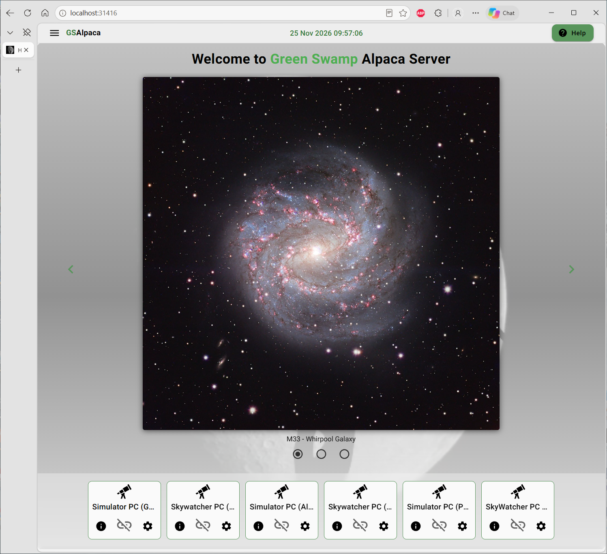
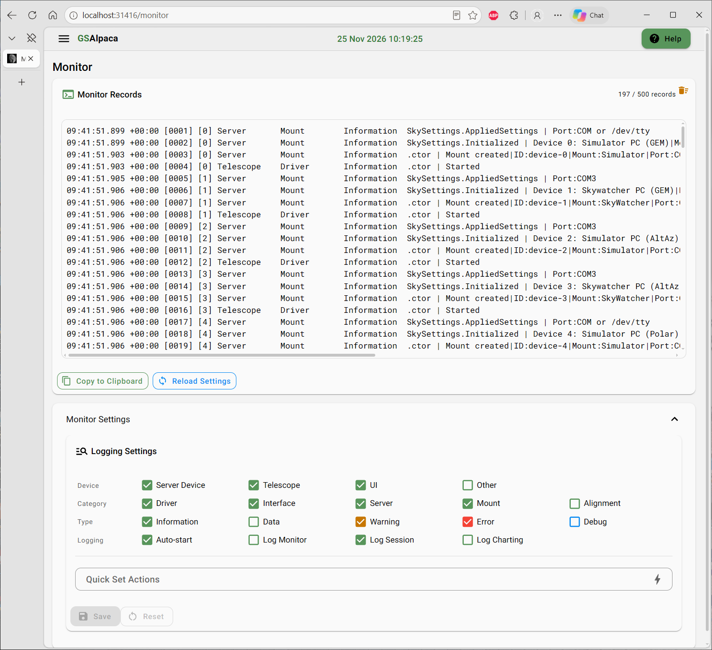
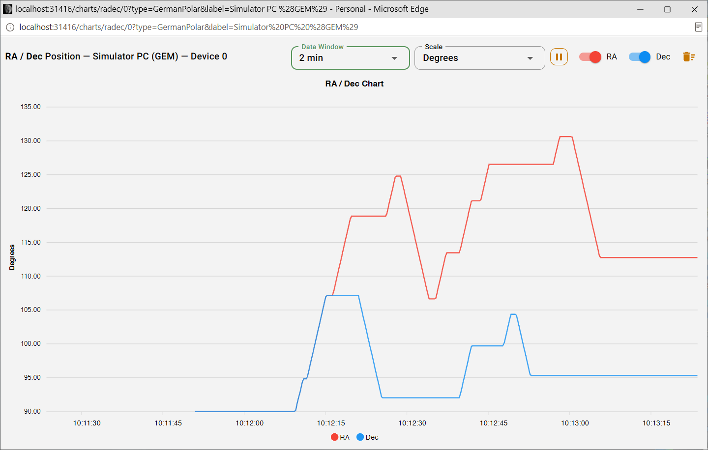
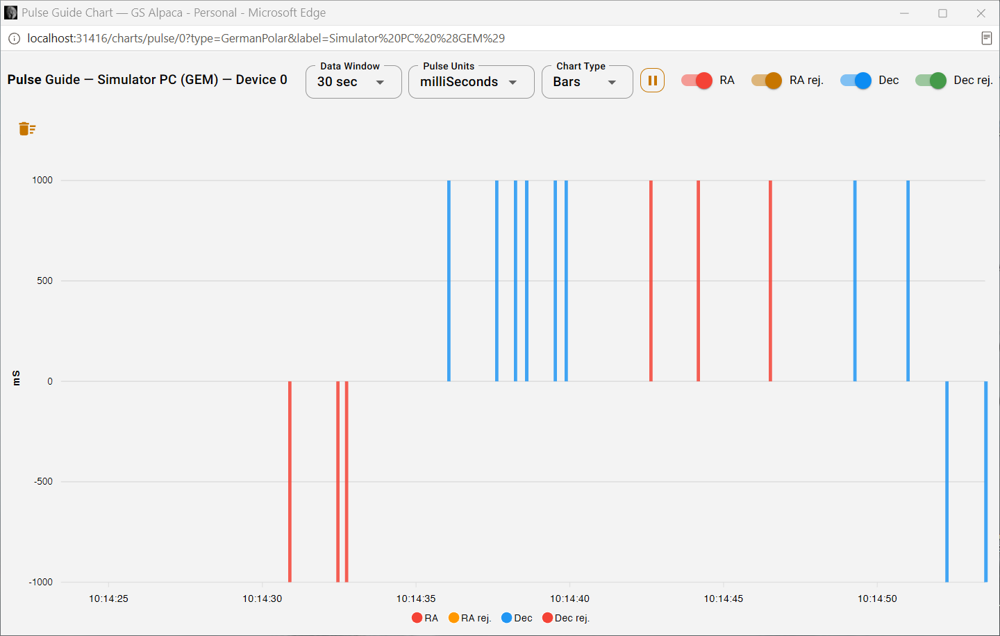
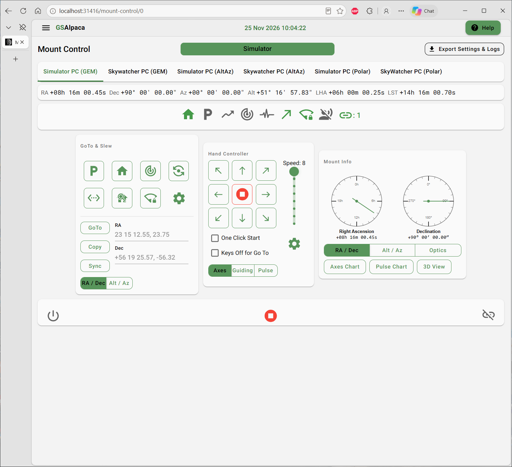
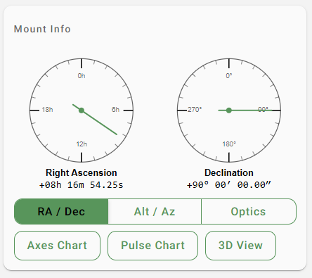
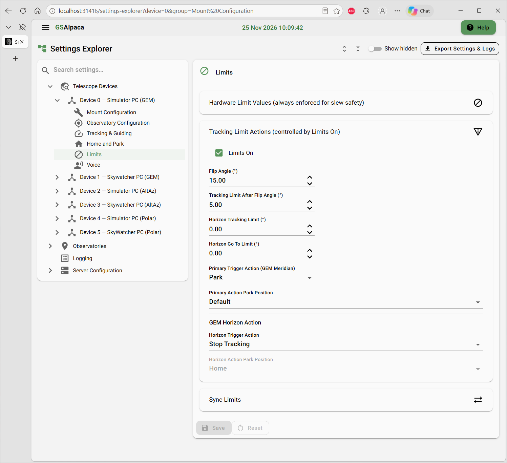
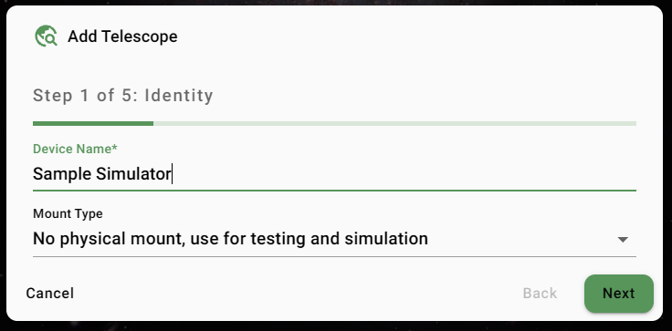
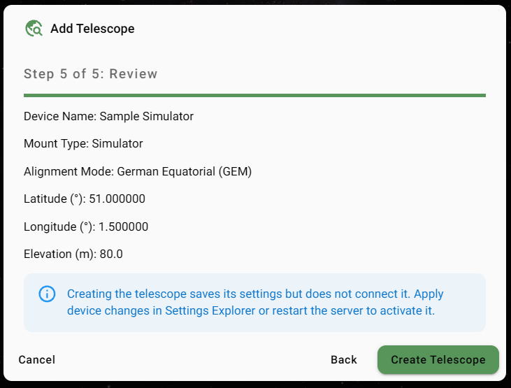

# Green Swamp Alpaca Server — User Guide

**2026-11-25 17:43**

---

## Table of Contents

1. [Overview and Purpose](#1-overview-and-purpose)
2. [Key Concepts](#2-key-concepts)
   - 2.1 [ASCOM and Alpaca](#21-ascom-and-alpaca)
   - 2.2 [Mount Types Supported](#22-mount-types-supported)
   - 2.3 [SkyWatcher and Simulator Modes](#23-skywatcher-and-simulator-modes)
   - 2.4 [Multiple Mounts in Parallel](#24-multiple-mounts-in-parallel)
3. [Getting Started](#3-getting-started)
   - 3.1 [First Launch](#31-first-launch)
   - 3.2 [Default Port and URL](#32-default-port-and-url)
   - 3.3 [Connecting an ASCOM Client](#33-connecting-an-ascom-client)
4. [Navigating the User Interface](#4-navigating-the-user-interface)
   - 4.1 [Navigation Menu](#41-navigation-menu)
5. [Page Reference](#5-page-reference)
   - 5.1 [Home](#51-home)
   - 5.2 [Mount Status](#52-mount-status)
   - 5.3 [Mount Configuration](#53-mount-configuration)
   - 5.4 [Monitor](#54-monitor)
   - 5.5 [Settings Explorer](#55-settings-explorer)
   - 5.6 [Server Configuration](#56-server-configuration)
   - 5.7 [Check Settings](#57-check-settings)
   - 5.8 [Axis Chart](#58-axis-chart)
   - 5.9 [Pulse Chart](#59-pulse-chart)
   - 5.10 [Mount Control](#510-mount-control)
   - 5.11 [3D Telescope View](#511-3d-telescope-view)
   - 5.12 [Display Preferences](#512-display-preferences)
6. [Settings Explorer In Depth](#6-settings-explorer-in-depth)
   - 6.1 [Tree Structure](#61-tree-structure)
   - 6.2 [Dirty-State Tracking and Saving](#62-dirty-state-tracking-and-saving)
   - 6.3 [Observatory Settings](#63-observatory-settings)
   - 6.4 [Server Configuration](#64-server-configuration)
   - 6.5 [Logging Settings](#65-logging-settings)
   - 6.6 [Telescope Device Settings](#66-telescope-device-settings)
7. [Managing Telescope Devices](#7-managing-telescope-devices)
   - 7.1 [Adding a Device](#71-adding-a-device)
   - 7.2 [Removing a Device](#72-removing-a-device)
   - 7.3 [Device Settings Groups](#73-device-settings-groups)
8. [Mount Type Configuration Detail](#8-mount-type-configuration-detail)
   - 8.1 [German Equatorial Mount (GEM)](#81-german-equatorial-mount-gem)
   - 8.2 [Polar / Fork Equatorial Mount](#82-polar--fork-equatorial-mount)
   - 8.3 [Alt-Azimuth Mount](#83-alt-azimuth-mount)
9. [SkyWatcher Driver Configuration](#9-skywatcher-driver-configuration)
10. [Simulator Mode](#10-simulator-mode)
11. [Settings Files and Persistence](#11-settings-files-and-persistence)
12. [ASCOM Client Compatibility](#12-ascom-client-compatibility)
13. [Troubleshooting](#13-troubleshooting)
14. [Appendix A — File and Directory Locations](#14-appendix-a--file-and-directory-locations)

---

## 1. Overview and Purpose

**Green Swamp Alpaca Server** is a local-network telescope mount driver server built on the [ASCOM Alpaca](https://ascom-standards.org) open standard. It exposes one or more physical or simulated telescope mounts as Alpaca-compliant REST devices so that any ASCOM-aware
planetarium, imaging, or automation application can connect to them over a standard HTTP connection — no COM ports, no local driver installation required on the client machine.

### What the application does

| Capability | Detail |
|---|---|
| **Alpaca REST API** | ASCOM Telescope interface version 4 over HTTP/JSON |
| **Multi-mount** | Drive several mounts simultaneously, each with its own device number |
| **Mount types** | German Equatorial (GEM), Polar / Fork Equatorial, Alt-Azimuth |
| **Hardware driver** | SkyWatcher motor controllers via serial (RS-232 / USB-Serial) |
| **Simulator** | Built-in software simulator for every mount type — no hardware required |
| **Web UI** | Browser-based dashboard for real-time status, settings, and diagnostics |
| **Logging** | Configurable real-time monitor with session and file logging |
| **Settings health** | Automatic validation and repair of the configuration file |

The server hosts a browser-based application. Once running, open it on the server computer at `http://localhost:31416`, or from another device on your local network when remote access is enabled.

### Before moving a physical mount

- Check clearance around the telescope, pier and observatory, and make sure cables can move freely throughout the intended travel.
- Configure and test limits and park positions for your own equipment. A warning indicator, configured limit or 3D model is not a substitute for observing the mount or an independent safety system.
- Know how to stop motion. Supervise initial slews, flips, homing and parking, and be especially careful when the mount's position is uncertain after a power interruption.
- Practice unfamiliar controls with a simulator first.

---

## 2. Key Concepts

### 2.1 ASCOM and Alpaca

**ASCOM** (Astronomy Common Object Model) is the industry-standard interface specification for astronomy equipment. The traditional COM-based driver requires the driver software to be installed on every client PC.

**ASCOM Alpaca** uses HTTP/REST so compatible clients can communicate over the network. Green Swamp Alpaca Server implements the Alpaca Telescope interface and supports Alpaca UDP discovery. Some legacy ASCOM clients need an Alpaca-compatible chooser or bridge.

**Right ascension (RA)** and **declination (Dec)** describe a sky position. **Altitude** and **azimuth** describe a direction relative to the observer's horizon. Accurate site coordinates and time are important for converting between them. A GEM's **pier side** describes its pointing orientation; a meridian flip changes that orientation. **Home** is a reference position, while **park** is a selected position for stopping or storing the mount.

Guiding applications send short RA or Dec correction pulses. Backlash is mechanical play when an axis reverses; periodic error correction (PEC/PPEC) compensates for repeating errors in the mount's gearing when supported. Review the mount and guiding software documentation before changing these advanced settings.

### 2.2 Mount Types Supported

The server supports three ASCOM alignment modes. Each determines how the mount tracks the sky
and how coordinates are transformed.

| Alignment Mode | Typical Hardware | Notes |
|---|---|---|
| **GermanPolar** (GEM) | German Equatorial mounts (e.g. EQ5, EQ6, AZ-EQ) | RA and Dec axes; meridian flip required; pier-side awareness; hour angle limit |
| **Polar** | Fork or barn-door equatorial mounts | RA and Dec axes; no meridian flip; polar primary side selectable |
| **AltAz** | Dobsonian, single-arm, computerised alt-az | Altitude and azimuth axes; horizontal tracking limit; no pier-side concept |

### 2.3 SkyWatcher and Simulator Modes

The **Mount Type** field in Mount Configuration selects the driver backend for each device:

- **SkyWatcher** — Communicates with a physical SkyWatcher mount via a serial port using the SynScan/SkyWatcher binary protocol. Requires a COM port (RS-232 or USB-to-Serial adapter) to be configured.
  
- **Simulator** — A pure software simulation of any of the three mount types. The simulated mount tracks, slews, parks, and pulse-guides just as a real mount would, making it ideal for testing planetarium software integrations, developing automation scripts, or learning the application without any hardware.

Both modes are full Alpaca-compatible telescope devices. A single running instance of the server can host SkyWatcher devices and simulator devices at the same time.

### 2.4 Multiple Mounts in Parallel

The server supports any number of telescope devices running concurrently, each identified by a unique integer **Device Number** (0, 1, 2, …). Each device:

- Has its own complete set of settings (serial port, alignment mode, limits, gearing, etc.)
- Appears as a separate Alpaca telescope endpoint:
  `http://{host}:{port}/api/v1/telescope/{deviceNumber}/...`
- Has its own tab in the **Mount Status** and **Mount Settings** pages
- Can be driven by one or more simultaneous ASCOM client connections independently

There is no theoretical limit to the number of devices; in practice it is limited by available serial ports (for SkyWatcher devices) or system resources (for simulator devices).

---

## 3. Getting Started

### 3.1 First Launch

On first launch the server creates a default configuration containing a single **Simulator (GEM)** device. This means the application is immediately usable without any hardware. You will see the home page and the device will appear in the status and settings views.

### 3.2 Default Port and URL

| | Value |
|---|---|
| Default Alpaca port | **31416** |
| Local UI URL | `http://localhost:31416` |
| Alpaca base URL | `http://localhost:31416/api/v1/telescope/{deviceNumber}/` |
| Setup redirect (legacy) | `http://localhost:31416/setup/v1/Telescope/{deviceNumber}/setup` → redirects to Mount Configuration |

The port can be changed in **Settings Explorer** → **Server Configuration** → **Alpaca Settings**. A server restart is required for a port change to take effect.

To try the simulator, open **Control**, select its device tab and click the Connect icon at the lower right. If no simulator is configured, use **Add Telescope** as described in [Section 7](#71-adding-a-device). After creating one, apply hot reload or restart to activate it. Once connected, explore the readouts and controls before connecting physical hardware.

### 3.3 Connecting an ASCOM Client

In your planetarium or imaging application (e.g. Cartes du Ciel, Sequence Generator Pro, N.I.N.A., Voyager):

1. Choose **ASCOM Alpaca** as the telescope type.
2. Use Alpaca UDP Auto-Discovery **or** enter the server IP and port manually.
3. Select the device number matching the mount you want to control.
4. Connect — the server will accept the connection and the mount will begin reporting status.

> **Tip:** Multiple ASCOM clients can connect to the same device simultaneously. The server
> tracks connected client count per device and displays it on the Status page.

---

## 4. Navigating the User Interface

Use the left-side navigation drawer to move between pages and open dialogs.

### 4.1 Navigation Menu

| Entry | Purpose |
|---|---|
| **Home** | Welcome page, carousel and device tiles |
| **Control** | Connect and operate a selected telescope |
| **Status** | Live mount telemetry |
| **Configuration** | Per-device configuration overview |
| **Monitor** | Live log records and logging filters |
| **Add Telescope** | Create a simulator or SkyWatcher device |
| **Settings Explorer** | Edit application and telescope settings |
| **Check Settings** | Validate settings and locate settings files |
| **Display Preferences** | Change this browser's appearance, zoom and language preferences |
| **Shutdown** | Open the shutdown confirmation |


To open the **Axis Chart**, **Pulse Chart** or **3D View**, go to **Control**, select and connect the telescope, then use the buttons in its **Mount Info** panel. They open in separate browser windows. Allow pop-ups for the server if necessary.

---

## 5. Page Reference

### 5.1 Home

The landing page shows a welcome message, an image carousel and a row of telescope tiles. Select a tile to open its Control page. Its information button shows device details, its connection indicator shows mount connection status, and its settings button opens the device's Configuration page.



---

### 5.2 Mount Status

**URL:** `/mount-status` or `/mount-status/{deviceNumber}`

Displays real-time telemetry for all registered telescope devices. If more than one device is registered, each appears as a separate **tab**. Clicking a tab navigates to `/mount-status/{deviceNumber}` so the view is bookmarkable and deep-linkable.

The page groups pointing coordinates, axis positions, status and mount information. Status includes connection count, slewing, guiding, tracking, limits, park and home. Mount details can include model, firmware, supported capabilities and, for SkyWatcher, controller voltage when available.


| Panel or value | How to read it |
|---|---|
| **Pointing Coordinates** | RA and Dec locate the target on the celestial sphere; altitude and azimuth describe its direction relative to the local horizon. Local hour angle (LHA) indicates its position relative to the local meridian. Pier side reports the mount's orientation. |
| **Axis Positions** | Actual and application X/Y positions are shown in degrees, with the corresponding axis step counts. These are mount-axis values, not interchangeable with sky coordinates. |
| **Status** | Mount Connected and Active Clients describe the connection; Slewing, Pulse Guiding and Tracking describe activity. Limits On and Limit Warning are separate: an enabled limit is not itself a warning, and a warning does not guarantee that motion will stop. At Park and At Home report the mount state. |
| **Mount information** | Mount type, alignment mode, model, firmware and supported features help identify the connected equipment. A home sensor, PPEC or polar LED is not available on every mount. SkyWatcher voltage and power-event fields appear when applicable; a dash means a voltage reading is unavailable. |

Use **Export** to collect settings and logs for diagnosis; inspect the archive for sensitive information before sharing. The page subscribes to live state updates and refreshes automatically; you do not need to reload the browser.

---

### 5.3 Mount Configuration

**URL:** `/mount-configuration` or `/mount-configuration/{deviceNumber}`

Provides a read-only overview of each device's configuration, one tab per device. **Edit in Settings Explorer** opens the device's settings for editing. The export button downloads a settings and logs archive.


---

### 5.4 Monitor

**URL:** `/monitor`

The page displays recent **Monitor Records** and an expandable **Logging Settings** panel.



The scrollable, monospaced buffer shows recent captured records. Controls:

| Button | Action |
|---|---|
| Clear (bin icon) | Empties the display buffer (does not affect the log file) |
| Copy to Clipboard | Copies the entire visible buffer as plain text |
| Reload Settings | Re-reads filter settings from disk |
| Write Buffer to File | (Fast Monitor mode only) Flushes the in-memory buffer to a log file |

**Logging Settings**
Expand the logging panel to adjust filters also available in Settings Explorer → Logging. Save changes with **Save**. The panel groups its controls into four rows:

- **Device** — Server Device, Telescope, UI and Other filters
- **Category** — subsystem categories such as Driver, Interface, Server, Mount and Alignment
- **Type** — Information, Data, Warning, Error and Debug filters
- **Logging** — Auto-start, Log Monitor, Log Session and Log Charting controls

Use **Quick Set Actions** to select filter categories or clear filters; see [Section 6.5](#65-logging-settings). The Logging editor is a combined panel, not a set of separate tree leaves.

---

### 5.5 Settings Explorer

**URL:** `/settings-explorer`

The primary settings management page organises settings into a tree on the left and displays the selected group on the right. Use **Export** to download a settings and logs archive; review it for sensitive information before sharing.


See [Section 6](#6-settings-explorer-in-depth) for a full description.

---

### 5.6 Server Configuration

Open **Settings Explorer** → **Server Configuration** and select **Alpaca Settings**, **User Interface** or **Security**. Save server configuration changes after editing. Changes such as the listening port require a server restart. Display preferences for the current browser are also available directly from the navigation menu; see [Section 5.12](#512-display-preferences).

---

### 5.7 Check Settings

**URL:** `/check-settings`

Validates the entire settings file and reports any problems found. Results are displayed as:

- **Errors** — settings that are invalid and will prevent correct operation (shown in red)
- **Warnings** — settings that are unusual but not necessarily wrong (shown in amber)

Each issue includes:
- An error code chip
- The device number it affects (if device-specific)
- A plain-English description of the problem
- A suggested resolution
- An **Auto-repairable** chip if the server can fix it automatically

Use the revalidation button to check again after making changes. The page also shows the settings folder and its JSON files, plus information about automatic repair and manual recovery. It does not provide an Auto-repair action button. Back up your settings before changing or restoring files.


---

### 5.8 Axis Chart

**URL:** `/charts/radec/{deviceNumber}`

In **Control**, connect the selected telescope and select **Axis Chart** in **Mount Info**. The chart opens in a separate window and plots the two mount axes over time. The labels reflect the mount's alignment mode.



| Control | Purpose |
|---|---|
| **Data window** | Select the recent time span, from 10 seconds to 30 minutes. |
| **Scale** | Display values in steps, degrees or arc-seconds. |
| **Pause / Resume** | Freeze the current display for inspection, then return to the rolling live view. |
| **Axis switches** | Show or hide either axis series. |
| **Clear** | Clear the displayed chart data. |

#### Axis Chart control details

- **Title and axes:** the title identifies the device and plotted axes. The horizontal axis is time; the vertical axis uses the selected scale. The axis names follow the alignment mode, for example RA/Dec or Az/Alt. The switches hide or show individual lines; they do not stop the mount.
- **Data window:** choose **10 seconds, 30 seconds, 2 minutes, 5 minutes, 15 minutes or 30 minutes** of recent data. It is unavailable while paused.
- **Scale:** choose **Steps**, **Degrees** or **Arc-seconds**. Changing scale changes the presentation of position data, not the mount's tracking speed.
- **Pause / Resume:** Pause takes a snapshot of the visible window. The paused chart exposes download, zoom, pan and reset controls; Resume returns to the rolling live view. A paused snapshot is not a permanent recording.
- **Clear:** clears the chart's collected points and paused snapshot. If paused, the Axis Chart returns to live mode. New samples can appear afterwards.
- **Connection indicator:** Reconnecting or Disconnected describes the chart's connection to the server, not a physical limit or safety status. Allow browser pop-ups if the window does not open. The chart has no point-hover tooltip enabled.

---

### 5.9 Pulse Chart

**URL:** `/charts/pulse/{deviceNumber}`

Open **Pulse Chart** from the connected telescope's **Mount Info** panel. It displays accepted and rejected RA and Dec guide pulses sent to the mount. Rejected pulses were not processed; investigate repeated rejections using the mount and guiding software settings rather than changing thresholds blindly. An empty plot can simply mean no guiding pulses have been received.



| Control | Purpose |
|---|---|
| **Data window** | Choose the recent time span. |
| **Units** | Select milliseconds, arc-seconds or steps. |
| **Chart type** | Show accepted pulses as bars, points or lines; rejected pulses are points. |
| **RA / RA rejected / Dec / Dec rejected** | Show or hide the corresponding series. |
| **Pause / Resume** | Inspect a frozen snapshot or return to live display. |
| **Clear** | Clear the displayed pulse data. |

A guide pulse is a timed correction requested by a guiding client; it is not itself a measurement of the star's tracking error. Use the RA and Dec switches to isolate one axis, and compare the rejected series with the guiding client's own logs. The minimum pulse settings are per axis in **Tracking & Guiding**; check those and the client configuration before adjusting them. Chart units and appearance change the presentation, not the guiding commands.

#### Pulse Chart control details

- **Title and axes:** the title identifies the device; time is horizontal and the selected pulse units are vertical. Accepted and rejected RA and Dec are separate series. Point-hover tooltips are disabled.
- **Data window:** select **10 seconds, 30 seconds, 2 minutes, 5 minutes, 15 minutes or 30 minutes**. This selector is disabled while paused.
- **Units:** **Milliseconds** displays pulse duration; **Arc-seconds** and **Steps** express the correction in other units. Positive and negative values distinguish correction direction.
- **Chart type:** **Bars**, **Points** or **Line** changes accepted-pulse series; rejected series remain points. The four named switches independently show or hide accepted and rejected RA and Dec.
- **Pause / Resume:** Pause freezes the visible data as a snapshot and exposes download, zoom, pan and reset controls. Resume returns to the rolling live view. A paused snapshot is not a permanent recording.
- **Clear:** clears the collected live pulse lists. Unlike the Axis Chart, Clear does not itself leave paused mode or discard its frozen snapshot; use Resume to return to the cleared live display. New pulses can appear afterwards.
- **Connection indicator:** Reconnecting or Disconnected reports the chart-to-server connection. An empty chart may also mean that there are no pulses, or that the relevant series are switched off.

Both charts save their display selections. The charts are diagnostic views; do not infer mount safety from them.

---

### 5.10 Mount Control

**URL:** `/mount-control` or `/mount-control/{deviceNumber}`

Select a telescope tab, then use **Connect** at the lower right to connect the UI client. Connection from another application does not replace this step for enabling the UI controls. Use the disconnect icon when finished. The top readout and indicator row show coordinates, connection count and mount state; hover over an icon for its description.



- **GOTO:** select RA/Dec or Alt/Az, enter the target and use **Go To**. **Copy** fills the target from the current position; **Sync** is available for supported RA/Dec operations. Check the target and mount clearance before moving.
- **Mount actions:** the icon buttons provide park/unpark, home, tracking, GEM pier-side flip, re-sync, AutoHome, limits and settings where available. Availability depends on connection, state and mount capability. The settings panel includes park-position and tracking-limit controls.
- **Hand Controller:** choose Axes, Guiding or Pulse mode, set the speed and use the direction buttons. The centre Stop button stops motion. The settings button opens hand-controller and pulse options.
- **Mount Info:** choose RA/Dec, Alt/Az or Optics dials, or open the Axis Chart, Pulse Chart and 3D View. These buttons require the UI connection.
- **Bottom bar:** use the red Stop button to stop motion, the connection icon to connect/disconnect and the power icon to open the shutdown dialog.



#### Page header, indicators and bottom bar

The telescope tabs select the device; a **Simulator** badge identifies the simulator. **Export** opens a settings and logs archive dialog showing the estimated file count and size. **Create** starts the download and shows progress; **Cancel** closes before creation, and an error offers **Retry** or **Close**. Review the archive for sensitive information before sharing.

The coordinate header displays RA, Dec, azimuth, altitude, local hour angle (LHA) and local sidereal time (LST). LST is the RA currently crossing the local meridian; LHA describes a pointing's position relative to that meridian. Accurate location, time and a correctly established mount position matter when interpreting these values.

| Indicator | Meaning |
|---|---|
| Home / P | At home / at park, respectively; inactive appearance means the corresponding state is not active. |
| Moving / tracking / pulse | Slewing, tracking including rate, and active pulse guiding. These are status indicators, not buttons. |
| Pier-side arrow | Reported side of pier; its tooltip identifies the side. |
| Limits | Shows off, on, or triggered; hover for the current state. An enabled limit is not proof of safe clearance. |
| Voice / link and count | Voice announcement state and the number of connected clients. The UI has its own connection; another client's connection does not enable its controls. |

The bottom **power** button opens a shutdown confirmation, including a warning when mounts are connected; cancel it to leave the server running. The red **Stop** requests an emergency stop for the selected mount and is enabled after the mount has connected at least once. The **Connect / Disconnect** button controls the UI client; a spinner indicates connection is in progress. Disconnecting the UI is not a substitute for stopping a moving mount or parking it.

#### Coordinates and Go To

Select **RA/Dec** or **Alt/Az** below the target fields. Enter either decimal values or one, two or three coordinate components. Components may be separated by spaces or colons; RA also accepts `h`, `m` and `s` suffixes, while angular coordinates accept degree and prime marks. Examples include `23 15 12.55`, `23:15:12.55`, `23h 15m 12.55s`, `23.75`, `+56° 19′ 25.57″` and `-56.32`. A single comma is accepted as a decimal separator when there is no period in the input; do not use a comma to separate coordinate components. Decimal values are displayed with a period.

RA is in hours and must be at least 0 and less than 24. Dec and altitude are in degrees from −90 to +90; azimuth is from 0 to 360. In component form, minutes must be whole numbers from 0 to 59 and seconds may be decimal but must be at least 0 and less than 60. RA and azimuth cannot be negative; Dec and altitude may have a leading sign. Invalid or out-of-range input is rejected before motion.

**Copy** puts the current coordinates into the fields; it does not move the mount. **Sync** associates the entered RA/Dec with the current pointing rather than slewing to it; it is available only in RA/Dec mode when the device supports it. A bad sync can make subsequent pointing unreliable.

Both **Go To** and **Sync** show a confirmation with the formatted coordinate pair: inspect it and choose **Accept** or **Cancel**. Go To checks the target against the configured horizon Go To limit before confirmation; a rejected target does not initiate a slew. Accepting a valid Go To requests motion; accepting Sync changes the assumed pointing. Watch for warning or error messages.

#### Mount actions and park positions

| Action | Purpose and precautions |
|---|---|
| **Park / Unpark** | Park moves to the selected named park position; unpark releases the parked state. Tracking after unparking is a device setting. Ensure the entire route to the selected park position is clear. |
| **Home** | Move to the mount's configured home reference. Home and a named park position are distinct concepts, even if they happen to have the same coordinates. |
| **Tracking** | Turn tracking on or off. The selected rate is configured under **Tracking & Guiding**. |
| **Flip** | For a GEM, request the opposite side-of-pier orientation. Check clearance and cable travel before proceeding. |
| **Re-sync** | Choose Home or a named park position as the mount's assumed reference. Put the physical mount at that exact reference first; re-sync is not a substitute for moving it there. |
| **AutoHome** | Search for home sensors. Set the maximum search travel; for a GEM the dialog also offers a Dec offset and sensor-position adjustments. The dialog shows progress and offers Stop during the search. Not all mounts have sensors. Observe the actual motion, especially after power loss. |
| **Limits** | Toggle the configured limits. Check their thresholds and actions; warning-only is not an automatic stop. |
| **Settings** | Open the Go To settings panel to select/manage park positions and edit the available tracking and horizon limit controls. Save changes in the panel. |

Park, unpark and home each request confirmation. Tracking and the limits toggle act directly without a confirmation dialog.

| Button | Availability |
|---|---|
| **Park / Unpark** | Requires the UI connection and the corresponding mount capability (**Can Park** or **Can Unpark**). |
| **Home** | Requires the UI connection, a home-capable mount and a mount that is not parked. |
| **Tracking** | Requires the UI connection. |
| **Flip** | Shown only in GEM mode; requires the UI connection and is disabled while slewing. |
| **Re-sync** | Requires the UI connection and is disabled while slewing. |
| **AutoHome** | Requires the UI connection and is disabled while parked. The button does not establish that the hardware has home sensors; confirm support before starting. |
| **Limits** | Requires the UI connection. |
| **Go To settings cog** | The panel is within the UI-connection-disabled Go To controls. |

**Flip Side of Pier dialog:** **Flip Now** requests the opposite pier side while retaining the sky position, subject to the flip limits. **Flip on next GoTo** changes the deferred-flip setting. The dialog's **Cancel** closes without an immediate flip, but still applies the current switch value; restore the switch first if you do not want to change it. Check physical clearance for either operation.

**Re-sync dialog:** select **Home** or **Park**; for Park, choose a named position. **Re-sync** applies the selected reference, and **Cancel** closes the dialog. Park is unavailable if no named positions exist. This changes the assumed reference, not the physical location.

**AutoHome dialog:** **Degree limit** is the maximum search travel (20–179°, initially 100°). In GEM mode, **Dec offset** offers 0, −90 or +90° after finding home; the RA and Dec sensor-position fields accept 85–95° in 0.1° steps. **Reset sensor positions to 90** changes both entries to 90°. **Start** begins the search, the progress bar shows progress, and **Stop** requests a stop while it is running; **Cancel** closes before starting. Confirm sensor support on Status, watch the mount and verify the resulting reference before further slews.

#### Go To settings cog and nested controls

Open the cog in the Go To panel. Expand each section to reveal its controls:

| Section or control | Meaning |
|---|---|
| **Park Positions** | The dropdown selects the intended active park position. The adjacent cog opens the park manager; selection is disabled if the UI is disconnected or parking is unsupported. |
| **Tracking Limits** | Select **No action**, **Stop tracking** or **Park**. Its cog reveals **Flip Angle** (0–30°) and **Tracking Limit After Flip Angle** (0–15°). These are angular settings, not time values. |
| **Horizon Limits** | Select **No action**, **Stop tracking** or **Park**. Its cog reveals **Horizon Tracking Limit** and **Horizon Go To Limit**; the latter accepts −20 to 30°. The Go To limit is distinct from the tracking action. |
| **Voice announcements** | Enable or disable voice announcements for the connected device. |
| **Save / Cancel / Close** | Save applies pending edits to the running mount settings; this panel does not write the device settings file. To retain settings across a restart, make and save the corresponding changes in Settings Explorer. Cancel discards pending panel edits; with no pending edits, Close exits. Park-manager actions below apply immediately and are not staged by this panel. |

In the **park manager**, select a position; **Update** replaces it with the current mount position and **Delete** removes it immediately without a confirmation dialog. At least one position must remain, so Delete is disabled when only one exists. **Add New** reveals a name field (up to 12 characters), **Create**, and **Cancel**. Creating or updating requires a running mount; **Close** closes the manager. To create a safe position, connect the mount, carefully move it to the desired position, then create the name. Select the intended position in the Go To panel and save it. Check the entire route before parking. When a limit action is set to Park, verify the corresponding park destination in **Settings Explorer → Limits** too.

#### Hand Controller

The arrows operate the selected device; the speed slider has eight steps. **Axes** uses axis motion, **Guiding** uses guiding directions, and **Pulse** uses the configurable pulse settings. Diagonal buttons combine directions. Start at a low speed and check the actual movement before relying on direction labels. The centre **Stop** button stops motion.

**One Click Start** switches to click-to-start and click-to-stop operation; when it is off, use the normal press-and-release control. Clicking a different direction in one-click mode stops the previous direction before starting the new one. **Keys Off for Go To** requests that direction keys be disabled while slewing. The speed, mode and these checkboxes are saved as they change.

The hand-controller cog opens **HC Settings** for the selected device:

| Tab / field | Meaning |
|---|---|
| **Axis Settings → Flip RA/Az** | Reverse the RA/azimuth direction. |
| **Axis Settings → Flip Dec/Alt** | Reverse the Dec/altitude direction. |
| **Axis Settings → Anti-backlash RA/Az, Dec/Alt** | Enable compensation separately for each axis. These four checkboxes apply and save immediately; closing or cancelling the Pulse tab does not undo them. |
| **Pulse Guide Rates → Speed** | Identifies one of the eight speed-slider steps. |
| **Duration (ms)** | Pulse duration for that speed, minimum 1 ms. |
| **Interval (ms)** | Interval for that speed, minimum 1 ms. |
| **Rate** | Motion rate for that speed, from 0.001 up to the displayed maximum slew rate. |
| **Save / Cancel** | On the Pulse tab, Save applies the edited pulse table; Cancel closes without saving its pending table edits. |

Backlash compensation addresses mechanical play; coordinate its use with the guiding application rather than applying multiple compensations blindly.

#### Mount Info dials

Choose **RA/Dec** for the right-ascension and declination dials, **Alt/Az** for azimuth and altitude, or **Optics** for the actual X/Y axis positions. The three launch buttons open the Axis Chart, Pulse Chart and 3D View for this device; all three are disabled until the UI client is connected.

The legacy [GS Server manual's Main Window reference](https://greenswamp.org/manual/main-window) remains useful for interpreting coordinate readouts such as LHA/LST and for the distinction between axis motion and guiding directions. It describes the older desktop program: controls such as mouse lock, scheduled parking and spiral search are not features of this web page.

> **Safety:** A flip, home, park or AutoHome operation can move the mount. Check the route and cables and supervise the movement. Re-sync changes the server's assumed position; ensure the physical mount is actually at the selected reference position first. Test configured limits on your equipment and do not assume that a warning alone stops motion.

Some astronomical and operational concepts in this guide are informed by the legacy [GS Server manual](https://greenswamp.org/manual/main-window). That manual describes the separate desktop application; its controls and procedures should not be assumed to exist in Alpaca Server.

---

### 5.11 3D Telescope View

**URL:** `/telescope-view/{deviceNumber}`

From **Control** → **Mount Info**, connect the selected telescope and choose **3D View**. The separate window shows a visual model driven by the reported axis positions, with a coordinate header.


The toolbar provides **Save View**, **Center on Mount**, **Reset Camera** and **Options**. Options include model and background, colour, grid, cardinal directions and heading, as well as assembly support, mount, telescope and axis adjustments where applicable. Save the options to apply them.


The top row identifies the device and displays actual axis 1 and axis 2 angles; the header beneath shows RA, Dec, Az, Alt, LHA and LST. Drag the model view to change perspective and use the mouse wheel to zoom. **Save View** retains the camera view in this browser; **Center on Mount** recentres it and **Reset Camera** restores the camera. If compass heading is enabled, the numbered heading button shows the camera bearing; click it to face north.

#### Options cog: field reference

| Field | What it changes |
|---|---|
| **Telescope model** | Select a built-in model when **Use Assembly** is off. |
| **Background** | Choose North America, Heart or Rosette Nebula, M51, M33, star field or none. |
| **Model color** | Choose the displayed model colour. |
| **Show ground grid** | Show or hide the grid. |
| **Show cardinal directions / Cardinal size** | Show or hide direction labels; choose Small, Medium, Large or Extra Large when shown. |
| **Show compass heading** | Show or hide the clickable camera-bearing button. |
| **Use Assembly** | Switch from the built-in model selection to separate support, mount and optical tube choices; compatibility depends on alignment and mount selection. |
| **Support** | Choose small, medium or large tripod or pier in assembly mode. |
| **Mount** | Choose the visual mount model in assembly mode; it does not change the connected driver. |
| **Optical tube assembly / size** | Select the visual tube type and 50%, 75%, 100%, 125%, 150% or 200% size in assembly mode. |
| **RA / Dec axis adjustment** | Adjust displayed orientation by −90 to +90° in one-degree steps. This does not change the physical mount reference or alignment. |
| **Save Settings / Cancel** | Save applies and stores the selected viewer options in this browser; Cancel discards the dialog's pending choices. |

The model is a visual aid, not a collision detector. If the mount starts in an unknown position or its reference position is wrong, the displayed orientation may also be wrong. Always check the physical mount and its surroundings.

---

### 5.12 Display Preferences

Open **Display Preferences** from the navigation menu to choose light, dark or system appearance; theme colour; zoom; display language; and regional format. The Red Light theme remains dark and provides a brightness control. Browser-specific preferences are independent of another browser's settings.


---

## 6. Settings Explorer In Depth

### 6.1 Tree Structure

The left tree and right editor have these branches. Expand nodes with their disclosure arrows; selecting a leaf displays its editor. Some top-level sections also have an action card.

```text
Telescope Devices                       [device manager]
  Device number — name
    Mount Configuration; Observatory Configuration; Tracking & Guiding;
    Home and Park; Limits; Voice
    Optics; Performance & Tuning; PPEC; Hand Controller  [Show Hidden]
Observatories                            [site manager]
  Individual named observatories
Logging                                  [combined logging panel; no child leaves]
Server Configuration
  Alpaca Settings; User Interface; Security
```

Selecting **Telescope Devices** shows the device manager: **Add Device**, delete on each device row, and **Apply Changes** when registration changes are pending. Apply Changes asks for confirmation and reloads all registrations; connected clients may be disconnected. Expand a device to edit its leaves. Select **Observatories** for the site list, or an individual site to edit it. Select **Logging** for the combined editor. **Server Configuration** is expanded to select its three leaves.

| Control | Action |
|---|---|
| **Expand All / Collapse All** | Open or close tree branches. |
| **Search** | Filter nodes by their displayed label or description; clear the search to restore the full tree. |
| **Show Hidden** | Reveal the four advanced device leaves above and additional advanced fields in some editors, GPS and Logging. |
| **Export** | Create a settings and logs archive; inspect it for sensitive information before sharing. |

Each tree node has a hover description. Settings Explorer can also open a device editor directly with `?device=N&group=GroupName` query parameters; for example, `/settings-explorer?device=0&group=Tracking%20%26%20Guiding` selects the Tracking & Guiding leaf for device 0 when it exists.

### 6.2 Dirty-State Tracking and Saving

Ordinary editor changes use a **working copy**. A dirty indicator and enabled **Save / Reset** show pending changes. Save writes the relevant backing settings object, not just the visible field: server configuration, all observatories, logging, or the selected device. Reset restores that object's last saved copy; it is not a factory reset. Selecting another node while the current node is dirty asks whether to discard the changes.

Some actions are exceptions: browser appearance and regional preferences apply independently, and **Copy to all devices** immediately saves affected device files after confirmation. Device add/delete also have their own dialogs and registration workflow. Do not rely on the current editor's Reset to undo those actions.

Saving a changed mount type, serial port, baud rate or alignment mode on a running mount can replace the device; connected clients are warned and must reconnect. Review physical position and settings before reconnecting. Some server changes, including port, require a server restart.

### 6.3 Observatory Settings

Select **Observatories** for the site list. **Add Observatory** opens a dialog with a unique name, latitude, longitude, elevation and UTC offset. Delete requires confirmation and the last site cannot be deleted. Add/delete changes are working-copy changes until saved; select a named site in the tree to edit it.

| Site field | Meaning |
|---|---|
| **Name** | A non-empty name unique among sites. |
| **Latitude / Longitude** | Decimal degrees, −90 to +90 and −180 to +180 respectively; north and east are positive. |
| **Elevation** | Metres above sea level, −500 to 9000. |
| **UTC Offset** | Hours relative to UTC, −14 to +14; for example, `1` means UTC+1. |
| **GPS / Cartes du Ciel** | Location-source connection settings and dialogs, described below. |

**Copy to all devices** asks for confirmation and immediately saves latitude, longitude, elevation, GPS port and GPS baud rate to every device. It is a copy, not a live link; later edits to the site do not propagate automatically. It does not copy UTC offset or every advanced GPS/CdC setting. This saves the complete device working copies, including any other pending device edits; review those before confirming.

#### GPS and Cartes du Ciel location sources

Both an observatory leaf and a telescope's **Observatory Configuration** provide these panels. GPS offers detected serial ports (or a text field for a port when none are detected) and baud rates **4800, 9600, 19200, 38400, 57600** and **115200**. **Show Hidden** reveals parity (**None, Odd, Even, Mark, Space**), stop bits (**None, One, OnePointFive, Two**), data bits (**5–8**), handshake (**None, XOnXOff, RequestToSend, RequestToSendXOnXOff**) and a timeout of **1–30 seconds**. Match these settings to the receiver rather than changing them experimentally. **Connect** reads a fix; the dialog displays NMEA type, latitude, longitude, altitude, GPS UTC, PC UTC and their difference when available. **Apply** copies the received location into the current working editor; **Cancel/Close** does not. Review the fix and save the editor. The time comparison does not set the computer clock.

For **Cartes du Ciel**, enter its server address and port and open **Connect**. With CdC running, **Fetch** displays its latitude, longitude and altitude beside the local values. The left arrow sends the local location to CdC immediately; the right arrow copies the CdC location to the current editor and closes the dialog. Save the editor to retain a copied-in location; Cancel cannot undo a location already sent to CdC.

### 6.4 Server Configuration

#### Alpaca Settings

| Field | Purpose |
|---|---|
| **Server Name / Server Port** | Discovery name and listening TCP port (1–65535). Restart the server after changing the port. |
| **Allow Remote Access** | Bind for remote network access; otherwise use localhost. The address panel shows available addresses or localhost. |
| **Local Respond Only to Localhost** | Restrict responses to localhost-sourced discovery to the loopback adapter. |
| **Allow Alpaca Discovery** | Advertise via Alpaca UDP discovery. |
| **Run in Strict Alpaca Mode** | Reject non-compliant Alpaca requests. |
| **Prevent Remote Disconnects** | Prevent remote clients from disconnecting devices. |
| **Enable Swagger UI** | Expose the OpenAPI interface at `/swagger`. |

#### User Interface and Security

**User Interface** contains the server's default zoom for browsers without their own zoom, **Auto-start Browser**, and the browser-specific display controls: appearance, theme colour, Red Light brightness, zoom, display language and regional format. Browser preferences apply separately from the server working-copy Save; changing language or regional format navigates to apply the choice. See [Display Preferences](#512-display-preferences).

**Security** contains **Enable Authentication**, **User Name**, **Password** and **Repeat Password**. The credential inputs are disabled until authentication is enabled. Enter matching non-empty passwords, save, and verify access before relying on the setting. Editing the password fields to mismatching or empty values clears the working stored password; do not save until both match. HTTP Basic authentication is not transport encryption; restrict network exposure and use appropriate network protection. Do not share credentials or unreviewed exports.

### 6.5 Logging Settings

Select **Logging** to open one combined panel; Device, Category, Type and Logging are rows in that panel, not separate tree leaves.

| Row | Controls |
|---|---|
| **Device** | Server Device, Telescope, UI and Other filters. |
| **Category** | Driver, Interface, Server, Mount and Alignment filters. |
| **Type** | Information, Data, Warning, Error and Debug filters. |
| **Logging** | Auto-start, Log Monitor, Log Session and Log Charting. Auto-start must be on for log files to be written. |
| **Hidden** | **Fast Monitor** uses a 1,000-record ring buffer; it and Log Monitor are mutually exclusive. **Log Path** overrides the default directory when supplied. |

**Quick Set Actions** provides All Devices, All Categories, All Types and Clear All. Check the resulting boxes before saving. **Save** writes the logging working copy; **Reset** restores the last saved copy. Use the Monitor page to view records and, in Fast Monitor mode, write the buffer to a file. More filters and trace logging can increase volume and may reveal sensitive information.

### 6.6 Telescope Device Settings

Each device has the following leaf groups. Groups marked *(hidden by default)* are only shown when the **Show Hidden** toggle is on.

| Group | Description |
|---|---|
| **Mount Configuration** | Device name, enabled flag, mount type, alignment mode, polar primary side, coordinate type, serial port, baud rate, backlash, encoders, custom gearing |
| **Observatory Configuration** | Per-device latitude, longitude, elevation, UTC offset, environmental inputs, GPS |
| **Tracking & Guiding** | Sidereal/lunar/solar/king tracking rates, RA offset, pulse guiding parameters, ST4 guide rate |
| **Home and Park** | Home axis positions (X/Y), auto-home positions, named park positions, active park selection |
| **Limits** | Hardware axis limits, tracking-limit actions, horizon GOTO limit and sync limits; GEM-specific flip and horizon tracking settings |
| **Voice** | Announcements, browser voice and volume |
| **Optics** *(hidden)* | Aperture diameter, aperture area, focal length and eyepiece field of view |
| **Performance & Tuning** *(hidden)* | Display refresh interval, GOTO precision, trace logging |
| **PPEC** *(hidden)* | PPEC enable setting |
| **Hand Controller** *(hidden)* | HC speed, mode, flip behaviour, anti-backlash |



#### Understanding the device editors

| Editor | What to check |
|---|---|
| **Mount Configuration** | Identity and geometry determine the device and coordinate mode. For SkyWatcher, select the correct serial port and baud rate. Hardware options include maximum slew rate, backlash, encoder and advanced-command settings; capabilities depend on the controller. Custom gearing is for known non-standard gearing, not routine tuning. |
| **Observatory Configuration** | Latitude, longitude and elevation belong to this device. Copying an observatory copies values rather than creating a live link. The editor also has environmental/refraction, GPS and Cartes du Ciel connection panels; temperature is limited to **−50 to +60 °C**. Check the relevant connection and review any received coordinates before applying them. |
| **Tracking & Guiding** | Select Sidereal for stars, Lunar for the Moon, Solar for the Sun or King when appropriate. Rate values are editable; avoid changing them without a specific reason. Track After Unpark controls whether tracking resumes after unparking. RA and Dec minimum pulse durations are **5–50 ms**; RA and Dec guide-rate percentages are **0–100% in 10% steps**. The hand-controller pulse table has a duration, interval and rate for each of its eight speed steps. |
| **Home and Park** | The home and AutoHome axis values are displayed separately from the named park positions. The panel shows the active park name and the Track After Unpark option. Use the Control page's park manager to capture or update a position from the connected mount. |
| **Limits** | Hardware limits specify axis travel values. Limits On enables the configured limit behaviour; the GEM flip angle and additional tracking allowance, horizon tracking threshold and horizon Go To limit have different purposes. Choose warning only, stop tracking or park as applicable, and select the park position when using a park action. Sync limits restrict sync operations independently. |
| **Optics** | Aperture and focal-length values describe the attached optics; enter actual equipment values rather than using them as motion controls. |
| **Performance & Tuning** | Display refresh interval, Go To precision and trace logging are diagnostic or advanced settings. Change them deliberately, as shorter intervals and extra logging can increase workload. |
| **PPEC** | The editor exposes a PPEC enable setting. PPEC is mount-dependent correction for repeatable drive error; check support on Status and the mount's own documentation. The legacy desktop manual's training controls should not be assumed to exist here. |
| **Voice** | Enable announcements, select a browser voice and set volume. |
| **Hand Controller** | Configure speed, mode, direction reversals, anti-backlash, direction keys during Go To and one-click operation. The Control page provides the operating controls. |

#### Mount Configuration fields

Expand **Device Information** for Enabled, device name and description, driver type (Simulator or SkyWatcher), alignment (GEM, Polar or Alt-Az), Polar primary side when applicable, and equatorial coordinate type (Other, Topocentric, J2000, J2050 or B1950). Choose the geometry and coordinate system to match the mount and clients.

**Serial Connection** contains the COM port and baud rate; the baud choices are **9600, 19200, 38400, 57600, 115200** and **230400**. Show Hidden adds data bits (5–8), handshake, read timeout (ms), DTR and RTS. Match the physical connection. **Mount Hardware** contains advanced commands, encoders, maximum slew rate (degrees/second), RA and Dec backlash (motor steps), polar LED brightness (0–255) and full motor current. Availability depends on the hardware. Backlash compensates mechanical play; avoid stacking compensation blindly with the guiding application.

The **Custom Gearing** panel is available within Mount Configuration; it is not one of the Show Hidden tree leaves. Its checkbox enables separate RA and Dec values for steps per revolution, worm teeth and tracking offset. The fields are disabled until enabled. Use measured, correct values only for modified gearing: incorrect gearing can produce unexpected motion. The legacy [GS Server manual](https://greenswamp.org/manual/main-window) explains the underlying concepts, but its desktop controls and defaults are not necessarily those of this server.

#### Observatory Configuration fields

**Location** has a saved-observatory selector and copy button, latitude, longitude and elevation; UTC offset appears with Show Hidden. Copying a site copies latitude, longitude, elevation, GPS and CdC connection values into the device working copy, but not UTC offset; it is not a continuing link. Save the device editor. **Environmental** contains refraction correction and temperature in °C. **GPS** and **Cartes du Ciel** have their own connection settings and dialogs as described in [Section 6.3](#63-observatory-settings).

#### Tracking & Guiding fields

**Tracking** has Track After Unpark, the Sidereal/Lunar/Solar/King selection and editable rates in arcseconds per second. Show Hidden adds RA tracking offset in steps and Alt-Az update interval in milliseconds. Use the relevant rate and avoid changing numerical values without understanding the mount and client.

**Pulse Guiding** contains separate minimum RA and Dec pulse durations (5–50 ms), Dec Pulse → GoTo, Alternating PPEC, ST4 guide-rate divisor, and RA/Dec guiding rates (0–100% of sidereal). Rejected pulse corrections can be inspected on the Pulse Chart; coordinate changes with the guiding software rather than changing thresholds blindly. Alternating PPEC and Dec Pulse → GoTo are advanced, mount-dependent choices.

**HC Pulse Guides** defines eight hand-controller speed rows. For each, enter Duration and Interval in milliseconds (minimum 1) and Rate (minimum 0.001, capped by maximum slew rate), then Save the device editor. These values govern the hand controller's Pulse mode, not the external guiding client's calibration. The Control page also has a pulse settings dialog; see [Mount Control](#510-mount-control).

#### Home, limits and safety

**Home and Park → Home** displays the Home and AutoHome X/Y axis values. **Park** displays named park positions and their axes, and provides an active-park name and Track After Unpark checkbox. Create or update named positions from the connected mount using the Control page's park manager.

**Limits → Hardware Limit Values** provides upper/lower Dec/Alt and RA/Az limits in degrees. **Tracking-Limit Actions** provides Limits On; the horizon Go To limit; and, for GEM, flip angle, tracking allowance after flip angle and horizon tracking limit. The primary trigger action is GEM meridian or hardware-limit tracking according to alignment. Choose Warning Only, Stop Tracking or Park, and select the primary park destination for Park. GEM also has a separate horizon trigger action and park destination. **Sync Limits** contains enable, maximum sync angle (0–60°) and No Sync Past Meridian.

Review limits for your own mount and cables; the values in the illustration are not recommended settings for every installation. Hardware slew limits and tracking actions serve different purposes; warning-only is not an automatic stop. A park action requires a safe, reachable destination. Test settings while supervising the equipment.

#### Voice and advanced leaves

- **Voice:** enable announcements, select a browser-provided voice (or clear it for the default), refresh the voice list and set volume from 0 to 100. Available voices depend on the browser and language.
- **Optics:** aperture diameter and focal length in metres, effective aperture area in square metres, and **Eyepiece FS** (eyepiece field of view) in arcminutes. Enter the actual optical configuration; these fields do not move the mount.
- **Performance & Tuning:** display check interval in milliseconds (minimum 100), Go To precision in arcseconds and per-device trace logging. Tune deliberately; a shorter refresh interval or extra logging can increase workload.
- **PPEC:** enable PPEC only where supported. It compensates for repeatable drive error; this leaf does not provide the legacy desktop training controls. The legacy [PPEC explanation](https://greenswamp.org/manual/ppec) describes training and playback on the desktop application; do not infer that the Alpaca Server UI exposes those controls. Consult the mount documentation.
- **Hand Controller:** HC speed and mode, RA/Dec anti-backlash, E/W and N/S reversal, Disable Keys on GoTo and One Click Start. These are device settings; use the Control page for operation and its cog for the **Axis Settings** and **Pulse Guide Rates** tabs.

---

## 7. Managing Telescope Devices

### 7.1 Adding a Device

1. Select **Add Telescope** in the navigation menu, or select **Telescope Devices** in
   **Settings Explorer** and click **Add Device**.
2. Enter a name and choose **Simulator** or **SkyWatcher**.
3. Choose German equatorial (GEM), polar/fork, or alt-azimuth; for polar, choose the primary side.
4. Enter and confirm the latitude, longitude and elevation, or copy an existing observatory and
   confirm its values. North and east are positive; elevation is in metres. Copying an observatory
   does not link the telescope to it, so later observatory edits do not update the telescope.
5. For SkyWatcher, choose or enter a serial port and baud rate, or leave the port blank to
   configure it later. The telescope can still be activated, but needs a valid port before connecting.
6. Review the settings and click **Create Telescope**. A device number is assigned automatically.
   Creating the device saves its settings but does not connect it.
7. Choose **Apply Hot Reload** to activate the telescope now, or **Not now** to defer activation.
   Hot reload rebuilds all device registrations and disconnects connected clients after confirmation.
   If you defer, the telescope is not usable until you apply changes in **Settings Explorer →
   Telescope Devices** or restart the server; it may already be listed on some pages.

The wizard presents identity, geometry, location, connection and review steps. These examples show the identity, location, review and activation screens:







Review the device's remaining settings, including mount limits, before connecting hardware.

### 7.2 Removing a Device

1. Open **Settings Explorer** and select **Telescope Devices**.
2. Find the device in the list and click the **Delete** (bin) icon on the right.
3. Confirm in the dialog. The device and all its settings are permanently removed.

> **Note:** Removing a device while an ASCOM client is connected to it will cause that client
> to receive a disconnect error. Disconnect clients before removing a device.

### 7.3 Device Settings Groups

After adding a device, configure it fully before connecting a client. At minimum:

1. **Mount Configuration** — Set the Mount Type (`SkyWatcher` or `Simulator`), Alignment Mode,
   and for SkyWatcher devices, the serial Port and Baud Rate.
2. **Observatory Configuration** — Set your site latitude, longitude and elevation so coordinate
   transforms are accurate.
3. **Limits** — Review hardware axis limits, tracking actions and any GEM-specific flip and horizon limits for your mount.

---

## 8. Mount Type Configuration Detail

### 8.1 German Equatorial Mount (GEM)

Select **Alignment Mode: German Equatorial (GEM)** in Mount Configuration.

A GEM can point to the same region of sky from either side of the pier. A meridian flip changes its orientation to help maintain clearance as the sky moves.

In **Limits**, review the GEM flip angle, tracking limit after the flip angle, horizon limits and the selected actions. The available action can be warning only, stop tracking or park; do not assume the mount will stop unless the selected configuration calls for it. Configure a safe park position before choosing a park action. Coordinate flip timing with your automation client, and supervise and test it on the actual equipment.

The flip angle is expressed in degrees around the meridian, while the tracking allowance is an additional angular amount past that angle. As a rough planning aid, one degree corresponds to about four minutes of sidereal motion; this is not a clearance guarantee. Flip behaviour also depends on the mount's pointing and the client command. The legacy [flip explanation](https://greenswamp.org/manual/flips) provides background, but its suggested desktop settings are not universal settings for this application or your equipment.

The Status page reports the current pier side alongside RA/Dec. Sync restrictions, including **No Sync Past Meridian**, are also available in Limits.

### 8.2 Polar / Fork Equatorial Mount

Select **Alignment Mode: Polar / Fork** in Mount Configuration.

A polar or fork mount has equatorial axes, but its mechanical travel depends on the mount and installation. The **Polar Primary Side** setting (Left or Right) determines the default orientation. Review axis limits and cable clearance for your particular equipment; do not assume the axes can rotate freely.

Review the hardware axis limits and their configured action in **Limits** for your polar mount.

### 8.3 Alt-Azimuth Mount

Select **Alignment Mode: Alt-Az** in Mount Configuration.

Alt-Az mounts use azimuth and altitude axes. Tracking a celestial target requires movement of both axes; the field can rotate during imaging without a field de-rotator. Review hardware limits, the horizon GOTO limit and the selected limit action for the actual mount. Pay particular attention to azimuth cable wrap and altitude clearance. GEM-specific flip-angle controls are not shown for Alt-Az devices.

---

## 9. SkyWatcher Driver Configuration

To connect a physical SkyWatcher mount:

1. Connect the mount to the PC via a serial or USB-to-serial cable.
2. Note the COM port number assigned by Windows (e.g. `COM3`).
3. In Settings Explorer, navigate to the device's **Mount Configuration**.
4. Set **Mount Type** to `SkyWatcher`.
5. Set **Port** to the COM port (e.g. `COM3`).
6. Set **Baud Rate**. The available choices are **9600, 19200, 38400, 57600, 115200** and **230400**; use the rate required by your mount and connection. The legacy [GS Server manual](https://greenswamp.org/manual/main-window) describes older hardware defaults, which are not a substitute for checking the current device documentation.
7. Leave other serial settings (Data Bits, Handshake, DTR/RTS) at their defaults unless you
   have a specific reason to change them.
8. Save and connect from your ASCOM client.

**Hardware settings** (Mount Hardware panel within Mount Configuration):

| Setting | Notes |
|---|---|
| Allow Advanced Commands | Enables extended SkyWatcher command set for additional features |
| Encoders Enabled | Activates absolute encoder feedback if your mount supports it |
| Max Slew Rate (°/s) | Cap on the maximum slew speed sent to the hardware |
| RA / Dec Backlash (steps) | Compensation steps applied when reversing direction |

**Custom Gearing** (within Mount Configuration):
For modified or non-standard gearing ratios — step counts per revolution and worm-wheel tooth counts for both axes. Leave at defaults for standard SkyWatcher mounts. The panel is available without Show Hidden; its input fields remain disabled until Custom Gearing is enabled.

---

## 10. Simulator Mode

The simulator is activated by setting **Mount Type** to `Simulator` in Mount Configuration (no serial port is required). It is available for all three alignment modes.

**What the simulator does:**

- Responds to all standard Alpaca Telescope commands (slew, track, park, unpark, pulse guide,
  sync, abort, etc.)
- Simulates realistic motion — a slew takes time proportional to the angular distance
- Tracks at sidereal rate while tracking is enabled
- Respects configured limits (axis limits, hour angle limit, horizontal axis limit)
- Reports realistic position coordinates based on the observatory location

**Typical uses:**

| Use case | How |
|---|---|
| Testing a new planetarium or automation script | Create a simulator device and point the script at it |
| Learning the settings explorer | Explore and change settings without risk to hardware |
| Developing or debugging this application | All UI features work identically with a simulator device |
| Running multiple virtual devices | Add several simulator devices with different alignment modes |

The default configuration ships with one Simulator (GEM) device (Device 0) so the application is
immediately functional without any hardware or configuration change.

---

## 11. Settings Files and Persistence

Settings are stored in several JSON files in a versioned folder. For an interactive Windows user the default folder is `%AppData%\GreenSwampAlpaca\{version}\`; services and overrides use different roots. **Check Settings** shows the active folder. See [Appendix A](#14-appendix-a--file-and-directory-locations) for the file names and other run modes.

Changes in Settings Explorer require **Save**; other actions, such as creating a device or changing chart display options, save as part of their own workflow. Some display preferences are stored in the browser rather than the server's settings folder.

For a backup, stop the server and copy the entire active versioned folder to a safe location. The **Export** button also downloads an archive of settings and logs; treat the archive as sensitive and verify its contents before sharing or relying on it for recovery.

---

## 12. ASCOM Client Compatibility

The server reports ASCOM Telescope interface version 4. It has been designed for use with Alpaca-compatible clients, including:

- **Cartes du Ciel (Skychart)**
- **Sequence Generator Pro (SGP)**
- **N.I.N.A.**
- **Voyager**
- **TheSkyX** (via Alpaca bridge)
- **Any application using the ASCOM Platform 6.6+ Alpaca chooser**

Legacy clients that use the ASCOM COM telescope driver continue to work if they are configured
to connect via the Alpaca Chooser in the ASCOM Platform.

**Legacy setup URL redirect:** Some ASCOM clients open the setup page via the URL
`/setup/v1/Telescope/{N}/setup`. The server redirects this URL to
`/mount-configuration/{N}`, the device configuration overview.

---

## 13. Troubleshooting

### The browser does not open automatically on startup

Check the browser auto-start option under **Settings Explorer** → **Server Configuration** → **User Interface**, or navigate manually to `http://localhost:31416`.

### An ASCOM client cannot find the server via discovery

- Ensure discovery is enabled under **Settings Explorer** → **Server Configuration** → **Alpaca Settings**.
- If the client is on the same machine, ensure **Allow Remote Access** is off (localhost only)
  or on (all interfaces) as appropriate.
- Check that no firewall is blocking UDP port 32227 (Alpaca discovery) or TCP port 31416.

### A SkyWatcher mount does not connect

- Verify the COM port in Device Manager matches the value in Mount Configuration.
- Try baud rate 9600 first; some newer mounts and hand controllers use 115200.
- Check that no other application (e.g. EQMod, Cartes du Ciel direct serial) is holding the
  COM port open.
- Enable the **Monitor** page and set Driver and Mount category filters on to see detailed
  serial communication messages.

### Settings appear to have been reset or lost

- Open **Check Settings** and revalidate. Read the reported issue and suggested resolution.
- Check the settings folder shown on that page; its location depends on how the server runs.
- Back up the current folder before attempting recovery. Restore a known-good versioned folder if necessary, with the server stopped.

### The Status page shows stale or zero position data

- The mount must be **connected** (Mount Connected = Yes on the Status page).
- For SkyWatcher devices, confirm the serial connection settings are correct.
- Check the Monitor page for error messages from the mount driver.

### A setting change has no effect

- Confirm you clicked **Save** after making the change. Unsaved changes are shown with an amber
  dot on the tree node.
- Some server settings (e.g. port number) require a server restart to take effect.

### A chart or 3D window does not open

1. On **Control**, select the telescope and connect the UI client. The launch buttons in **Mount Info** are disabled while it is disconnected.
2. If the browser blocks the window, allow pop-ups for the server's address and try again.
3. The device-specific URLs are `/charts/radec/{deviceNumber}`, `/charts/pulse/{deviceNumber}` and `/telescope-view/{deviceNumber}`.

### A chart is empty or disconnected

- Confirm that the telescope and chart are connected and that the required series are enabled.
- The Pulse Chart needs guiding pulses; a connected mount alone does not produce them. Resume live display if the chart is paused.
- If a reconnecting or disconnected indicator persists, check the server and browser network connection.

### The 3D model is missing or looks wrong

- Confirm the correct telescope and alignment mode are selected and that the mount's reported reference position is correct.
- Use **Reset Camera** or **Center on Mount**, and review the model and axis adjustments in **Options**.
- Check the browser's graphics support and reload the view if the model fails to render. Do not use an uncertain model position to judge physical clearance.

---

## 14. Appendix A — File and Directory Locations

This appendix describes the principal application, configuration and log locations. Actual paths depend on installation, service mode and overrides.

---

### A.1 Application Binaries

The executable, supporting assemblies, and static web assets that make up the server itself.

#### Windows (MSI installer)

```
C:\Program Files\GreenSwamp\Alpaca Server\
  GreenSwamp.Alpaca.Server.exe          ← main executable
  *.dll                                  ← runtime assemblies
  appsettings.json                       ← built-in default settings (read-only)
  wwwroot\                               ← Blazor static web assets
```

The installer registers a Windows Service named **GreenSwampAlpacaServer** pointing at
`GreenSwamp.Alpaca.Server.exe` in the directory above.

#### Linux (.deb package)

```
/opt/greenswamp/alpaca-server/
  GreenSwamp.Alpaca.Server               ← main executable (chmod +x)
  *.dll                                  ← runtime assemblies
  appsettings.json                       ← built-in default settings (read-only)
  wwwroot/                               ← Blazor static web assets
```

The package installs a systemd unit at `/lib/systemd/system/greenswamp-alpaca.service`.
The service runs as the dedicated system account **greenswamp**.

---

### A.2 User Configuration Files

The server places settings in a version subfolder under its settings root. **Check Settings** displays the active folder. Typical files include:

| File | Contents |
|---|---|
| `appsettings.server.user.json` | Server network, authentication and UI defaults |
| `devices.alpaca.user.json` | Registered Alpaca device metadata |
| `device-00.settings.json`, `device-01.settings.json`, … | Settings for each numbered telescope |
| `observatory.settings.json` | Observatory settings |
| `monitor.settings.user.json` | Monitor and logging settings |
| `chart.settings.user.json` | Chart display settings |
| `modelsets.settings.json`, `carousel.settings.json` | Model-set and carousel settings |

Default roots, before the version subfolder is appended:

| Run mode | Settings root |
|---|---|
| Windows interactive | `%AppData%\GreenSwampAlpaca` |
| Windows service | `%PUBLIC%\Documents\GreenSwampServer` |
| Linux interactive | `~/.config/GreenSwampAlpaca` |
| Linux systemd service | `STATE_DIRECTORY`, typically `/var/lib/greenswamp-alpaca`; otherwise the service user's `GreenSwampServer` folder or `/var/lib/greenswamp-alpaca` |

`--service-settings-path=<path>` takes precedence over `GREENSWAMP_SETTINGS_PATH`; either overrides the default root. A version subfolder is still used. Service and override logs are placed in a `Logs` subfolder of the root, not the version folder. Browser display and 3D-view preferences are not included in the server settings folder.

---

### A.3 Log and Monitor Files

Log files record session activity, errors and mount communication according to the monitor settings. Review logs and exported archives for sensitive information before sharing them.

| Run mode | Default log folder |
|---|---|
| Windows interactive | `Documents\GreenSwamp\AlpacaServer` under the current user |
| Linux interactive | `~/GreenSwamp/AlpacaServer` |
| Service or settings-root override | `Logs` under the active settings root |

The Linux systemd unit also sends standard output and errors to the journal. The actual configured log path and logging options may differ; check **Monitor** or **Settings Explorer** → **Logging**.

---

*Green Swamp Alpaca Server — User Guide — 2026-11-25 10:31*
