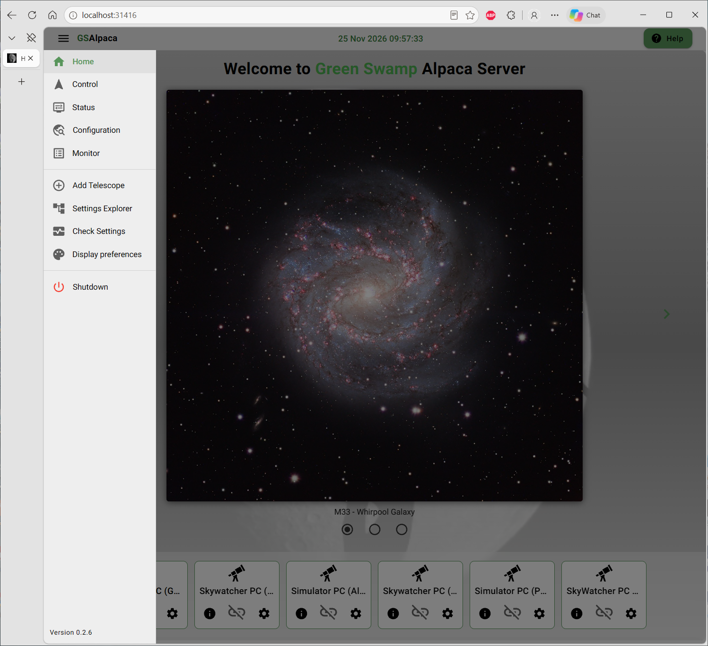
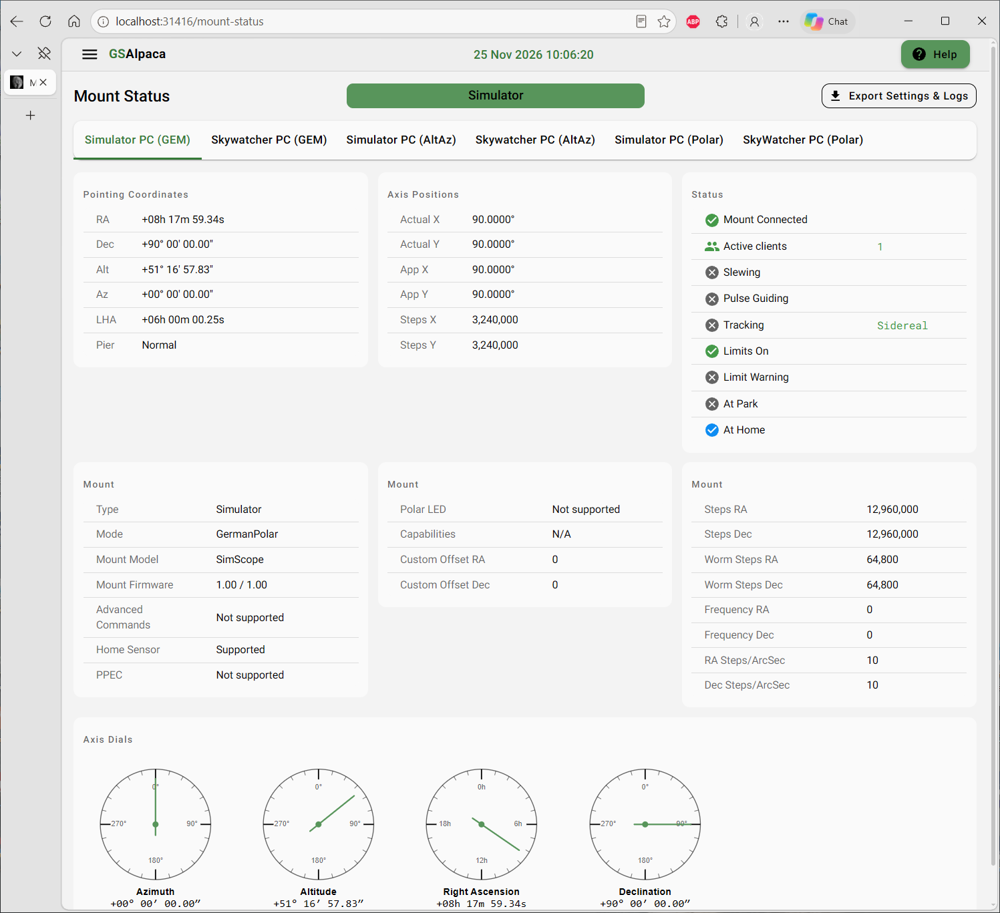
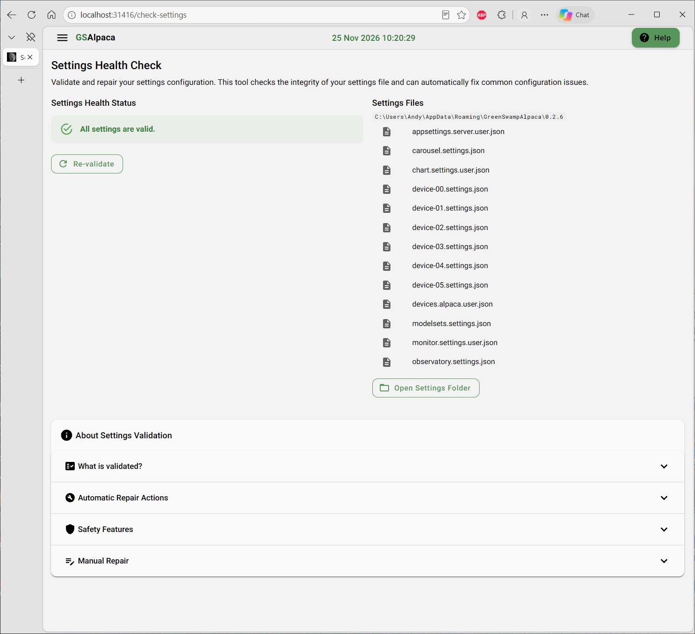
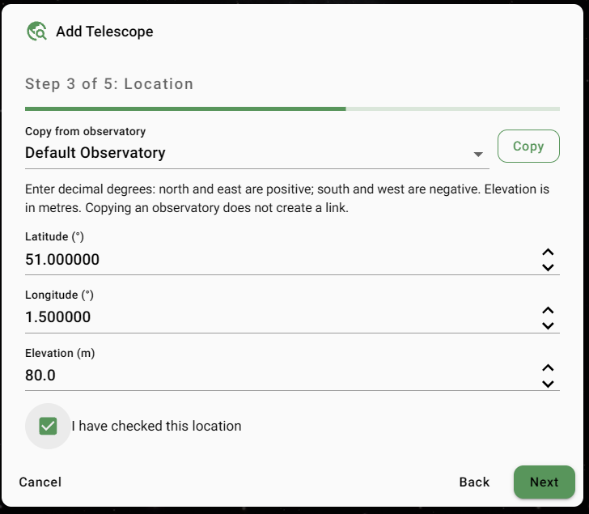

# Green Swamp Alpaca Server — User Guide

**2026-11-25 10:31**

---

## Table of Contents

1. [Overview and Purpose](#1-overview-and-purpose)
2. [Key Concepts](#2-key-concepts)
   - 2.1 [ASCOM and Alpaca](#21-ascom-and-alpaca)
   - 2.2 [Mount Types Supported](#22-mount-types-supported)
   - 2.3 [SkyWatcher and Simulator Modes](#23-skywatcher-and-simulator-modes)
   - 2.4 [Multiple Mounts in Parallel](#24-multiple-mounts-in-parallel)
3. [Getting Started](#3-getting-started)
   - 3.1 [First Launch](#31-first-launch)
   - 3.2 [Default Port and URL](#32-default-port-and-url)
   - 3.3 [Connecting an ASCOM Client](#33-connecting-an-ascom-client)
4. [Navigating the User Interface](#4-navigating-the-user-interface)
   - 4.1 [Navigation Menu](#41-navigation-menu)
5. [Page Reference](#5-page-reference)
   - 5.1 [Home](#51-home)
   - 5.2 [Mount Status](#52-mount-status)
   - 5.3 [Mount Configuration](#53-mount-configuration)
   - 5.4 [Monitor](#54-monitor)
   - 5.5 [Settings Explorer](#55-settings-explorer)
   - 5.6 [Server Configuration](#56-server-configuration)
   - 5.7 [Check Settings](#57-check-settings)
   - 5.8 [Axis Chart](#58-axis-chart)
   - 5.9 [Pulse Chart](#59-pulse-chart)
   - 5.10 [Mount Control](#510-mount-control)
   - 5.11 [3D Telescope View](#511-3d-telescope-view)
   - 5.12 [Display Preferences](#512-display-preferences)
6. [Settings Explorer In Depth](#6-settings-explorer-in-depth)
   - 6.1 [Tree Structure](#61-tree-structure)
   - 6.2 [Dirty-State Tracking and Saving](#62-dirty-state-tracking-and-saving)
   - 6.3 [Observatory Settings](#63-observatory-settings)
   - 6.4 [Server Configuration](#64-server-configuration)
   - 6.5 [Logging Settings](#65-logging-settings)
   - 6.6 [Telescope Device Settings](#66-telescope-device-settings)
7. [Managing Telescope Devices](#7-managing-telescope-devices)
   - 7.1 [Adding a Device](#71-adding-a-device)
   - 7.2 [Removing a Device](#72-removing-a-device)
   - 7.3 [Device Settings Groups](#73-device-settings-groups)
8. [Mount Type Configuration Detail](#8-mount-type-configuration-detail)
   - 8.1 [German Equatorial Mount (GEM)](#81-german-equatorial-mount-gem)
   - 8.2 [Polar / Fork Equatorial Mount](#82-polar--fork-equatorial-mount)
   - 8.3 [Alt-Azimuth Mount](#83-alt-azimuth-mount)
9. [SkyWatcher Driver Configuration](#9-skywatcher-driver-configuration)
10. [Simulator Mode](#10-simulator-mode)
11. [Settings Files and Persistence](#11-settings-files-and-persistence)
12. [ASCOM Client Compatibility](#12-ascom-client-compatibility)
13. [Troubleshooting](#13-troubleshooting)
14. [Appendix A — File and Directory Locations](#14-appendix-a--file-and-directory-locations)

---

## 1. Overview and Purpose

**Green Swamp Alpaca Server** is a local-network telescope mount driver server built on the [ASCOM Alpaca](https://ascom-standards.org) open standard. It exposes one or more physical or simulated telescope mounts as Alpaca-compliant REST devices so that any ASCOM-aware
planetarium, imaging, or automation application can connect to them over a standard HTTP connection — no COM ports, no local driver installation required on the client machine.

### What the application does

| Capability | Detail |
|---|---|
| **Alpaca REST API** | ASCOM Telescope interface version 4 over HTTP/JSON |
| **Multi-mount** | Drive several mounts simultaneously, each with its own device number |
| **Mount types** | German Equatorial (GEM), Polar / Fork Equatorial, Alt-Azimuth |
| **Hardware driver** | SkyWatcher motor controllers via serial (RS-232 / USB-Serial) |
| **Simulator** | Built-in software simulator for every mount type — no hardware required |
| **Web UI** | Browser-based dashboard for real-time status, settings, and diagnostics |
| **Logging** | Configurable real-time monitor with session and file logging |
| **Settings health** | Automatic validation and repair of the configuration file |

The server hosts a browser-based application. Once running, open it on the server computer at `http://localhost:31416`, or from another device on your local network when remote access is enabled.

### Before moving a physical mount

- Check clearance around the telescope, pier and observatory, and make sure cables can move freely throughout the intended travel.
- Configure and test limits and park positions for your own equipment. A warning indicator, configured limit or 3D model is not a substitute for observing the mount or an independent safety system.
- Know how to stop motion. Supervise initial slews, flips, homing and parking, and be especially careful when the mount's position is uncertain after a power interruption.
- Practice unfamiliar controls with a simulator first.

---

## 2. Key Concepts

### 2.1 ASCOM and Alpaca

**ASCOM** (Astronomy Common Object Model) is the industry-standard interface specification for astronomy equipment. The traditional COM-based driver requires the driver software to be installed on every client PC.

**ASCOM Alpaca** uses HTTP/REST so compatible clients can communicate over the network. Green Swamp Alpaca Server implements the Alpaca Telescope interface and supports Alpaca UDP discovery. Some legacy ASCOM clients need an Alpaca-compatible chooser or bridge.

**Right ascension (RA)** and **declination (Dec)** describe a sky position. **Altitude** and **azimuth** describe a direction relative to the observer's horizon. Accurate site coordinates and time are important for converting between them. A GEM's **pier side** describes its pointing orientation; a meridian flip changes that orientation. **Home** is a reference position, while **park** is a selected position for stopping or storing the mount.

Guiding applications send short RA or Dec correction pulses. Backlash is mechanical play when an axis reverses; periodic error correction (PEC/PPEC) compensates for repeating errors in the mount's gearing when supported. Review the mount and guiding software documentation before changing these advanced settings.

### 2.2 Mount Types Supported

The server supports three ASCOM alignment modes. Each determines how the mount tracks the sky
and how coordinates are transformed.

| Alignment Mode | Typical Hardware | Notes |
|---|---|---|
| **GermanPolar** (GEM) | German Equatorial mounts (e.g. EQ5, EQ6, AZ-EQ) | RA and Dec axes; meridian flip required; pier-side awareness; hour angle limit |
| **Polar** | Fork or barn-door equatorial mounts | RA and Dec axes; no meridian flip; polar primary side selectable |
| **AltAz** | Dobsonian, single-arm, computerised alt-az | Altitude and azimuth axes; horizontal tracking limit; no pier-side concept |

### 2.3 SkyWatcher and Simulator Modes

The **Mount Type** field in Mount Configuration selects the driver backend for each device:

- **SkyWatcher** — Communicates with a physical SkyWatcher mount via a serial port using the SynScan/SkyWatcher binary protocol. Requires a COM port (RS-232 or USB-to-Serial adapter) to be configured.
  
- **Simulator** — A pure software simulation of any of the three mount types. The simulated mount tracks, slews, parks, and pulse-guides just as a real mount would, making it ideal for testing planetarium software integrations, developing automation scripts, or learning the application without any hardware.

Both modes are full Alpaca-compatible telescope devices. A single running instance of the server can host SkyWatcher devices and simulator devices at the same time.

### 2.4 Multiple Mounts in Parallel

The server supports any number of telescope devices running concurrently, each identified by a unique integer **Device Number** (0, 1, 2, …). Each device:

- Has its own complete set of settings (serial port, alignment mode, limits, gearing, etc.)
- Appears as a separate Alpaca telescope endpoint:
  `http://{host}:{port}/api/v1/telescope/{deviceNumber}/...`
- Has its own tab in the **Mount Status** and **Mount Settings** pages
- Can be driven by one or more simultaneous ASCOM client connections independently

There is no theoretical limit to the number of devices; in practice it is limited by available serial ports (for SkyWatcher devices) or system resources (for simulator devices).

---

## 3. Getting Started

### 3.1 First Launch

On first launch the server creates a default configuration containing a single **Simulator (GEM)** device. This means the application is immediately usable without any hardware. You will see the home page and the device will appear in the status and settings views.

### 3.2 Default Port and URL

| | Value |
|---|---|
| Default Alpaca port | **31416** |
| Local UI URL | `http://localhost:31416` |
| Alpaca base URL | `http://localhost:31416/api/v1/telescope/{deviceNumber}/` |
| Setup redirect (legacy) | `http://localhost:31416/setup/v1/Telescope/{deviceNumber}/setup` → redirects to Mount Configuration |

The port can be changed in **Settings Explorer** → **Server Configuration** → **Network**. A server restart is required for a port change to take effect.

To try the simulator, open **Control**, select its device tab and click the Connect icon at the lower right. If no simulator is configured, use **Add Telescope** as described in [Section 7](#71-adding-a-device). After creating one, apply hot reload or restart to activate it. Once connected, explore the readouts and controls before connecting physical hardware.

### 3.3 Connecting an ASCOM Client

In your planetarium or imaging application (e.g. Cartes du Ciel, Sequence Generator Pro, N.I.N.A., Voyager):

1. Choose **ASCOM Alpaca** as the telescope type.
2. Use Alpaca UDP Auto-Discovery **or** enter the server IP and port manually.
3. Select the device number matching the mount you want to control.
4. Connect — the server will accept the connection and the mount will begin reporting status.

> **Tip:** Multiple ASCOM clients can connect to the same device simultaneously. The server
> tracks connected client count per device and displays it on the Status page.

---

## 4. Navigating the User Interface

Use the left-side navigation drawer to move between pages and open dialogs.

### 4.1 Navigation Menu

| Entry | Purpose |
|---|---|
| **Home** | Welcome page, carousel and device tiles |
| **Control** | Connect and operate a selected telescope |
| **Status** | Live mount telemetry |
| **Configuration** | Per-device configuration overview |
| **Monitor** | Live log records and logging filters |
| **Add Telescope** | Create a simulator or SkyWatcher device |
| **Settings Explorer** | Edit application and telescope settings |
| **Check Settings** | Validate settings and locate settings files |
| **Display Preferences** | Change this browser's appearance, zoom and language preferences |
| **Shutdown** | Open the shutdown confirmation |



To open the **Axis Chart**, **Pulse Chart** or **3D View**, go to **Control**, select and connect the telescope, then use the buttons in its **Mount Info** panel. They open in separate browser windows. Allow pop-ups for the server if necessary.

---

## 5. Page Reference

### 5.1 Home

The landing page shows a welcome message, an image carousel and a row of telescope tiles. Select a tile to open its Control page. Its information button shows device details, its connection indicator shows mount connection status, and its settings button opens the device's Configuration page.


---

### 5.2 Mount Status

**URL:** `/mount-status` or `/mount-status/{deviceNumber}`

Displays real-time telemetry for all registered telescope devices. If more than one device is registered, each appears as a separate **tab**. Clicking a tab navigates to `/mount-status/{deviceNumber}` so the view is bookmarkable and deep-linkable.

The page groups pointing coordinates, axis positions, status and mount information. Status includes connection count, slewing, guiding, tracking, limits, park and home. Mount details can include model, firmware, supported capabilities and, for SkyWatcher, controller voltage when available.



The page subscribes to live state updates and refreshes automatically; you do not need to reload the browser.

---

### 5.3 Mount Configuration

**URL:** `/mount-configuration` or `/mount-configuration/{deviceNumber}`

Provides a read-only overview of each device's configuration, one tab per device. **Edit in Settings Explorer** opens the device's settings for editing. The export button downloads a settings and logs archive.


---

### 5.4 Monitor

**URL:** `/monitor`

The page displays recent **Monitor Records** and an expandable **Logging Settings** panel.


The scrollable, monospaced buffer shows recent captured records. Controls:

| Button | Action |
|---|---|
| Clear (bin icon) | Empties the display buffer (does not affect the log file) |
| Copy to Clipboard | Copies the entire visible buffer as plain text |
| Reload Settings | Re-reads filter settings from disk |
| Write Buffer to File | (Fast Monitor mode only) Flushes the in-memory buffer to a log file |

**Logging Settings**
Expand the logging panel to adjust filters also available in Settings Explorer → Logging. Save changes with **Save**. Four filter categories:

- **Device Filters** — which device types produce log entries (Server, Telescope, UI)
- **Category Filters** — which subsystem categories appear (Driver, Interface, Server, Mount, etc.)
- **Message Type Filters** — which severity levels appear (Info, Warning, Error, Debug, Data)
- **Logging Control** — enable/disable the session log file, monitor log file, and charting data file

Preset buttons at the top of the logging section apply commonly used filter combinations
(Development, Production, Troubleshooting, Profile Debug) in one click.

---

### 5.5 Settings Explorer

**URL:** `/settings-explorer`

The primary settings management page organises settings into a tree on the left and displays the selected group on the right. Use **Export** to download a settings and logs archive; review it for sensitive information before sharing.


See [Section 6](#6-settings-explorer-in-depth) for a full description.

---

### 5.6 Server Configuration

Open **Settings Explorer** → **Server Configuration** to edit network, user-interface and authentication settings. Save the relevant group after editing. Changes such as the listening port require a server restart. Display preferences for the current browser are also available directly from the navigation menu; see [Section 5.12](#512-display-preferences).

---

### 5.7 Check Settings

**URL:** `/check-settings`

Validates the entire settings file and reports any problems found. Results are displayed as:

- **Errors** — settings that are invalid and will prevent correct operation (shown in red)
- **Warnings** — settings that are unusual but not necessarily wrong (shown in amber)

Each issue includes:
- An error code chip
- The device number it affects (if device-specific)
- A plain-English description of the problem
- A suggested resolution
- An **Auto-repairable** chip if the server can fix it automatically

Use the revalidation button to check again after making changes. The page also shows the settings folder and its JSON files, plus information about automatic repair and manual recovery. It does not provide an Auto-repair action button. Back up your settings before changing or restoring files.



---

### 5.8 Axis Chart

**URL:** `/charts/radec/{deviceNumber}`

In **Control**, connect the selected telescope and select **Axis Chart** in **Mount Info**. The chart opens in a separate window and plots the two mount axes over time. The labels reflect the mount's alignment mode.


| Control | Purpose |
|---|---|
| **Data window** | Select the recent time span, from 10 seconds to 30 minutes. |
| **Scale** | Display values in steps, degrees or arc-seconds. |
| **Pause / Resume** | Freeze the current display for inspection, then return to the rolling live view. |
| **Axis switches** | Show or hide either axis series. |
| **Clear** | Clear the displayed chart data. |

When paused, the chart exposes controls for inspecting the snapshot, including zoom, pan and export. The data-window selector is unavailable until live display resumes. A disconnected or reconnecting indicator refers to the chart's connection to the server. Allow pop-ups if the window does not open.

---

### 5.9 Pulse Chart

**URL:** `/charts/pulse/{deviceNumber}`

Open **Pulse Chart** from the connected telescope's **Mount Info** panel. It displays accepted and rejected RA and Dec guide pulses sent to the mount. Rejected pulses were not processed; investigate repeated rejections using the mount and guiding software settings rather than changing thresholds blindly. An empty plot can simply mean no guiding pulses have been received.


| Control | Purpose |
|---|---|
| **Data window** | Choose the recent time span. |
| **Units** | Select milliseconds, arc-seconds or steps. |
| **Chart type** | Show accepted pulses as bars, points or lines; rejected pulses are points. |
| **RA / RA rejected / Dec / Dec rejected** | Show or hide the corresponding series. |
| **Pause / Resume** | Inspect a frozen snapshot or return to live display. |
| **Clear** | Clear the displayed pulse data. |

Both charts save their display selections. The charts are diagnostic views; do not infer mount safety from them.

---

### 5.10 Mount Control

**URL:** `/mount-control` or `/mount-control/{deviceNumber}`

Select a telescope tab, then use **Connect** at the lower right to connect the UI client. Connection from another application does not replace this step for enabling the UI controls. Use the disconnect icon when finished. The top readout and indicator row show coordinates, connection count and mount state; hover over an icon for its description.


- **GOTO:** select RA/Dec or Alt/Az, enter the target and use **Go To**. **Copy** fills the target from the current position; **Sync** is available for supported RA/Dec operations. Check the target and mount clearance before moving.
- **Mount actions:** the icon buttons provide park/unpark, home, tracking, GEM pier-side flip, re-sync, AutoHome, limits and settings where available. Availability depends on connection, state and mount capability. The settings panel includes park-position and tracking-limit controls.
- **Hand Controller:** choose Axes, Guiding or Pulse mode, set the speed and use the direction buttons. The centre Stop button stops motion. The settings button opens hand-controller and pulse options.
- **Mount Info:** choose RA/Dec, Alt/Az or Optics dials, or open the Axis Chart, Pulse Chart and 3D View. These buttons require the UI connection.
- **Bottom bar:** use the red Stop button to stop motion, the connection icon to connect/disconnect and the power icon to open the shutdown dialog.


> **Safety:** A flip, home, park or AutoHome operation can move the mount. Check the route and cables and supervise the movement. Re-sync changes the server's assumed position; ensure the physical mount is actually at the selected reference position first. Test configured limits on your equipment and do not assume that a warning alone stops motion.

---

### 5.11 3D Telescope View

**URL:** `/telescope-view/{deviceNumber}`

From **Control** → **Mount Info**, connect the selected telescope and choose **3D View**. The separate window shows a visual model driven by the reported axis positions, with a coordinate header.


The toolbar provides **Save View**, **Center on Mount**, **Reset Camera** and **Options**. Options include model and background, colour, grid, cardinal directions and heading, as well as assembly support, mount, telescope and axis adjustments where applicable. Save the options to apply them.


The model is a visual aid, not a collision detector. If the mount starts in an unknown position or its reference position is wrong, the displayed orientation may also be wrong. Always check the physical mount and its surroundings.

---

### 5.12 Display Preferences

Open **Display Preferences** from the navigation menu to choose light, dark or system appearance; theme colour; zoom; display language; and regional format. The Red Light theme remains dark and provides a brightness control. Browser-specific preferences are independent of another browser's settings.


---

## 6. Settings Explorer In Depth

### 6.1 Tree Structure

The settings tree has three levels:

```
Section
  └- Group (leaf node — clicking shows the editor)
```

The top-level sections are:

| Section | Description |
|---|---|
| **Observatory** | Shared physical site properties (latitude, longitude, elevation, UTC offset) |
| **Logging** | Monitor filter settings — device, category, message type filters and log file targets |
| **Server Configuration** | HTTP server behaviour, network binding, authentication, identity |
| **Telescope Devices** | Per-device mount settings, one section per registered device |

Select the **Telescope Devices** section to show the Device Manager card for adding, removing or applying device changes. Expand a device and select a leaf group to edit its settings.

**Toolbar controls:**

| Control | Action |
|---|---|
| Expand All (↕ icon) | Opens all tree nodes |
| Collapse All (↕ icon) | Closes all tree nodes |
| Search box | Filters the tree to matching group names |
| Show Hidden (toggle) | Reveals advanced groups normally hidden from casual use (Optics, PEC/PPEC, Performance & Tuning, Hand Controller) |

### 6.2 Dirty-State Tracking and Saving

Any change you make to a setting is held in memory as a **working copy** and is not written to disk until you explicitly save. The tree indicates unsaved changes with:

- A small **amber dot badge** (●) next to any leaf group that has unsaved changes
- **Save** and **Reset** buttons that become available when changes are pending

**Save** writes the working copy to disk. **Reset** discards the selected working changes and reverts to the last saved state.

The selected group is marked dirty when its working settings differ from the saved copy. Device settings are saved per device, not as separate files for each group.

> **Warning:** Navigating away from a dirty (unsaved) node will show a confirmation dialog
> asking whether you want to discard changes. Confirm to continue navigating, or cancel to
> stay and save first.

### 6.3 Observatory Settings

**Group: Observatory Settings**

Shared observatory location used as defaults when new devices are created. Fields:

| Field | Description |
|---|---|
| Latitude | Observatory latitude in decimal degrees (−90 to +90) |
| Longitude | Observatory longitude in decimal degrees (−180 to +180) |
| Elevation | Elevation above sea level in metres |
| UTC Offset | Local time offset from UTC (e.g. `01:00:00` for UTC+1) |

### 6.4 Server Configuration

These groups cover different aspects of the Alpaca HTTP server:

| Group | Key Settings |
|---|---|
| **Network** | Port, remote access, UDP discovery, loopback discovery |
| **User Interface** | Zoom, browser auto-start, display theme, language |
| **Authentication** | Enable auth, username |

Display preferences are saved per browser. Choose Light, Dark, or Follow System independently of the theme colour: Green (Green Swamp), Forest (forest green), Ocean (teal), Steel (steel blue), Nebula (deep violet), Copper (burnt orange), or Red Light. Follow System responds to system appearance changes. Red Light always remains dark and retains its night brightness control; the chosen appearance is restored when another colour is selected.

### 6.5 Logging Settings

When the **Logging** section node is selected, a special presets card is shown instead of a plain editor. Four quick-action buttons allow bulk filter changes (select all devices, all categories, all types, or clear all). Four pre-set buttons load commonly used filter profiles.

The individual filter leaf groups (Device Filters, Category Filters, Message Type Filters, Logging Control) each open a dedicated editor with checkboxes for fine-grained control.

### 6.6 Telescope Device Settings

Each device has the following leaf groups. Groups marked *(hidden by default)* are only shown when the **Show Hidden** toggle is on.

| Group | Description |
|---|---|
| **Mount Configuration** | Device name, enabled flag, mount type, alignment mode, polar primary side, coordinate type, serial port, baud rate, backlash, encoders, custom gearing |
| **Observatory Configuration** | Per-device latitude, longitude, elevation, UTC offset, environmental inputs, GPS |
| **Tracking & Guiding** | Sidereal/lunar/solar/king tracking rates, RA offset, pulse guiding parameters, ST4 guide rate |
| **Home and Park** | Home axis positions (X/Y), auto-home positions, named park positions, active park selection |
| **Limits** | Hardware axis limits, tracking-limit actions, horizon GOTO limit and sync limits; GEM-specific flip and horizon tracking settings |
| **Optics** *(hidden)* | Aperture diameter, aperture area, focal length |
| **Performance & Tuning** *(hidden)* | Loop update interval, GOTO precision, trace logging |
| **PEC / PPEC** *(hidden)* | Periodic error correction and predictive PEC settings |
| **Hand Controller** *(hidden)* | HC speed, mode, flip behaviour, anti-backlash |


Review limits for your own mount and cables; the values in the illustration are not recommended settings for every installation.

---

## 7. Managing Telescope Devices

### 7.1 Adding a Device

1. Select **Add Telescope** in the navigation menu, or select **Telescope Devices** in
   **Settings Explorer** and click **Add Device**.
2. Enter a name and choose **Simulator** or **SkyWatcher**.
3. Choose German equatorial (GEM), polar/fork, or alt-azimuth; for polar, choose the primary side.
4. Enter and confirm the latitude, longitude and elevation, or copy an existing observatory and
   confirm its values. North and east are positive; elevation is in metres. Copying an observatory
   does not link the telescope to it, so later observatory edits do not update the telescope.
5. For SkyWatcher, choose or enter a serial port and baud rate, or leave the port blank to
   configure it later. The telescope can still be activated, but needs a valid port before connecting.
6. Review the settings and click **Create Telescope**. A device number is assigned automatically.
   Creating the device saves its settings but does not connect it.
7. Choose **Apply Hot Reload** to activate the telescope now, or **Not now** to defer activation.
   Hot reload rebuilds all device registrations and disconnects connected clients after confirmation.
   If you defer, the telescope is not usable until you apply changes in **Settings Explorer →
   Telescope Devices** or restart the server; it may already be listed on some pages.

The wizard presents identity, geometry, location, connection and review steps. These examples show the identity, location, review and activation screens:





Review the device's remaining settings, including mount limits, before connecting hardware.

### 7.2 Removing a Device

1. Open **Settings Explorer** and select **Telescope Devices**.
2. Find the device in the list and click the **Delete** (bin) icon on the right.
3. Confirm in the dialog. The device and all its settings are permanently removed.

> **Note:** Removing a device while an ASCOM client is connected to it will cause that client
> to receive a disconnect error. Disconnect clients before removing a device.

### 7.3 Device Settings Groups

After adding a device, configure it fully before connecting a client. At minimum:

1. **Mount Configuration** — Set the Mount Type (`SkyWatcher` or `Simulator`), Alignment Mode,
   and for SkyWatcher devices, the serial Port and Baud Rate.
2. **Observatory Configuration** — Set your site latitude, longitude and elevation so coordinate
   transforms are accurate.
3. **Limits** — Review hardware axis limits, tracking actions and any GEM-specific flip and horizon limits for your mount.

---

## 8. Mount Type Configuration Detail

### 8.1 German Equatorial Mount (GEM)

Select **Alignment Mode: German Equatorial (GEM)** in Mount Configuration.

A GEM can point to the same region of sky from either side of the pier. A meridian flip changes its orientation to help maintain clearance as the sky moves.

In **Limits**, review the GEM flip angle, tracking limit after the flip angle, horizon limits and the selected actions. The available action can be warning only, stop tracking or park; do not assume the mount will stop unless the selected configuration calls for it. Configure a safe park position before choosing a park action. Coordinate flip timing with your automation client, and supervise and test it on the actual equipment.

The Status page reports the current pier side alongside RA/Dec. Sync restrictions, including **No Sync Past Meridian**, are also available in Limits.

### 8.2 Polar / Fork Equatorial Mount

Select **Alignment Mode: Polar / Fork** in Mount Configuration.

A polar or fork mount has equatorial axes, but its mechanical travel depends on the mount and installation. The **Polar Primary Side** setting (Left or Right) determines the default orientation. Review axis limits and cable clearance for your particular equipment; do not assume the axes can rotate freely.

Review the hardware axis limits and their configured action in **Limits** for your polar mount.

### 8.3 Alt-Azimuth Mount

Select **Alignment Mode: Alt-Az** in Mount Configuration.

Alt-Az mounts use azimuth and altitude axes. Tracking a celestial target requires movement of both axes; the field can rotate during imaging without a field de-rotator. Review hardware limits, the horizon GOTO limit and the selected limit action for the actual mount. Pay particular attention to azimuth cable wrap and altitude clearance. GEM-specific flip-angle controls are not shown for Alt-Az devices.

---

## 9. SkyWatcher Driver Configuration

To connect a physical SkyWatcher mount:

1. Connect the mount to the PC via a serial or USB-to-serial cable.
2. Note the COM port number assigned by Windows (e.g. `COM3`).
3. In Settings Explorer, navigate to the device's **Mount Configuration**.
4. Set **Mount Type** to `SkyWatcher`.
5. Set **Port** to the COM port (e.g. `COM3`).
6. Set **Baud Rate** — SkyWatcher typically uses `9600`; some hand controllers use `115200`.
7. Leave other serial settings (Data Bits, Handshake, DTR/RTS) at their defaults unless you
   have a specific reason to change them.
8. Save and connect from your ASCOM client.

**Hardware settings** (Mount Hardware panel within Mount Configuration):

| Setting | Notes |
|---|---|
| Allow Advanced Commands | Enables extended SkyWatcher command set for additional features |
| Encoders Enabled | Activates absolute encoder feedback if your mount supports it |
| Max Slew Rate (°/s) | Cap on the maximum slew speed sent to the hardware |
| RA / Dec Backlash (steps) | Compensation steps applied when reversing direction |

**Custom Gearing** (within Mount Configuration, Show Hidden):
For modified or non-standard gearing ratios — step counts per revolution and worm-wheel tooth counts for both axes. Leave at defaults for standard SkyWatcher mounts.

---

## 10. Simulator Mode

The simulator is activated by setting **Mount Type** to `Simulator` in Mount Configuration (no serial port is required). It is available for all three alignment modes.

**What the simulator does:**

- Responds to all standard Alpaca Telescope commands (slew, track, park, unpark, pulse guide,
  sync, abort, etc.)
- Simulates realistic motion — a slew takes time proportional to the angular distance
- Tracks at sidereal rate while tracking is enabled
- Respects configured limits (axis limits, hour angle limit, horizontal axis limit)
- Reports realistic position coordinates based on the observatory location

**Typical uses:**

| Use case | How |
|---|---|
| Testing a new planetarium or automation script | Create a simulator device and point the script at it |
| Learning the settings explorer | Explore and change settings without risk to hardware |
| Developing or debugging this application | All UI features work identically with a simulator device |
| Running multiple virtual devices | Add several simulator devices with different alignment modes |

The default configuration ships with one Simulator (GEM) device (Device 0) so the application is
immediately functional without any hardware or configuration change.

---

## 11. Settings Files and Persistence

Settings are stored in several JSON files in a versioned folder. For an interactive Windows user the default folder is `%AppData%\GreenSwampAlpaca\{version}\`; services and overrides use different roots. **Check Settings** shows the active folder. See [Appendix A](#14-appendix-a--file-and-directory-locations) for the file names and other run modes.

Changes in Settings Explorer require **Save**; other actions, such as creating a device or changing chart display options, save as part of their own workflow. Some display preferences are stored in the browser rather than the server's settings folder.

For a backup, stop the server and copy the entire active versioned folder to a safe location. The **Export** button also downloads an archive of settings and logs; treat the archive as sensitive and verify its contents before sharing or relying on it for recovery.

---

## 12. ASCOM Client Compatibility

The server reports ASCOM Telescope interface version 4. It has been designed for use with Alpaca-compatible clients, including:

- **Cartes du Ciel (Skychart)**
- **Sequence Generator Pro (SGP)**
- **N.I.N.A.**
- **Voyager**
- **TheSkyX** (via Alpaca bridge)
- **Any application using the ASCOM Platform 6.6+ Alpaca chooser**

Legacy clients that use the ASCOM COM telescope driver continue to work if they are configured
to connect via the Alpaca Chooser in the ASCOM Platform.

**Legacy setup URL redirect:** Some ASCOM clients open the setup page via the URL
`/setup/v1/Telescope/{N}/setup`. The server redirects this URL to
`/mount-configuration/{N}`, the device configuration overview.

---

## 13. Troubleshooting

### The browser does not open automatically on startup

Check the browser auto-start option under **Settings Explorer** → **Server Configuration** → **User Interface**, or navigate manually to `http://localhost:31416`.

### An ASCOM client cannot find the server via discovery

- Ensure discovery is enabled under **Settings Explorer** → **Server Configuration** → **Network**.
- If the client is on the same machine, ensure **Allow Remote Access** is off (localhost only)
  or on (all interfaces) as appropriate.
- Check that no firewall is blocking UDP port 32227 (Alpaca discovery) or TCP port 31416.

### A SkyWatcher mount does not connect

- Verify the COM port in Device Manager matches the value in Mount Configuration.
- Try baud rate 9600 first; some newer mounts and hand controllers use 115200.
- Check that no other application (e.g. EQMod, Cartes du Ciel direct serial) is holding the
  COM port open.
- Enable the **Monitor** page and set Driver and Mount category filters on to see detailed
  serial communication messages.

### Settings appear to have been reset or lost

- Open **Check Settings** and revalidate. Read the reported issue and suggested resolution.
- Check the settings folder shown on that page; its location depends on how the server runs.
- Back up the current folder before attempting recovery. Restore a known-good versioned folder if necessary, with the server stopped.

### The Status page shows stale or zero position data

- The mount must be **connected** (Mount Connected = Yes on the Status page).
- For SkyWatcher devices, confirm the serial connection settings are correct.
- Check the Monitor page for error messages from the mount driver.

### A setting change has no effect

- Confirm you clicked **Save** after making the change. Unsaved changes are shown with an amber
  dot on the tree node.
- Some server settings (e.g. port number) require a server restart to take effect.

### A chart or 3D window does not open

1. On **Control**, select the telescope and connect the UI client. The launch buttons in **Mount Info** are disabled while it is disconnected.
2. If the browser blocks the window, allow pop-ups for the server's address and try again.
3. The device-specific URLs are `/charts/radec/{deviceNumber}`, `/charts/pulse/{deviceNumber}` and `/telescope-view/{deviceNumber}`.

### A chart is empty or disconnected

- Confirm that the telescope and chart are connected and that the required series are enabled.
- The Pulse Chart needs guiding pulses; a connected mount alone does not produce them. Resume live display if the chart is paused.
- If a reconnecting or disconnected indicator persists, check the server and browser network connection.

### The 3D model is missing or looks wrong

- Confirm the correct telescope and alignment mode are selected and that the mount's reported reference position is correct.
- Use **Reset Camera** or **Center on Mount**, and review the model and axis adjustments in **Options**.
- Check the browser's graphics support and reload the view if the model fails to render. Do not use an uncertain model position to judge physical clearance.

---

## 14. Appendix A — File and Directory Locations

This appendix describes the principal application, configuration and log locations. Actual paths depend on installation, service mode and overrides.

---

### A.1 Application Binaries

The executable, supporting assemblies, and static web assets that make up the server itself.

#### Windows (MSI installer)

```
C:\Program Files\GreenSwamp\Alpaca Server\
  GreenSwamp.Alpaca.Server.exe          ← main executable
  *.dll                                  ← runtime assemblies
  appsettings.json                       ← built-in default settings (read-only)
  wwwroot\                               ← Blazor static web assets
```

The installer registers a Windows Service named **GreenSwampAlpacaServer** pointing at
`GreenSwamp.Alpaca.Server.exe` in the directory above.

#### Linux (.deb package)

```
/opt/greenswamp/alpaca-server/
  GreenSwamp.Alpaca.Server               ← main executable (chmod +x)
  *.dll                                  ← runtime assemblies
  appsettings.json                       ← built-in default settings (read-only)
  wwwroot/                               ← Blazor static web assets
```

The package installs a systemd unit at `/lib/systemd/system/greenswamp-alpaca.service`.
The service runs as the dedicated system account **greenswamp**.

---

### A.2 User Configuration Files

The server places settings in a version subfolder under its settings root. **Check Settings** displays the active folder. Typical files include:

| File | Contents |
|---|---|
| `appsettings.server.user.json` | Server network, authentication and UI defaults |
| `devices.alpaca.user.json` | Registered Alpaca device metadata |
| `device-00.settings.json`, `device-01.settings.json`, … | Settings for each numbered telescope |
| `observatory.settings.json` | Observatory settings |
| `monitor.settings.user.json` | Monitor and logging settings |
| `chart.settings.user.json` | Chart display settings |
| `modelsets.settings.json`, `carousel.settings.json` | Model-set and carousel settings |

Default roots, before the version subfolder is appended:

| Run mode | Settings root |
|---|---|
| Windows interactive | `%AppData%\GreenSwampAlpaca` |
| Windows service | `%PUBLIC%\Documents\GreenSwampServer` |
| Linux interactive | `~/.config/GreenSwampAlpaca` |
| Linux systemd service | `STATE_DIRECTORY`, typically `/var/lib/greenswamp-alpaca`; otherwise the service user's `GreenSwampServer` folder or `/var/lib/greenswamp-alpaca` |

`--service-settings-path=<path>` takes precedence over `GREENSWAMP_SETTINGS_PATH`; either overrides the default root. A version subfolder is still used. Service and override logs are placed in a `Logs` subfolder of the root, not the version folder. Browser display and 3D-view preferences are not included in the server settings folder.

---

### A.3 Log and Monitor Files

Log files record session activity, errors and mount communication according to the monitor settings. Review logs and exported archives for sensitive information before sharing them.

| Run mode | Default log folder |
|---|---|
| Windows interactive | `Documents\GreenSwamp\AlpacaServer` under the current user |
| Linux interactive | `~/GreenSwamp/AlpacaServer` |
| Service or settings-root override | `Logs` under the active settings root |

The Linux systemd unit also sends standard output and errors to the journal. The actual configured log path and logging options may differ; check **Monitor** or **Settings Explorer** → **Logging**.

---

*Green Swamp Alpaca Server — User Guide — 2026-11-25 10:31*
