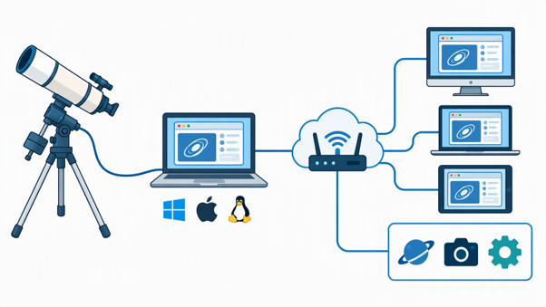
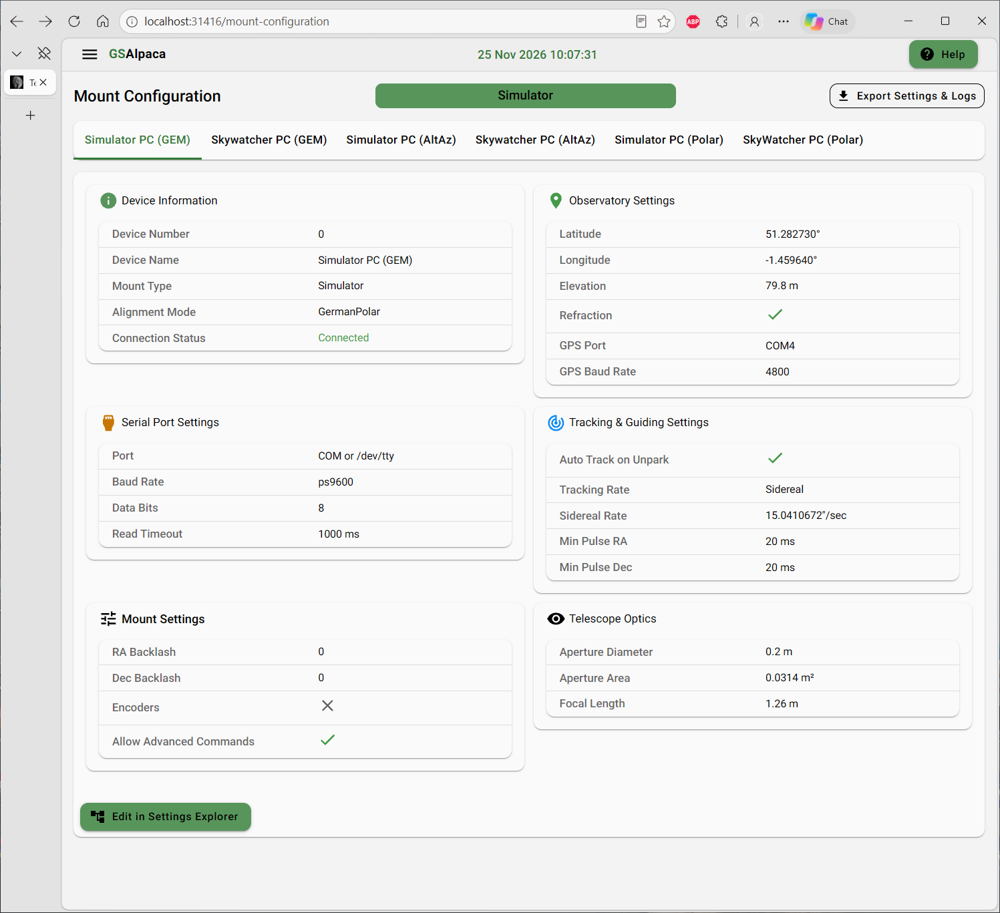
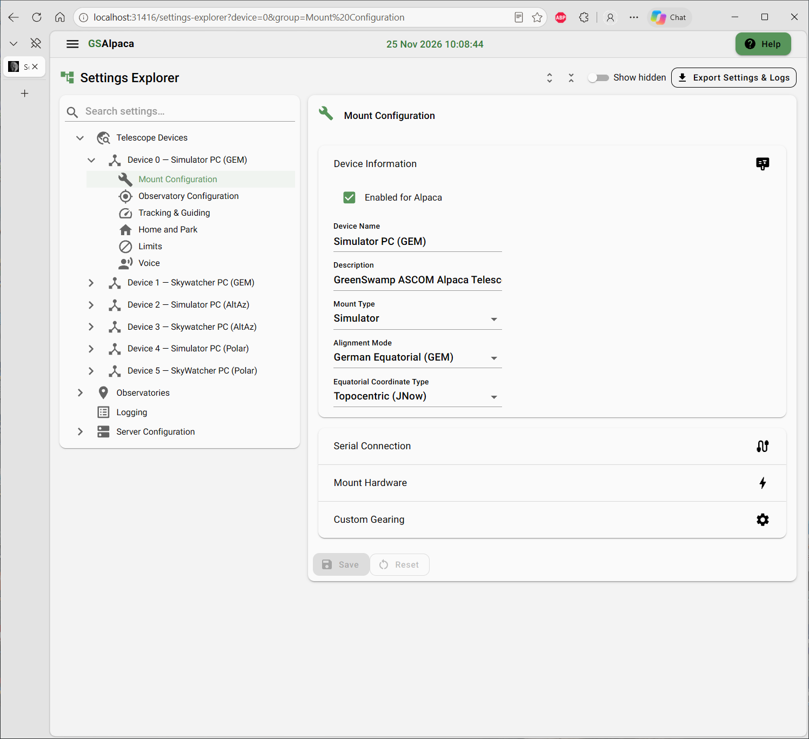
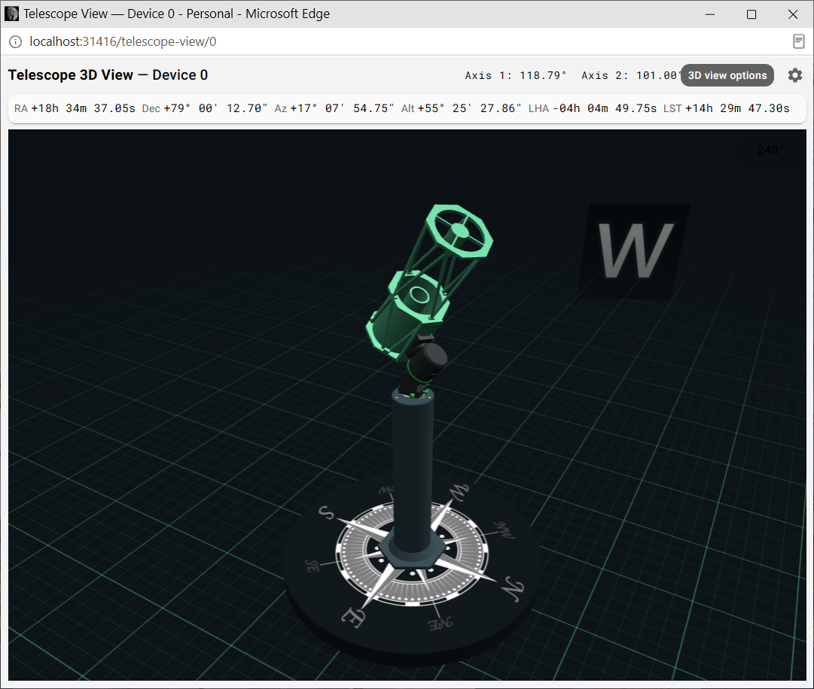
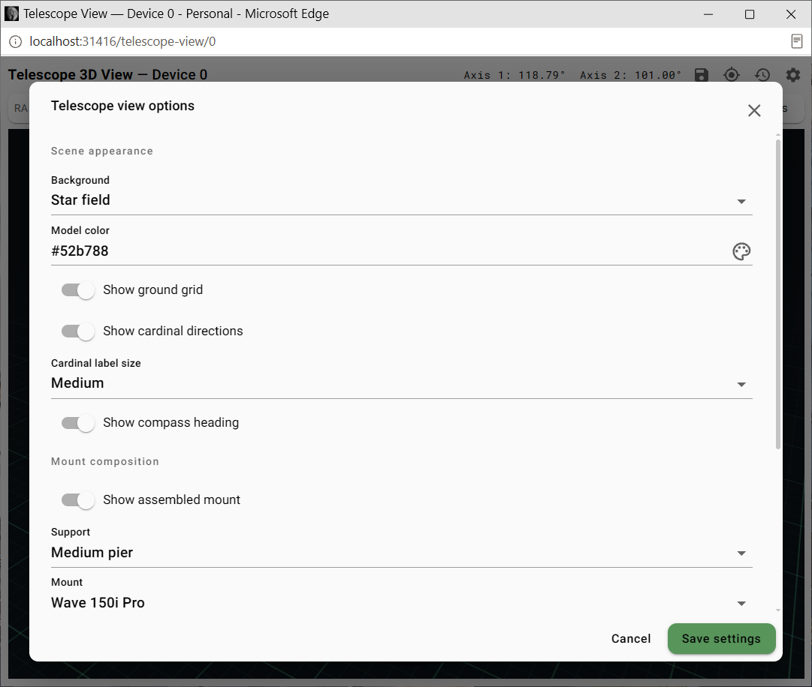
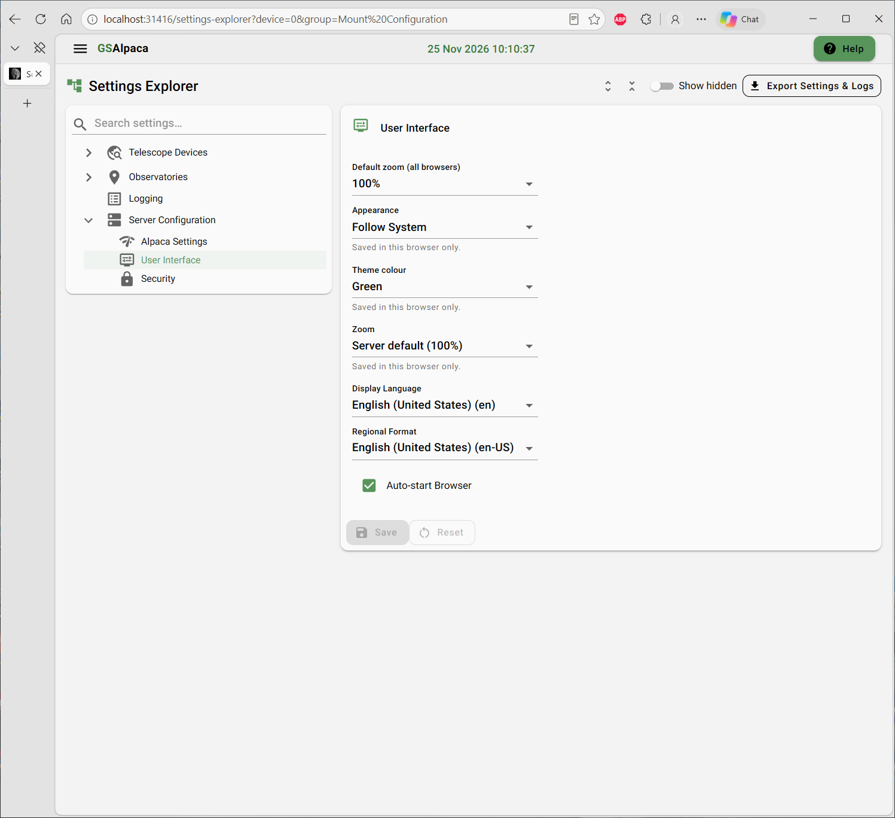
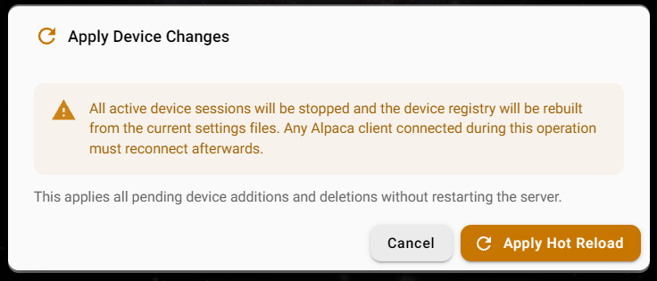

# Green Swamp Alpaca Server — User Guide

**2026-11-25 17:49**

---

## Table of Contents

- [Green Swamp Alpaca Server — User Guide](#green-swamp-alpaca-server--user-guide)
  - [Table of Contents](#table-of-contents)
    - [Where to start](#where-to-start)
    - [What the application does](#what-the-application-does)
    - [How the pieces fit together](#how-the-pieces-fit-together)
    - [Before moving a physical mount](#before-moving-a-physical-mount)
    - [More in depth](#more-in-depth)
      - [ASCOM and Alpaca](#ascom-and-alpaca)
      - [Real mounts and the simulator](#real-mounts-and-the-simulator)
      - [Several mounts at once](#several-mounts-at-once)
  - [2. System Requirements](#2-system-requirements)
    - [Server computer](#server-computer)
    - [What else you need](#what-else-you-need)
    - [Network ports](#network-ports)
    - [Supported mounts](#supported-mounts)
    - [Astronomy software (Alpaca clients)](#astronomy-software-alpaca-clients)
    - [Browser](#browser)
  - [3. Installation](#3-installation)
    - [3.1 Choose and download the package](#31-choose-and-download-the-package)
    - [3.2 Choose how the server will run](#32-choose-how-the-server-will-run)
    - [3.3 Windows (MSI)](#33-windows-msi)
    - [3.4 Linux (DEB)](#34-linux-deb)
    - [3.5 macOS (DMG)](#35-macos-dmg)
    - [3.6 Updates, backups and overrides](#36-updates-backups-and-overrides)
  - [4. Getting Started](#4-getting-started)
    - [4.1 First launch](#41-first-launch)
    - [4.2 Default port and URL](#42-default-port-and-url)
    - [4.3 Try the simulator](#43-try-the-simulator)
    - [4.4 Connecting an ASCOM client](#44-connecting-an-ascom-client)
    - [4.5 Connecting a real mount](#45-connecting-a-real-mount)
  - [5. Navigating the User Interface](#5-navigating-the-user-interface)
    - [5.1 Navigation Menu](#51-navigation-menu)
  - [6. Page Reference](#6-page-reference)
    - [6.1 Home](#61-home)
    - [6.2 Control](#62-control)
      - [Page header, indicators and bottom bar](#page-header-indicators-and-bottom-bar)
      - [GoTo \& Slew Panel](#goto--slew-panel)
      - [Control Buttons](#control-buttons)
      - [Coordinates and Go To](#coordinates-and-go-to)
      - [Hand Controller Panel](#hand-controller-panel)
      - [Mount actions and park positions](#mount-actions-and-park-positions)
      - [Go To settings cog and nested controls](#go-to-settings-cog-and-nested-controls)
      - [Mount Info dials](#mount-info-dials)
    - [6.3 Mount Status](#63-mount-status)
    - [6.4 Mount Configuration](#64-mount-configuration)
    - [6.5 Monitor](#65-monitor)
    - [6.6 Settings Explorer](#66-settings-explorer)
    - [6.7 Display Preferences](#67-display-preferences)
    - [6.8 Check Settings](#68-check-settings)
    - [6.9 Axis Chart](#69-axis-chart)
      - [Axis Chart control details](#axis-chart-control-details)
    - [6.10 Pulse Chart](#610-pulse-chart)
      - [Pulse Chart control details](#pulse-chart-control-details)
    - [6.11 3D Telescope View](#611-3d-telescope-view)
      - [Options cog: field reference](#options-cog-field-reference)
    - [6.12 Display Preferences](#612-display-preferences)
  - [7. Settings Explorer In Depth](#7-settings-explorer-in-depth)
    - [7.1 Tree Structure](#71-tree-structure)
    - [7.2 Dirty-State Tracking and Saving](#72-dirty-state-tracking-and-saving)
    - [7.3 Observatory Settings](#73-observatory-settings)
      - [GPS and Cartes du Ciel location sources](#gps-and-cartes-du-ciel-location-sources)
    - [7.4 Server Configuration](#74-server-configuration)
      - [Alpaca Settings](#alpaca-settings)
      - [User Interface and Security](#user-interface-and-security)
    - [7.5 Logging Settings](#75-logging-settings)
    - [7.6 Telescope Device Settings](#76-telescope-device-settings)
      - [Understanding the device editors](#understanding-the-device-editors)
      - [Mount Configuration fields](#mount-configuration-fields)
      - [Observatory Configuration fields](#observatory-configuration-fields)
      - [Tracking \& Guiding fields](#tracking--guiding-fields)
      - [Home, limits and safety](#home-limits-and-safety)
      - [Voice and advanced leaves](#voice-and-advanced-leaves)
    - [7.7 Removing a Device](#77-removing-a-device)
    - [7.8 Device Settings Groups](#78-device-settings-groups)
  - [8. Adding a Telescope Device](#8-adding-a-telescope-device)
  - [9. Mount Type Configuration Detail](#9-mount-type-configuration-detail)
    - [9.1 German Equatorial Mount (GEM)](#91-german-equatorial-mount-gem)
    - [9.2 Polar / Fork Equatorial Mount](#92-polar--fork-equatorial-mount)
    - [9.3 Alt-Azimuth Mount](#93-alt-azimuth-mount)
  - [10. SkyWatcher Driver Configuration](#10-skywatcher-driver-configuration)
  - [11. Simulator Mode](#11-simulator-mode)
  - [12. Settings Files and Persistence](#12-settings-files-and-persistence)
  - [13. ASCOM Client Compatibility](#13-ascom-client-compatibility)
  - [14. Troubleshooting](#14-troubleshooting)
    - [The browser does not open automatically on startup](#the-browser-does-not-open-automatically-on-startup)
    - [An ASCOM client cannot find the server via discovery](#an-ascom-client-cannot-find-the-server-via-discovery)
    - [A SkyWatcher mount does not connect](#a-skywatcher-mount-does-not-connect)
    - [Settings appear to have been reset or lost](#settings-appear-to-have-been-reset-or-lost)
    - [The Status page shows stale or zero position data](#the-status-page-shows-stale-or-zero-position-data)
    - [A setting change has no effect](#a-setting-change-has-no-effect)
    - [A chart or 3D window does not open](#a-chart-or-3d-window-does-not-open)
    - [A chart is empty or disconnected](#a-chart-is-empty-or-disconnected)
    - [The 3D model is missing or looks wrong](#the-3d-model-is-missing-or-looks-wrong)
  - [Appendix A — Glossary](#appendix-a--glossary)
    - [A.1 Terms](#a1-terms)
    - [A.2 Mount types](#a2-mount-types)
  - [Appendix B — File and Directory Locations](#appendix-b--file-and-directory-locations)
    - [B.1 Application Binaries](#b1-application-binaries)
      - [Windows (MSI installer)](#windows-msi-installer)
      - [Linux (.deb package)](#linux-deb-package)
    - [B.2 User Configuration Files](#b2-user-configuration-files)
    - [B.3 Log and Monitor Files](#b3-log-and-monitor-files)

---

## 1. Overview

**Green Swamp Alpaca Server** lets the astronomy software you already use control your telescope mount, whether that is a real SkyWatcher mount or a built-in simulator.

### Where to start

If you are new to the application, follow this path. Each step points to the part of the guide that covers it.

1. Check that your computer and mount are supported: [System Requirements](#2-system-requirements).
2. Install the server: [Installation](#3-installation).
3. Open the web pages and try the built-in simulator: [Try the simulator](#43-try-the-simulator).
4. Connect your planetarium or imaging software: [Connecting an ASCOM client](#44-connecting-an-ascom-client).
5. When you are ready, set up your real mount: [Connecting a real mount](#45-connecting-a-real-mount).

If a word is unfamiliar, such as *declination* or *meridian flip*, look it up in the [Glossary](#appendix-a--glossary).

### What the application does

Think of Green Swamp Alpaca Server as a translator that sits between your telescope mount and your astronomy software. Planetarium programs, imaging applications and automation tools all want to tell a mount where to point, but each would otherwise need its own way of talking to your particular mount. The server speaks to the mount for them. Your software only has to speak [ASCOM Alpaca](https://ascom-standards.org), an open standard that lets astronomy equipment and software talk to each other over an ordinary network.

Here is what you can do with it:

- **Control your mount from your usual software.** Programs such as Cartes du Ciel, N.I.N.A., Sequence Generator Pro and Voyager can find the server on your network, connect to your mount, and point, track and guide it. Typically a planetarium, an imaging program and a guiding program can all use the same mount at the same time. The computers running those programs don't need any COM ports or special telescope drivers installed. They just need to reach the server over the network.
- **Connect SkyWatcher mounts.** The server works with SkyWatcher mounts, using a USB, serial or Wi-Fi connection. It handles the technical details of talking to the mount's controller. See [System Requirements](#2-system-requirements) for the list of supported mounts.
- **Run more than one mount.** If you have several telescopes, each one appears as its own device, and each keeps its own settings.
- **Practise without any equipment.** A built-in simulator behaves like a real mount, so you can learn the controls, try your software or test a new setup on a cloudy night. It works with all three kinds of mount: German equatorial, polar or fork equatorial, and alt-azimuth.
- **Manage everything from your web browser.** The server has its own web pages where you can move the mount, watch live position and status, change settings, view charts and a 3D picture of the telescope, and see a running log of what the server is doing. You don't install anything extra to use them. Just open the address `http://localhost:31416` in a browser on the server computer, or use the server computer's address from another device on your network.
- **Catch settings mistakes.** The server checks its settings and can repair many problems automatically, so a bad entry is less likely to stop you getting started.

### How the pieces fit together

The server runs on the computer that has the mount connected to it (by USB, a serial or EQ Direct cable, or SkyWatcher Wi-Fi). That computer can run Windows, macOS or Linux, including a Raspberry Pi.

You use the server through a web page. You can open that page in a browser on the same computer, or on any other Windows, macOS or Linux device that can reach the server over your network, such as a laptop in the house while the server sits in the observatory. Your astronomy programs (the *Alpaca clients*) connect to the server over the same network, and they share the mount with the browser.



> **Network access and security.** In the standard settings the server accepts connections from other computers on your network (**Allow Remote Access** is switched on), and password protection is switched off. This means anyone who can reach the server's port (31416) could open the web pages and move your mount. Only use the server on a network you trust, such as your home or observatory network, and never expose it directly to the internet. To tighten this, turn on authentication or turn off remote access; see [Server Configuration](#74-server-configuration) (Alpaca Settings, and User Interface and Security).

### Before moving a physical mount

- Check clearance around the telescope, pier and observatory, and make sure cables can move freely throughout the intended travel.
- Configure and test limits and park positions for your own equipment. A warning indicator, configured limit or 3D model is not a substitute for observing the mount or an independent safety system.
- Know how to stop motion. Supervise initial slews, flips, homing and parking, and be especially careful when the mount's position is uncertain after a power interruption.
- Practise unfamiliar controls with a simulator first.

### More in depth

#### ASCOM and Alpaca

**ASCOM** (Astronomy Common Object Model) is an industry-standard way for astronomy software to talk to equipment.

**ASCOM Alpaca** does the same job over a network using web protocols (HTTP), so compatible programs can talk to the server from any computer. Green Swamp Alpaca Server provides the Alpaca *Telescope* interface (the set of commands for controlling a mount) and supports Alpaca *discovery*, which lets many programs find the server on your network automatically. Some older ASCOM programs need an Alpaca-compatible chooser or bridge to connect. See [ASCOM Client Compatibility](#13-ascom-client-compatibility).

Unfamiliar terms such as right ascension, declination, backlash or meridian flip are explained in the [Glossary](#appendix-a--glossary). Review the mount and guiding software documentation before changing advanced settings such as backlash or PEC/PPEC.

#### Real mounts and the simulator

Each telescope you add is either a **SkyWatcher** device or a **Simulator** device. You choose this with the **Mount Type** field in Mount Configuration. (Do not confuse this with the *alignment mode*, which describes the shape of the mount: German equatorial, polar or alt-azimuth. See the [Glossary](#a2-mount-types).)

- **SkyWatcher** devices control a real SkyWatcher mount using the SynScan/SkyWatcher command protocol. A USB or COM port must be set up for the connection.
- **Simulator** devices are pure software. A simulated mount tracks, slews, parks and pulse-guides just like a real one, so it is ideal for testing planetarium software, trying automation scripts, or learning the application without any hardware. It can imitate any of the three mount types described in the [Glossary](#a2-mount-types).

Both kinds behave as full Alpaca telescope devices, and one running server can host SkyWatcher and Simulator devices at the same time.

#### Several mounts at once

The server can run several telescopes at the same time. Each has its own **device number** (0, 1, 2, …), which the server assigns when you add the telescope, and:

- keeps its own complete set of settings, such as serial port, mount type, limits and gearing;
- appears to Alpaca clients as a separate telescope. Clients normally choose it from a list, or you can enter its device number;
- has its own tab on the **Mount Status** and **Mount Configuration** pages;
- can be driven by one or more ASCOM clients independently.

In practice you are limited by the serial ports available for SkyWatcher mounts, or by the computer's resources for simulators.

---

## 2. System Requirements

### Server computer

The server is built on .NET 10 and is published as a self-contained package, so you do not need to install .NET separately. Installers are provided for the platforms below. The operating system must also be supported by .NET 10 (see the [.NET 10 supported OS list](https://github.com/dotnet/core/blob/main/release-notes/10.0/supported-os.md)).

| Platform | Architectures | Package | Minimum operating system |
| --- | --- | --- | --- |
| **Windows** | x64, x86 (32-bit) | MSI installer | Windows 10 (version 1607 or later) or Windows 11 |
| **Linux** | x64, arm64, arm (32-bit) | DEB package | A systemd-based distribution supported by .NET 10, for example Ubuntu 22.04 or later or Debian 13 |
| **macOS** | Intel (x64), Apple silicon (arm64) | DMG disk image | macOS 15 or later |

- Windows Server 2012 or later (x64) can also be used.
- The smallest supported computer is a **Raspberry Pi 4**. Use the arm64 package with a 64-bit Raspberry Pi OS; the 32-bit arm package is for 32-bit systems.

### What else you need

- A SkyWatcher mount, or no hardware at all if you only use the built-in simulator.
- A USB, serial (RS-232 or USB-serial) or SkyWatcher Wi-Fi connection between the mount and the server computer. Connect the mount to the computer before you start the server.
- A network connection between the server computer and any other browsers or ASCOM Alpaca clients. A computer running everything itself (server, browser and astronomy software) needs no network.

Use the USB port on newer mounts. For mounts without a USB port or Wi-Fi, an EQ Direct cable is the preferred connection. Suitable cables are available online; one supplier is <http://www.store.shoestringastronomy.com>.

**Wi-Fi mounts:** a SkyWatcher Wi-Fi adapter is often set up to create its own Wi-Fi network. If your server computer joins that network, it may lose its normal network or internet connection while it controls the mount. Plan the network so the server computer can reach both the mount and your other computers.

### Network ports

If you use a firewall, allow these ports on the server computer so that other computers can reach it:

| Port | Used for |
| --- | --- |
| TCP **31416** | The web pages and the Alpaca interface. This is the default; you can change it in the settings. |
| UDP **32227** | Alpaca discovery, which lets client programs find the server automatically. If discovery finds nothing, you can still enter the server's address and port by hand. |

The Windows installer adds a firewall exception for the web port. Other firewalls, including those on Linux and macOS, are not configured for you.

### Supported mounts

The server supports mounts that use the SkyWatcher (Synta) protocol, including:

- **EQ series:** EQ8, EQ8-R, EQ6-R Pro, NEQ6, HEQ5-R Pro, HEQ5, EQ5, EQ4, EQ3 Pro
- **AZ-EQ and AZ series:** AZ-EQ6GT, AZ-EQ5GT, AZ-GTi, Sirius Pro AZ/EQ-G, Orion Atlas Pro AZ/EQ-G
- **Other models:** HDX110, Star Discovery, CQ350, Fusion-120i, Wave 100i, Wave 150i

Other mounts that use the same protocol may work, but they are not listed here.

### Astronomy software (Alpaca clients)

Your planetarium, imaging or guiding program must support **ASCOM Alpaca**. Older programs that only support the traditional ASCOM Platform on Windows need an Alpaca-compatible chooser or bridge. See [ASCOM Client Compatibility](#13-ascom-client-compatibility).

### Browser

The web pages work in a current version of a mainstream browser (such as Edge, Chrome, Firefox or Safari) on the server computer or on any other device that can reach the server. Allow pop-ups for the server's address, because the chart and 3D view windows open separately. The 3D view also needs browser graphics (WebGL) support.

---

## 3. Installation

### 3.1 Choose and download the package

Download the package for your computer from the project's [GitHub Releases page](https://github.com/Principia4834/GreenSwampAlpaca/releases). The packages are self-contained, so you do not need to install .NET. Choose the one that matches your platform and processor:

| Your computer | Package | How to tell which one you need |
| --- | --- | --- |
| Windows | MSI installer: x64 or x86 | Open **Settings → System → About** and read **System type**. Most modern PCs are x64. |
| Linux, including Raspberry Pi | DEB package: x64, arm64 or arm | Run `dpkg --print-architecture` in a terminal. It prints `amd64` (use x64), `arm64` or `armhf` (use arm). |
| macOS | DMG disk image: Intel (x64) or Apple silicon (arm64) | Choose **Apple menu → About This Mac**. Look for **Chip** (Apple silicon) or **Processor** (Intel). |

Your computer may warn you about a downloaded installer. Windows SmartScreen may ask for confirmation; if you downloaded the file from the project's Releases page, choose **More info** and then **Run anyway**. The macOS application is signed and notarized by the project.

### 3.2 Choose how the server will run

On every platform the server can run in either of two ways. Most people should pick one and ignore the other.

- **Run it yourself (user-launched application).** You start the server from the Start menu, Applications or the application menu, and it runs while you are logged in. This suits a laptop or a computer you also use for other things.
- **Run it as a background service.** The server starts by itself when the computer starts, with no one logged in, and keeps running. This suits a computer dedicated to the observatory.

| | Background service | User-launched application |
| --- | --- | --- |
| Started by | Windows service manager, Linux systemd, or the macOS per-user launch agent (started with the `--service` option) | You, from a Start menu entry, Applications or a terminal |
| Runs | Without a logged-in user; Windows and Linux services start at boot | Only while you are logged in and the application is running |
| Opens the browser at start-up | No | Yes, if **Auto-start Browser** is enabled in **Settings Explorer** → **Server Configuration** → **User Interface** |
| Settings and logs | The service locations in the tables below | The interactive locations in the tables below |

> **Run only one at a time.** The two ways of running keep separate settings and both use port 31416. If the service is already running and you start the application yourself, the application detects this and just opens your browser on the running service, so you will be looking at the service's settings, not your own. If you start a service while the application is running, the second one cannot use the port. Stop or disable one before you use the other.

### 3.3 Windows (MSI)

1. Run the MSI and follow the setup wizard. You can change the installation folder.
2. On the **Service Configuration** page choose how the Windows service starts: **Automatic** (the default; starts at boot and is started as soon as the installation finishes) or **Manual** (you start and stop it from the Services console). Choose **Manual** if you plan to launch the server yourself from the Start menu. Choose **Automatic** for a dedicated observatory computer.
3. The installer registers the **GreenSwampAlpacaServer** service (running as Local System), adds a Windows Firewall exception for TCP port 31416, and creates two Start menu entries in a **GreenSwamp Alpaca Server** folder: one launches the server as a user application, and the other (**Management UI**) opens `http://localhost:31416` in your browser.

**Check that it worked.** If you chose Automatic, the service is already running, so open `http://localhost:31416` in a browser, or use the **Management UI** Start menu entry. The browser does not open by itself for a service. If you chose Manual, start the server from the Start menu and the browser opens automatically.

| Item | Default location |
| --- | --- |
| Program files | `C:\Program Files\GreenSwamp\Alpaca Server\` (`Program Files (x86)` for the x86 package on 64-bit Windows) |
| Settings, service mode | `C:\Users\Public\Documents\GreenSwampServer\{version}\` |
| Logs, service mode | `C:\Users\Public\Documents\GreenSwampServer\Logs\` |
| Settings, interactive run | `%AppData%\GreenSwampAlpaca\{version}\` |
| Logs, interactive run | `Documents\GreenSwamp\AlpacaServer\` |

Because the service runs as Local System, it uses the Public Documents location rather than your personal folders. To use the Start menu entry instead of the service, first stop the service in the Services console, and set its start type to Manual or Disabled if it should not start at boot.

**Uninstall.** Remove **Green Swamp Alpaca Server** from **Settings → Apps → Installed apps**. If you want a completely clean start afterwards, you can also delete the settings folders listed above.

### 3.4 Linux (DEB)

Install with `sudo apt install ./<package>.deb` (or `sudo dpkg -i <package>.deb`). The installer:

- places the program in `/opt/greenswamp/alpaca-server/`;
- creates a system account named **greenswamp**, added to the `dialout` group for serial port access;
- installs and enables the `greenswamp-alpaca` systemd service, but does not start it. It starts on the next boot, or immediately with `sudo systemctl start greenswamp-alpaca.service`;
- adds two application menu entries under Science → Astronomy: **GreenSwamp Alpaca Server**, which launches the server as a user application, and **GreenSwamp Alpaca Server - Management UI**, which only opens `http://localhost:31416` in your browser.

> **Choose one way of running.** Because the service is enabled, it starts at the next boot. If you intend to launch the server yourself from the menu, disable the service first (see below). Otherwise the menu entry will only open your browser on the running service.

**Check that it worked.** Start the service (`sudo systemctl start greenswamp-alpaca.service`), then run `systemctl status greenswamp-alpaca.service`, which should report `active (running)`. Open `http://localhost:31416` in a browser. On a computer without a screen, such as a Raspberry Pi in an observatory, open `http://<server address>:31416` from another computer on your network, using the server's host name or IP address (find it with `hostname -I`). The package does not change your firewall. If you use `ufw`, allow the ports with `sudo ufw allow 31416/tcp` and `sudo ufw allow 32227/udp`.

| Item | Default location |
| --- | --- |
| Program files | `/opt/greenswamp/alpaca-server/` |
| Service unit | `/lib/systemd/system/greenswamp-alpaca.service` |
| Settings, service mode | `/var/lib/greenswamp-alpaca/{version}/` |
| Logs, service mode | `/var/lib/greenswamp-alpaca/Logs/` and the systemd journal (`journalctl -u greenswamp-alpaca`) |
| Settings, interactive run | `~/.config/GreenSwampAlpaca/{version}/` |
| Logs, interactive run | `~/GreenSwamp/AlpacaServer/` |

**To run the server as a user-launched application instead of the service,** stop and disable the service (`sudo systemctl disable --now greenswamp-alpaca.service`), then start **GreenSwamp Alpaca Server** from the application menu, or run `/opt/greenswamp/alpaca-server/GreenSwamp.Alpaca.Server` from a terminal, as your own account and without the `--service` option. Your account needs access to the serial port (usually membership of the `dialout` group). The server runs until you close it, and the browser opens automatically when Auto-start Browser is enabled and a desktop session is available.

If a USB-serial adapter is not accessible, confirm that the account running the server belongs to the `dialout` group.

**Uninstall.** Run `sudo apt remove greenswamp-alpaca-server`. This stops and disables the service and removes the program files. Use `sudo apt purge greenswamp-alpaca-server` to also remove the `greenswamp` account and the `/var/log/greenswamp` folder. Settings in `/var/lib/greenswamp-alpaca/` and in your home folder are not removed by either command.

### 3.5 macOS (DMG)

1. Open the DMG and copy the **entire folder** (the application together with *Configure Background Startup.command*) into **Applications**, or into your personal Applications folder. Do not run it from the disk image.
2. Start **GreenSwamp Alpaca Server** from Applications. This runs it as a user-launched application. The application is signed and notarized, so macOS may ask you to confirm that you want to open an application downloaded from the internet.
3. Optional: to run the server in the background whenever you log in, run **Configure Background Startup.command** from the installed folder in Terminal and choose *Enable*. This creates a per-user launch agent; it is not a boot-time service and stops at logout. Use the same helper to disable it or show its status. If macOS blocks the helper, open **System Settings → Privacy & Security** and allow it, or run it from Terminal with `bash`.

**Check that it worked.** The browser opens automatically when you start the application (if Auto-start Browser is enabled). Otherwise open `http://localhost:31416`.

| Item | Default location |
| --- | --- |
| Application | `/Applications/GreenSwamp Alpaca Server.app` |
| Settings, interactive run | `~/.config/GreenSwampAlpaca/{version}/` |
| Logs, interactive run | `~/GreenSwamp/AlpacaServer/` |
| Settings, background startup | `~/GreenSwampServer/{version}/` |
| Logs, background startup | `~/GreenSwampServer/Logs/` and `~/Library/Logs/GreenSwampAlpaca/` (launchd output) |

Background startup uses a different settings folder from interactive launches, and existing settings are **not** migrated automatically. Do not start a second instance while the background agent is running, because both use port 31416.

**Uninstall.** If you enabled background startup, run **Configure Background Startup.command** and choose *Disable* first. Then delete the application folder from Applications. Settings and logs in the folders above are not removed.

### 3.6 Updates, backups and overrides

After installing an update, the server creates a new version folder for its settings and migrates your settings into it. For a backup, stop the server and copy the active versioned folder. **Check Settings** shows the folder in use. The settings location can be overridden; see [Appendix B](#appendix-b--file-and-directory-locations) for the full list of files, run modes and overrides.

---

## 4. Getting Started

### 4.1 First launch

Start the server (see [Installation](#3-installation)) and open `http://localhost:31416` in a web browser on the server computer. When the server starts as a user-launched application, the browser opens for you.

On first launch the server creates a default configuration with a single **Simulator (GEM)** device, so the application is usable straight away without any hardware. You will see the **Home** page. The simulator appears on the status and settings pages.

If the page does not open, check that the server is running (a service does not open the browser by itself), and that you are using the correct port. See [Troubleshooting](#14-troubleshooting).

### 4.2 Default port and URL

| | Value |
| --- | --- |
| Default Alpaca port | **31416** |
| Web pages on the server computer | `http://localhost:31416` |
| Web pages from another computer | `http://<server address>:31416` |
| Alpaca interface for client programs | `http://<server address>:31416/api/v1/telescope/{deviceNumber}/` |
| Setup redirect (legacy) | `http://localhost:31416/setup/v1/Telescope/{deviceNumber}/setup` → redirects to Mount Configuration |

Most astronomy programs find the server automatically, so you will rarely type the Alpaca interface address yourself. It is shown for programs that need it. The device number is the number the server gave the telescope (the first is 0).

You can change the port in **Settings Explorer** → **Server Configuration** → **Alpaca Settings**. Restart the server for a port change to take effect. If you change the port, update your firewall too, because the Windows installer only opens the default port.

### 4.3 Try the simulator

Before you connect a real mount, spend a few minutes with the simulator.

1. Open **Control** in the navigation menu.
2. Select the simulator's device tab.
3. Click the **Connect** icon at the lower right of the page.
4. Once connected, try the readouts and controls: start tracking, slew to a position, and watch the position change.

If there is no simulator in the list, add one with **Add Telescope** and choose **Simulator**; see [Adding a Telescope Device](#8-adding-a-telescope-device). When the wizard finishes it offers **Apply Hot Reload**. Hot reload makes the server switch on the new telescope straight away, and it disconnects any clients that are connected at the time. Choose **Not now** if you would rather restart the server yourself later.

### 4.4 Connecting an ASCOM client

In your planetarium, imaging or guiding application (for example Cartes du Ciel, N.I.N.A., Sequence Generator Pro, PHD2 or SharpCap):

1. Choose **ASCOM Alpaca** as the telescope type. If your program only offers the traditional ASCOM chooser, see [ASCOM Client Compatibility](#13-ascom-client-compatibility).
2. Let the program search for the server (Alpaca discovery), **or** enter the server's IP address and port by hand.
3. Select the device number or name that matches the mount you want to control.
4. Connect. The mount should then begin reporting its position and status. You can confirm the connection on the **Mount Status** page, which shows the number of connected clients.

If the program finds nothing, check that the server is running, that it is on the same network as the client, and that your firewall allows the ports listed in [Network ports](#network-ports). Remote clients also need **Allow Remote Access** to be switched on (see [Alpaca Settings](#alpaca-settings)). You can always connect by entering the address by hand.

> **Tip:** Several ASCOM clients can connect to the same device at the same time. The server counts the connected clients for each device and shows the number on the **Mount Status** page.

### 4.5 Connecting a real mount

When you are comfortable with the simulator, set up your real mount. Read [Before moving a physical mount](#before-moving-a-physical-mount) first.

1. Connect the mount to the server computer (USB, serial or EQ Direct cable, or SkyWatcher Wi-Fi) and power it on.
2. Add a SkyWatcher device with **Add Telescope**: choose **SkyWatcher**, choose the alignment mode that matches your mount (German equatorial, polar/fork or alt-azimuth), enter your observing site (latitude, longitude and elevation), and choose the serial port and baud rate. See [Adding a Telescope Device](#8-adding-a-telescope-device) and [SkyWatcher Driver Configuration](#10-skywatcher-driver-configuration).
3. Apply the change (**Apply Hot Reload**) so the new telescope is active.
4. Check the settings that protect your equipment, especially limits and park positions, before you move the mount. See [Mount Type Configuration Detail](#9-mount-type-configuration-detail) and the **Limits** and **Home and Park** groups in [Telescope Device Settings](#76-telescope-device-settings).
5. Check that the computer's date, time and time zone are correct, and that your site location is right. Pointing and tracking depend on them.
6. Open **Control**, select the device tab, click **Connect**, and make a small, supervised move first.

---

## 5. Navigating the User Interface

Use the left-side navigation drawer to move between pages and open dialogs.

### 5.1 Navigation Menu

| Entry | Purpose |
| --- | --- |
| **Home** | Welcome page, carousel and device tiles |
| **Control** | Connect and operate a selected telescope |
| **Status** | Live mount telemetry |
| **Configuration** | Per-device configuration overview |
| **Monitor** | Live log records and logging filters |
| **Add Telescope** | Create a simulator or SkyWatcher device |
| **Settings Explorer** | Edit application and telescope settings |
| **Check Settings** | Validate settings and locate settings files |
| **Display Preferences** | Change this browser's appearance, zoom and language preferences |
| **Shutdown** | Open the shutdown confirmation |


To open the **Axis Chart**, **Pulse Chart** or **3D View**, go to **Control**, select and connect the telescope, then use the buttons in its **Mount Info** panel. They open in separate browser windows. Allow pop-ups for the server if necessary.

---

## 6. Page Reference

### 6.1 Home

The landing page shows a welcome message, an image carousel and a row of telescope tiles. Select a tile to open its Control page. Its information button shows device details, its connection indicator shows mount connection status, and its settings button opens the device's Configuration page.


---

### 6.2 Control

This page contains all telescope controls and displays position and mount status. Select a telescope tab, then use **Connect** at the lower right to connect the UI client and enable the controls. Connection from another application does not enable the UI controls. Use the disconnect icon when finished.


#### Page header, indicators and bottom bar

The telescope tabs select the device; a **Simulator** badge identifies the simulator. **Export Settings & Logs** opens a settings and logs archive dialog showing the estimated file count and size. **Create** starts the download and shows progress; **Cancel** closes before creation, and an error offers **Retry** or **Close**. Review the archive for sensitive information before sharing.

The coordinate header displays RA, Dec, azimuth, altitude, local hour angle (LHA) and local sidereal time (LST).

RA (Right Ascension) – the distance of a point east of the First Point of Aries, measured along the celestial equator and expressed in hours, minutes, and seconds. Double click on the value to swap between hours and degrees display.

Dec (Declination) – the angular distance of a point north or south of the celestial equator.

Azimuth – the direction of a celestial object from the observer, expressed as the angular distance from the north or south point of the horizon to the point at which a vertical circle passing through the object intersects the horizon.

Altitude – the distance measurement, usually in the vertical or "up" direction, between a reference datum and a point or object.

Local Hour Angle (LHA) – it is the angle between the meridian of the observer and the meridian of the object you are pointing at. This can be used to tell how far the object is before or after the meridian.

Local Sidereal Time (LST) - it equals the Right Ascension (R.A.) of the celestial coordinate of an object that is currently crossing the local meridian.

| Indicator                 | Meaning (Hover an icon for its description)                  |
| ------------------------- | ------------------------------------------------------------ |
| Home / P                  | At home / at park, respectively; if the icon is greyed out the corresponding state is not active. |
| Moving / tracking / pulse | Slewing, tracking including rate, and active pulse guiding. These are status indicators, not buttons. |
| Pier-side arrow           | Reported side of pier; its tooltip identifies the side.      |
| Limits                    | Shows off, on, or triggered; hover for the current state. An enabled limit does not guarantee safe operations in all conditions, especially if there are hardware or mechanical issues. |
| Voice / link and count    | Voice announcement state and the number of connected clients. The UI has its own connection; another client's connection does not enable its controls. If the current count is zero but a client has been previously connected an orange "0" is shown. |

The bottom left **power** button shuts down the server. The shutdown must be confirmed by the user. There is a warning when mounts are connected; cancel to leave the server running. The red **Stop** requests an emergency stop for the selected mount and is enabled after the mount has connected at least once.

The **Connect / Disconnect** button enables or disables access to the mount by the the UI client; a spinner indicates connection is in progress. Alpaca clients can independently connect or disconnect. Disconnecting the UI does not stop mount motion or initiate parking

---

#### GoTo & Slew Panel

This panels are only enabled when the UI is connected. The GoTo & Slew panel allows:

- **GOTO Slews:** select RA/Dec or Alt/Az, enter the target and use **Go To**. **Copy** fills the target from the current position; **Sync** is available for supported RA/Dec operations. Check the target and mount clearance before moving.

- **Mount actions:** the icon buttons provide park/unpark, home, tracking, GEM pier-side flip, re-sync, AutoHome, limits and settings where available. Availability depends on connection, state and mount capability. The settings panel includes park-position and tracking-limit controls.

#### Control Buttons

Park Positions – List of available positions for parking. The default is two listings ‘Default’ and ‘Home’. Home is the same position as the Home button. Default is a copy of the park position from previous versions of GS. If you never set the previous version park position, then Default will be set to the home position. Any application requesting GS to park the mount uses the selected position at the time of the request. Adding and removing positions is done in the settings area of the Main tab. Park positions are defined and stored separately for equatorial, polar and Alt/Az mounts.

**Park Button** – moves the mount to the park position defined within the setup settings. If the mount is currently slewing the button will stop the mount. Click again and the mount will park to the position in the dropdown.

**Home Button** – moves the mount to the initial home position which is typically counterweight down and the dec axis pointing to the pole. For Alt/Az mounts the home position is defined as Az pointing to North and the telescope tube horizontal. For polar mounts the home position is defined as Az pointing South (North for the southern hemisphere) and the telescope tube 5 degrees above horizontal. If the mount is currently slewing the button will stop the mount. Click again and the mount will move home.

**Stop Button** – Stops mount movement

**Tracking Button** – turns on or off the selected tracking rate to use. Will be automatically applied after a slew or goto. For Alt/Az mounts tracking will maintain a constant Right Ascension and Declination so that an object of interest remains in the center of the field of view. However, without a field de-rotator the field of view will appear to rotate about the center point. This rotation may be acceptable for visual observation or shorter exposure imaging but star trails will be visible on longer exposure imaging.

**ReSync** – Resets the mount axes encoder positions to either the home position or a preset park position. The home position for equatorial mounts is defined as Dec pointing to the pole and Ra with the counterweights down. For polar mounts the home position is defined as Az pointing South (North for the southern hemisphere) and the telescope tube 5 degrees above horizontal. For Alt/Az mounts the home position is defined as Az pointing to North and the telescope tube horizontal.

When resyncing with a park position make sure the mount is turned on, connected, and in the desired park position. If not in the correct position, manually move the mount to the desired position and ReSync with that park position. For encoder accuracy be sure the manual position is as close to the park position as possible.

**Flip SOP Button** – for equatorial mounts, moves the mount to the opposite side of the pier if allowed by hardware limits. Works in both directions. The button text is color accented when flip is allowed. An “On” badge is active when a flip is in progress.

For Alt/Az mounts, moves the mount in the opposite direction to positions around the South azimuth direction if allowed by hardware limits. Works in both directions. WARNING: The mount will slew 360 degrees through North to reach the new position. Check that cables will not twist or bind.

For polar mounts, moves the mount to the alternative RA/Dec position if allowed by hardware limits.

**AutoHome Button** – If your mount is equipped with auto home sensors then this button will assist in recovering the mount when it starts in a position that is not recognized as a park or home position. This would be helpful if the mount loses power and is then powered on and the axis positions are unknown. AutoHome will attempt to find each axis home sensor. It does this by moving each axis 5 degrees at a time towards the sensor for a maximum of 100 degrees. If it did not find the home sensor it will tell you at the end of the process. Once finished you will have the option to run it again for another 100-degree search. If you’re using a side saddle you can enter an offset that will move the mount +90 or –90 degrees after home is found and AutoHome is complete.

For German equatorial mounts only: Your mount's AutoHome sensor may not be exactly at the 90° position due to manufacturing tolerances, which are typically a few degrees. The GEM AutoHome position is GEM counterweight down pointing to the celestial pole. This is the (90, 90) Ra/Dec position which you can check using the RaDec graphic. To compensate for small errors in the auto home sensor position:

- Click the Auto Home button
  - In the "Sensor Position Adjustment" section:
  - Enter the actual Ra axis position where your home sensor is located
  - Enter the actual Dec axis position where your home sensor is located
- Click Start to commence the AutoHome function

To determine your AutoHome sensor position:

- Run auto home with default settings (90, 90)
- Note where the mount actually homes to
- If it's off by a few degrees, adjust the settings by that amount
- Example: Mount homes to (87, 91) instead of (90, 90)
  - Set Ra Sensor Position to 87.0 and Dec Sensor Position to 91.0
  

Click "Reset" to set the assumed AutoHome sensor position to (90, 90) – counterweight down pointing to the celestial pole

For polar mounts only: If the auto home sensors have been moved from the default position these values must be set from the Settings page before starting AutoHome. The default value for both axes is 90 degrees (GEM counterweight down pointing to the celestial pole), and these values must only be changed if your mount has modified auto home sensor positions (e.g. EQ8 dual telescope polar mounts).

WARNING - If you slew greater than +180deg from home and lose power, when doing the auto home, instead of slewing in a negative direction to get back it will slew in a positive direction and possibly twist or bind existing cables. It’s recommended to monitor the mount at all times while doing an AutoHome.

Limits Button – Enables or disables tracking and horizon limits. Click the (TBD) to display the Set Mount Limits dialog (described below under Settings)

---

#### Coordinates and Go To

Select **RA/Dec** or **Alt/Az** by clicking the v=buttons below the coordinate entry fields. Enter either decimal values or one, two or three coordinate components. Components may be separated by spaces or colons; RA also accepts `h`, `m` and `s` suffixes, while angular coordinates accept degree and prime marks. Examples include `23 15 12.55`, `23:15:12.55`, `23h 15m 12.55s`, `23.75`, `+56° 19′ 25.57″` and `-56.32`. A single comma is accepted as a decimal separator when there is no period in the input; do not use a comma to separate coordinate components. Decimal values are displayed with a period.

RA is in hours and must be at least 0 and less than 24. Dec and altitude are in degrees from −90 to +90; azimuth is from 0 to 360. In component form, minutes must be whole numbers from 0 to 59 and seconds may be decimal but must be at least 0 and less than 60. RA and azimuth cannot be negative; Dec and altitude may have a leading sign. Invalid or out-of-range input is rejected before motion.

**Copy** puts the current coordinates into the fields; it does not move the mount. **Sync** sets the current mount position to the entered RA/Dec rather than slewing to it; it is available only in RA/Dec mode. A poor sync can make subsequent pointing innacurate.

Both **Go To** and **Sync** require confirmation of the formatted coordinate pair: inspect it and choose **Accept** or **Cancel**. Go To checks the target against the configured horizon Go To limit before confirmation; a rejected target does not initiate a slew. Accepting a valid Go To starts motion; accepting Sync changes the assumed pointing. Watch for warning or error messages.

#### Hand Controller Panel

The hand controller panel allows manual control of the mount position in eight directions (N, NW, W, SW, S, SE, E and NE) at varying speeds. Diagonal buttons combine directions, moving both axes at the same time.

The arrow buttons move the mount in the indicated direction and the speed is set by the slider which has eight steps. **Axes** uses axis motion, **Guiding** uses guiding directions, and **Pulse** uses the configurable pulse settings. Start at a low speed and check the actual movement before relying on direction labels. The centre **Stop** button stops motion.

**One Click Start** switches to click-to-start and click-to-stop operation; when it is off, use the normal press-and-release control. Clicking a different direction in one-click mode stops the previous direction before starting the new one. **Keys Off for Go To** requests that direction keys be disabled while slewing. The speed, mode and these checkboxes are saved as they change.

The hand-controller settings icon opens the **HC Settings** dialog. The following settings are available:

| Tab / field                                      | Meaning                                                      |
| ------------------------------------------------ | ------------------------------------------------------------ |
| **Axis Settings → Flip RA/Az**                   | Reverse the RA/azimuth direction.                            |
| **Axis Settings → Flip Dec/Alt**                 | Reverse the Dec/altitude direction.                          |
| **Axis Settings → Anti-backlash RA/Az, Dec/Alt** | Enable compensation separately for each axis. These four checkboxes apply and save immediately; closing or cancelling the Pulse tab does not undo them. |
| **Pulse Guide Rates → Speed**                    | Identifies one of the eight speed-slider steps.              |
| **Duration (ms)**                                | Pulse duration for that speed, minimum 1 ms.                 |
| **Interval (ms)**                                | Interval for that speed, minimum 1 ms.                       |
| **Rate**                                         | Motion rate for that speed, from 0.001 up to the displayed maximum slew rate. |
| **Save / Cancel**                                | On the Pulse tab, Save applies the edited pulse table; Cancel closes without saving its pending table edits. |

Mode - Axes - Follow clockwise and counterclockwise directions of the axis. User would be able to set a flip switch for N vs S Hemi directions. Axis1 would be Ra/Az and Axis2 would be Dec/Alt

North (CW Axis2), South (CCW Axis2)
East (CW Axis1), West (CCW Axis1)

Mode - Guiding - Follow guiding directions in the same way guiding programs calibrate NESW with pulses for guiding. The following is defined by the ASCOM standard and would always apply. The user could not flip directions.

North (+ declination/altitude), South (- declination/altitude)
East (+ right ascension/azimuth), West (- right ascension/azimuth)

Mode - Pulse - Enables pulse movement mode. The arrow keys operate in pulse mode. The pulse duration, interval between pulses and rate are user configurable.

Flip Dir – reverses the direction that the mount moves, swapping East and West / North and South

Anti-Lash – attempts to compensate for mechanical backlash errors in the mount when using the hand controls. Use the checkboxes to turn off/on the compensation for each axis. Best used at slower speeds when trying to use the hand controls to keep an object aligned.

E/W – Works when tracking is on and is based on the amount in the Backlash RA setting. If there is backlash in the RA axis each move east will move the lash to the wrong side. This will move the mount proportionally back to the west trying to remove the backlash so tracking will re-engage without having to travel the backlash distance.

N/S – Works when reversing the N/S direction and is based on the amount in the Backlash Dec setting. When the reverse direction is applied the compensation is applied before the actual move. This takes up the backlash in Dec before the reverse move is applied. Each reverse direction the backlash will be proportionally applied.

Backlash compensation addresses mechanical play; coordinate its use with the guiding application rather than applying multiple compensations blindly.

The hand controller panel allows:

- **Hand Controller:** choose Axes, Guiding or Pulse mode, set the speed and use the direction buttons. The centre Stop button stops motion. The settings button opens hand-controller and pulse options.

- **Mount Info:** choose RA/Dec, Alt/Az or Optics dials, or open the Axis Chart, Pulse Chart and 3D View. These buttons require the UI connection.

- **Bottom bar:** use the red Stop button to stop motion, the connection icon to connect/disconnect and the power icon to open the shutdown dialog.

#### Mount actions and park positions

| Action            | Purpose and precautions                                      |
| ----------------- | ------------------------------------------------------------ |
| **Park / Unpark** | Park moves to the selected named park position; unpark releases the parked state. Tracking after unparking is a device setting. Ensure the entire route to the selected park position is clear. |
| **Home**          | Move to the mount's configured home reference. Home and a named park position are distinct concepts, even if they happen to have the same coordinates. |
| **Tracking**      | Turn tracking on or off. The selected rate is configured under **Tracking & Guiding**. |
| **Flip**          | For a GEM, request the opposite side-of-pier orientation. Check clearance and cable travel before proceeding. |
| **Re-sync**       | Choose Home or a named park position as the mount's assumed reference. Put the physical mount at that exact reference first; re-sync is not a substitute for moving it there. |
| **AutoHome**      | Search for home sensors. Set the maximum search travel; for a GEM the dialog also offers a Dec offset and sensor-position adjustments. The dialog shows progress and offers Stop during the search. Not all mounts have sensors. Observe the actual motion, especially after power loss. |
| **Limits**        | Toggle the configured limits. Check their thresholds and actions; warning-only is not an automatic stop. |
| **Settings**      | Open the Go To settings panel to select/manage park positions and edit the available tracking and horizon limit controls. Save changes in the panel. |

Park, unpark and home each request confirmation. Tracking and the limits toggle act directly without a confirmation dialog.

| Button                 | Availability                                                 |
| ---------------------- | ------------------------------------------------------------ |
| **Park / Unpark**      | Requires the UI connection and the corresponding mount capability (**Can Park** or **Can Unpark**). |
| **Home**               | Requires the UI connection, a home-capable mount and a mount that is not parked. |
| **Tracking**           | Requires the UI connection.                                  |
| **Flip**               | Shown only in GEM mode; requires the UI connection and is disabled while slewing. |
| **Re-sync**            | Requires the UI connection and is disabled while slewing.    |
| **AutoHome**           | Requires the UI connection and is disabled while parked. The button does not establish that the hardware has home sensors; confirm support before starting. |
| **Limits**             | Requires the UI connection.                                  |
| **Go To settings cog** | The panel is within the UI-connection-disabled Go To controls. |

**Flip Side of Pier dialog:** **Flip Now** requests the opposite pier side while retaining the sky position, subject to the flip limits. **Flip on next GoTo** changes the deferred-flip setting. The dialog's **Cancel** closes without an immediate flip, but still applies the current switch value; restore the switch first if you do not want to change it. Check physical clearance for either operation.

**Re-sync dialog:** select **Home** or **Park**; for Park, choose a named position. **Re-sync** applies the selected reference, and **Cancel** closes the dialog. Park is unavailable if no named positions exist. This changes the assumed reference, not the physical location.

**AutoHome dialog:** **Degree limit** is the maximum search travel (20–179°, initially 100°). In GEM mode, **Dec offset** offers 0, −90 or +90° after finding home; the RA and Dec sensor-position fields accept 85–95° in 0.1° steps. **Reset sensor positions to 90** changes both entries to 90°. **Start** begins the search, the progress bar shows progress, and **Stop** requests a stop while it is running; **Cancel** closes before starting. Confirm sensor support on Status, watch the mount and verify the resulting reference before further slews.

#### Go To settings cog and nested controls

Open the cog in the Go To panel. Expand each section to reveal its controls:

| Section or control        | Meaning                                                      |
| ------------------------- | ------------------------------------------------------------ |
| **Park Positions**        | The dropdown selects the intended active park position. The adjacent cog opens the park manager; selection is disabled if the UI is disconnected or parking is unsupported. |
| **Tracking Limits**       | Select **No action**, **Stop tracking** or **Park**. Its cog reveals **Flip Angle** (0–30°) and **Tracking Limit After Flip Angle** (0–15°). These are angular settings, not time values. |
| **Horizon Limits**        | Select **No action**, **Stop tracking** or **Park**. Its cog reveals **Horizon Tracking Limit** and **Horizon Go To Limit**; the latter accepts −20 to 30°. The Go To limit is distinct from the tracking action. |
| **Voice announcements**   | Enable or disable voice announcements for the connected device. |
| **Save / Cancel / Close** | Save applies pending edits to the running mount settings; this panel does not write the device settings file. To retain settings across a restart, make and save the corresponding changes in Settings Explorer. Cancel discards pending panel edits; with no pending edits, Close exits. Park-manager actions below apply immediately and are not staged by this panel. |

In the **park manager**, select a position; **Update** replaces it with the current mount position and **Delete** removes it immediately without a confirmation dialog. At least one position must remain, so Delete is disabled when only one exists. **Add New** reveals a name field (up to 12 characters), **Create**, and **Cancel**. Creating or updating requires a running mount; **Close** closes the manager. To create a safe position, connect the mount, carefully move it to the desired position, then create the name. Select the intended position in the Go To panel and save it. Check the entire route before parking. When a limit action is set to Park, verify the corresponding park destination in **Settings Explorer → Limits** too.

#### Mount Info dials

Choose **RA/Dec** for the right-ascension and declination dials, **Alt/Az** for azimuth and altitude, or **Optics** for the actual X/Y axis positions. The three launch buttons open the Axis Chart, Pulse Chart and 3D View for this device; all three are disabled until the UI client is connected.


> **Safety:** A flip, home, park or AutoHome operation can move the mount. Check the route and cables and supervise the movement. Re-sync changes the server's assumed position; ensure the physical mount is actually at the selected reference position first. Test configured limits on your equipment and do not assume that a warning alone stops motion.

---

### 6.3 Mount Status

The mount status page displays real-time information for all registered telescope devices. If more than one device is registered, each appears as a separate **tab**. Clicking a tab navigates to `/mount-status/{deviceNumber}` so the view can be book marked and linked to.

The page has panels that show pointing coordinates, axis positions, status and mount information. The status panel shows the connection status and how many clients are connected. The mount status slewing, pulse guiding, tracking, limits on, at park and at home are updated in real time. Mount details can include model, firmware, supported capabilities and, for SkyWatcher, controller voltage, power events, Polar LED when available.


| Panel or value | How to read it |
| --- | --- |
| **Pointing Coordinates** | RA and Dec locate the target on the celestial sphere; altitude and azimuth describe its direction relative to the local horizon. Local hour angle (LHA) indicates its position relative to the local meridian. Pier side reports the mount's orientation. |
| **Axis Positions** | Actual and application X/Y positions are shown in degrees, with the corresponding axis step counts. These are mount-axis values, not interchangeable with sky coordinates. |
| **Status** | Mount Connected and Active Clients describe the connection; Slewing, Pulse Guiding and Tracking describe activity. Limits On and Limit Warning are separate: an enabled limit is not itself a warning, and a warning does not guarantee that motion will stop. At Park and At Home report the mount state. |
| **Mount information** | Mount type, alignment mode, model, firmware and supported features help identify the connected equipment. A home sensor, PPEC or polar LED is not available on every mount. SkyWatcher voltage and power-event fields appear when applicable; a dash means a voltage reading is unavailable. |
| **Axis Dials** | Realtime readouts of the mount's pointing coordinates: Azimuth and Altitude and Right Ascension and Declination |

Use **Export Settings & Logs** to collect settings and logs for diagnosis; inspect the files for sensitive information, such as location, before sharing. The page subscribes to live state updates and refreshes automatically.

---

### 6.4 Mount Configuration

This page provides a read-only overview of each device's configuration, one tab per device. **Edit in Settings Explorer** opens the device's settings for editing. Use **Export Settings & Logs** to collect settings and logs for diagnosis; inspect the files for sensitive information, such as location, before sharing.



---

### 6.5 Monitor

The page displays recent **Monitor Records** and an expandable **Logging Settings** panel. The last 500 monitor records are displayed in the scrollable window. All monitor records are saved.


The scrollable buffer shows recent captured records. The controls have the following functions:

| Button | Action |
| --- | --- |
| Clear (bin icon) | Empties the display buffer (does not affect the log file) |
| Copy to Clipboard | Copies the entire visible buffer as plain text |
| Reload Settings | Re-reads filter settings from disk |
| Write Buffer to File | (Fast Monitor mode only) Flushes the in-memory buffer to a log file |

**Logging Settings**
Expand the logging panel to the adjust monitor log filters. Save changes with the **Save** button. The panel groups its controls into four rows:

- **Device** — Server Device, Telescope, UI and Other filters
- **Category** — subsystem categories such as Driver, Interface, Server, Mount and Alignment
- **Type** — Information, Data, Warning, Error and Debug filters
- **Logging** — Auto-start, Log Monitor, Log Session and Log Charting controls

Use **Quick Set Actions** to select filter categories or clear filters; see [Section 7.5](#75-logging-settings).

---

### 6.6 Settings Explorer

This is the primary settings management page. It organises settings into a tree on the left and displays the selected group on the right. An example group is shown in the screen shot. Use **Export** to download a settings and logs archive; review it for sensitive information before sharing.



See [Section 7](#7-settings-explorer-in-depth) for a full description.

---

### 6.7 Display Preferences

This dialog controls the display preferences for the current browser. Set the Appearance (light or dark), Theme Colour, User Interface Zoom (75% to 150%), Display Language and Regional Format.

---

### 6.8 Check Settings

This page validates the entire settings file and reports any problems found. Results are displayed as:

- **Errors** — settings that are invalid and will prevent correct operation (shown in red)
- **Warnings** — settings that are unusual but not necessarily wrong (shown in amber)

Each issue includes:

- The device number it affects (if device-specific)
- A plain-English description of the problem
- A suggested resolution
- An **Auto-repairable** buttonif the server can fix it automatically

Use the revalidation button to check again after making changes. The page also shows the settings folder and its JSON files, plus information about automatic repair and manual recovery. Back up your settings before changing or restoring files.


---

### 6.9 Axis Chart

**URL:** `/charts/radec/{deviceNumber}`

In **Control**, connect the selected telescope and select **Axis Chart** in **Mount Info**. The chart opens in a separate window and plots the two mount axes over time. The labels reflect the mount's alignment mode.


| Control            | Purpose                                                      |
| ------------------ | ------------------------------------------------------------ |
| **Data window**    | Select the recent time span, from 10 seconds to 30 minutes.  |
| **Scale**          | Display values in steps, degrees or arc-seconds.             |
| **Pause / Resume** | Freeze the current display for inspection, then return to the rolling live view. |
| **Axis switches**  | Show or hide either axis series.                             |
| **Clear**          | Clear the displayed chart data.                              |

#### Axis Chart control details

- **Title and axes:** the title identifies the device and plotted axes. The horizontal axis is time; the vertical axis uses the selected scale. The axis names follow the alignment mode, for example RA/Dec or Az/Alt. The switches hide or show individual lines; they do not stop the mount.
- **Data window:** choose **10 seconds, 30 seconds, 2 minutes, 5 minutes, 15 minutes or 30 minutes** of recent data. It is unavailable while paused.
- **Scale:** choose **Steps**, **Degrees** or **Arc-seconds**. Changing scale changes the presentation of position data, not the mount's tracking speed.
- **Pause / Resume:** Pause takes a snapshot of the visible window. The paused chart exposes download, zoom, pan and reset controls; Resume returns to the rolling live view. A paused snapshot is not a permanent recording.
- **Clear:** clears the chart's collected points and paused snapshot. If paused, the Axis Chart returns to live mode. New samples can appear afterwards.
- **Connection indicator:** Reconnecting or Disconnected describes the chart's connection to the server, not a physical limit or safety status. Allow browser pop-ups if the window does not open. The chart has no point-hover tooltip enabled.

---

### 6.10 Pulse Chart

**URL:** `/charts/pulse/{deviceNumber}`

Open **Pulse Chart** from the connected telescope's **Mount Info** panel. It displays accepted and rejected RA and Dec guide pulses sent to the mount. Rejected pulses were not processed; investigate repeated rejections using the mount and guiding software settings rather than changing thresholds blindly. An empty plot can simply mean no guiding pulses have been received.


| Control                                   | Purpose                                                      |
| ----------------------------------------- | ------------------------------------------------------------ |
| **Data window**                           | Choose the recent time span.                                 |
| **Units**                                 | Select milliseconds, arc-seconds or steps.                   |
| **Chart type**                            | Show accepted pulses as bars, points or lines; rejected pulses are points. |
| **RA / RA rejected / Dec / Dec rejected** | Show or hide the corresponding series.                       |
| **Pause / Resume**                        | Inspect a frozen snapshot or return to live display.         |
| **Clear**                                 | Clear the displayed pulse data.                              |

A guide pulse is a timed correction requested by a guiding client; it is not itself a measurement of the star's tracking error. Use the RA and Dec switches to isolate one axis, and compare the rejected series with the guiding client's own logs. The minimum pulse settings are per axis in **Tracking & Guiding**; check those and the client configuration before adjusting them. Chart units and appearance change the presentation, not the guiding commands.

#### Pulse Chart control details

- **Title and axes:** the title identifies the device; time is horizontal and the selected pulse units are vertical. Accepted and rejected RA and Dec are separate series. Point-hover tooltips are disabled.
- **Data window:** select **10 seconds, 30 seconds, 2 minutes, 5 minutes, 15 minutes or 30 minutes**. This selector is disabled while paused.
- **Units:** **Milliseconds** displays pulse duration; **Arc-seconds** and **Steps** express the correction in other units. Positive and negative values distinguish correction direction.
- **Chart type:** **Bars**, **Points** or **Line** changes accepted-pulse series; rejected series remain points. The four named switches independently show or hide accepted and rejected RA and Dec.
- **Pause / Resume:** Pause freezes the visible data as a snapshot and exposes download, zoom, pan and reset controls. Resume returns to the rolling live view. A paused snapshot is not a permanent recording.
- **Clear:** clears the collected live pulse lists. Unlike the Axis Chart, Clear does not itself leave paused mode or discard its frozen snapshot; use Resume to return to the cleared live display. New pulses can appear afterwards.
- **Connection indicator:** Reconnecting or Disconnected reports the chart-to-server connection. An empty chart may also mean that there are no pulses, or that the relevant series are switched off.

Both charts save their display selections. The charts are diagnostic views; do not infer mount safety from them.

---

### 6.11 3D Telescope View

**URL:** `/telescope-view/{deviceNumber}`

From **Control** → **Mount Info**, connect the selected telescope and choose **3D View**. The separate window shows a visual model driven by the reported axis positions, with a coordinate header.



The toolbar provides **Save View**, **Center on Mount**, **Reset Camera** and **Options**. Options include model and background, colour, grid, cardinal directions and heading, as well as assembly support, mount, telescope and axis adjustments where applicable. Save the options to apply them.



The top row identifies the device and displays actual axis 1 and axis 2 angles; the header beneath shows RA, Dec, Az, Alt, LHA and LST. Drag the model view to change perspective and use the mouse wheel to zoom. **Save View** retains the camera view in this browser; **Center on Mount** recentres it and **Reset Camera** restores the camera. If compass heading is enabled, the numbered heading button shows the camera bearing; click it to face north.

#### Options cog: field reference

| Field | What it changes |
| --- | --- |
| **Telescope model** | Select a built-in model when **Use Assembly** is off. |
| **Background** | Choose North America, Heart or Rosette Nebula, M51, M33, star field or none. |
| **Model color** | Choose the displayed model colour. |
| **Show ground grid** | Show or hide the grid. |
| **Show cardinal directions / Cardinal size** | Show or hide direction labels; choose Small, Medium, Large or Extra Large when shown. |
| **Show compass heading** | Show or hide the clickable camera-bearing button. |
| **Use Assembly** | Switch from the built-in model selection to separate support, mount and optical tube choices; compatibility depends on alignment and mount selection. |
| **Support** | Choose small, medium or large tripod or pier in assembly mode. |
| **Mount** | Choose the visual mount model in assembly mode; it does not change the connected driver. |
| **Optical tube assembly / size** | Select the visual tube type and 50%, 75%, 100%, 125%, 150% or 200% size in assembly mode. |
| **RA / Dec axis adjustment** | Adjust displayed orientation by −90 to +90° in one-degree steps. This does not change the physical mount reference or alignment. |
| **Save Settings / Cancel** | Save applies and stores the selected viewer options in this browser; Cancel discards the dialog's pending choices. |

The model is a visual aid, not a collision detector. If the mount starts in an unknown position or its reference position is wrong, the displayed orientation may also be wrong. Always check the physical mount and its surroundings.

---

### 6.12 Display Preferences

Open **Display Preferences** from the navigation menu to choose light, dark or system appearance; theme colour; zoom; display language; and regional format. The Red Light theme remains dark and provides a brightness control. Browser-specific preferences are independent of another browser's settings.



---

## 7. Settings Explorer In Depth

### 7.1 Tree Structure

The left tree and right editor have these branches. Expand nodes with their disclosure arrows; selecting a leaf displays its editor. Some top-level sections also have an action card.

```text
Telescope Devices                       [device manager]
  Device number — name
    Mount Configuration; Observatory Configuration; Tracking & Guiding;
    Home and Park; Limits; Voice
    Optics; Performance & Tuning; PPEC; Hand Controller  [Show Hidden]
Observatories                            [site manager]
  Individual named observatories
Logging                                  [combined logging panel; no child leaves]
Server Configuration
  Alpaca Settings; User Interface; Security
```

Selecting **Telescope Devices** shows the device manager: **Add Device**, delete on each device row, and **Apply Changes** when registration changes are pending. Apply Changes asks for confirmation and reloads all registrations; connected clients may be disconnected. Expand a device to edit its leaves. Select **Observatories** for the site list, or an individual site to edit it. Select **Logging** for the combined editor. **Server Configuration** is expanded to select its three leaves.

| Control | Action |
| --- | --- |
| **Expand All / Collapse All** | Open or close tree branches. |
| **Search** | Filter nodes by their displayed label or description; clear the search to restore the full tree. |
| **Show Hidden** | Reveal the four advanced device leaves above and additional advanced fields in some editors, GPS and Logging. |
| **Export** | Create a settings and logs archive; inspect it for sensitive information before sharing. |

Each tree node has a hover description. Settings Explorer can also open a device editor directly with `?device=N&group=GroupName` query parameters; for example, `/settings-explorer?device=0&group=Tracking%20%26%20Guiding` selects the Tracking & Guiding leaf for device 0 when it exists.

### 7.2 Dirty-State Tracking and Saving

Ordinary editor changes use a **working copy**. A dirty indicator and enabled **Save / Reset** show pending changes. Save writes the relevant backing settings object, not just the visible field: server configuration, all observatories, logging, or the selected device. Reset restores that object's last saved copy; it is not a factory reset. Selecting another node while the current node is dirty asks whether to discard the changes.

Some actions are exceptions: browser appearance and regional preferences apply independently, and **Copy to all devices** immediately saves affected device files after confirmation. Device add/delete also have their own dialogs and registration workflow. Do not rely on the current editor's Reset to undo those actions.

Saving a changed mount type, serial port, baud rate or alignment mode on a running mount can replace the device; connected clients are warned and must reconnect. Review physical position and settings before reconnecting. Some server changes, including port, require a server restart.

### 7.3 Observatory Settings

Select **Observatories** for the site list. **Add Observatory** opens a dialog with a unique name, latitude, longitude, elevation and UTC offset. Delete requires confirmation and the last site cannot be deleted. Add/delete changes are working-copy changes until saved; select a named site in the tree to edit it.

| Site field | Meaning |
| --- | --- |
| **Name** | A non-empty name unique among sites. |
| **Latitude / Longitude** | Decimal degrees, −90 to +90 and −180 to +180 respectively; north and east are positive. |
| **Elevation** | Metres above sea level, −500 to 9000. |
| **UTC Offset** | Hours relative to UTC, −14 to +14; for example, `1` means UTC+1. |
| **GPS / Cartes du Ciel** | Location-source connection settings and dialogs, described below. |

**Copy to all devices** asks for confirmation and immediately saves latitude, longitude, elevation, GPS port and GPS baud rate to every device. It is a copy, not a live link; later edits to the site do not propagate automatically. It does not copy UTC offset or every advanced GPS/CdC setting. This saves the complete device working copies, including any other pending device edits; review those before confirming.

#### GPS and Cartes du Ciel location sources

Both an observatory leaf and a telescope's **Observatory Configuration** provide these panels. GPS offers detected serial ports (or a text field for a port when none are detected) and baud rates **4800, 9600, 19200, 38400, 57600** and **115200**. **Show Hidden** reveals parity (**None, Odd, Even, Mark, Space**), stop bits (**None, One, OnePointFive, Two**), data bits (**5–8**), handshake (**None, XOnXOff, RequestToSend, RequestToSendXOnXOff**) and a timeout of **1–30 seconds**. Match these settings to the receiver rather than changing them experimentally. **Connect** reads a fix; the dialog displays NMEA type, latitude, longitude, altitude, GPS UTC, PC UTC and their difference when available. **Apply** copies the received location into the current working editor; **Cancel/Close** does not. Review the fix and save the editor. The time comparison does not set the computer clock.

For **Cartes du Ciel**, enter its server address and port and open **Connect**. With CdC running, **Fetch** displays its latitude, longitude and altitude beside the local values. The left arrow sends the local location to CdC immediately; the right arrow copies the CdC location to the current editor and closes the dialog. Save the editor to retain a copied-in location; Cancel cannot undo a location already sent to CdC.

### 7.4 Server Configuration

#### Alpaca Settings

| Field | Purpose |
| --- | --- |
| **Server Name / Server Port** | Discovery name and listening TCP port (1–65535). Restart the server after changing the port. |
| **Allow Remote Access** | Bind for remote network access; otherwise use localhost. The address panel shows available addresses or localhost. |
| **Local Respond Only to Localhost** | Restrict responses to localhost-sourced discovery to the loopback adapter. |
| **Allow Alpaca Discovery** | Advertise via Alpaca UDP discovery. |
| **Run in Strict Alpaca Mode** | Reject non-compliant Alpaca requests. |
| **Prevent Remote Disconnects** | Prevent remote clients from disconnecting devices. |
| **Enable Swagger UI** | Expose the OpenAPI interface at `/swagger`. |

#### User Interface and Security

**User Interface** contains the server's default zoom for browsers without their own zoom, **Auto-start Browser**, and the browser-specific display controls: appearance, theme colour, Red Light brightness, zoom, display language and regional format. Browser preferences apply separately from the server working-copy Save; changing language or regional format navigates to apply the choice. See [Display Preferences](#612-display-preferences).

**Security** contains **Enable Authentication**, **User Name**, **Password** and **Repeat Password**. The credential inputs are disabled until authentication is enabled. Enter matching non-empty passwords, save, and verify access before relying on the setting. Editing the password fields to mismatching or empty values clears the working stored password; do not save until both match. HTTP Basic authentication is not transport encryption; restrict network exposure and use appropriate network protection. Do not share credentials or unreviewed exports.

### 7.5 Logging Settings

Select **Logging** to open one combined panel; Device, Category, Type and Logging are rows in that panel, not separate tree leaves.

| Row | Controls |
| --- | --- |
| **Device** | Server Device, Telescope, UI and Other filters. |
| **Category** | Driver, Interface, Server, Mount and Alignment filters. |
| **Type** | Information, Data, Warning, Error and Debug filters. |
| **Logging** | Auto-start, Log Monitor, Log Session and Log Charting. Auto-start must be on for log files to be written. |
| **Hidden** | **Fast Monitor** uses a 1,000-record ring buffer; it and Log Monitor are mutually exclusive. **Log Path** overrides the default directory when supplied. |

**Quick Set Actions** provides All Devices, All Categories, All Types and Clear All. Check the resulting boxes before saving. **Save** writes the logging working copy; **Reset** restores the last saved copy. Use the Monitor page to view records and, in Fast Monitor mode, write the buffer to a file. More filters and trace logging can increase volume and may reveal sensitive information.

### 7.6 Telescope Device Settings

Each device has the following leaf groups. Groups marked *(hidden by default)* are only shown when the **Show Hidden** toggle is on.

| Group | Description |
| --- | --- |
| **Mount Configuration** | Device name, enabled flag, mount type, alignment mode, polar primary side, coordinate type, serial port, baud rate, backlash, encoders, custom gearing |
| **Observatory Configuration** | Per-device latitude, longitude, elevation, UTC offset, environmental inputs, GPS |
| **Tracking & Guiding** | Sidereal/lunar/solar/king tracking rates, RA offset, pulse guiding parameters, ST4 guide rate |
| **Home and Park** | Home axis positions (X/Y), auto-home positions, named park positions, active park selection |
| **Limits** | Hardware axis limits, tracking-limit actions, horizon GOTO limit and sync limits; GEM-specific flip and horizon tracking settings |
| **Voice** | Announcements, browser voice and volume |
| **Optics** *(hidden)* | Aperture diameter, aperture area, focal length and eyepiece field of view |
| **Performance & Tuning** *(hidden)* | Display refresh interval, GOTO precision, trace logging |
| **PPEC** *(hidden)* | PPEC enable setting |
| **Hand Controller** *(hidden)* | HC speed, mode, flip behaviour, anti-backlash |


#### Understanding the device editors

| Editor | What to check |
| --- | --- |
| **Mount Configuration** | Identity and geometry determine the device and coordinate mode. For SkyWatcher, select the correct serial port and baud rate. Hardware options include maximum slew rate, backlash, encoder and advanced-command settings; capabilities depend on the controller. Custom gearing is for known non-standard gearing, not routine tuning. |
| **Observatory Configuration** | Latitude, longitude and elevation belong to this device. Copying an observatory copies values rather than creating a live link. The editor also has environmental/refraction, GPS and Cartes du Ciel connection panels; temperature is limited to **−50 to +60 °C**. Check the relevant connection and review any received coordinates before applying them. |
| **Tracking & Guiding** | Select Sidereal for stars, Lunar for the Moon, Solar for the Sun or King when appropriate. Rate values are editable; avoid changing them without a specific reason. Track After Unpark controls whether tracking resumes after unparking. RA and Dec minimum pulse durations are **5–50 ms**; RA and Dec guide-rate percentages are **0–100% in 10% steps**. The hand-controller pulse table has a duration, interval and rate for each of its eight speed steps. |
| **Home and Park** | The home and AutoHome axis values are displayed separately from the named park positions. The panel shows the active park name and the Track After Unpark option. Use the Control page's park manager to capture or update a position from the connected mount. |
| **Limits** | Hardware limits specify axis travel values. Limits On enables the configured limit behaviour; the GEM flip angle and additional tracking allowance, horizon tracking threshold and horizon Go To limit have different purposes. Choose warning only, stop tracking or park as applicable, and select the park position when using a park action. Sync limits restrict sync operations independently. |
| **Optics** | Aperture and focal-length values describe the attached optics; enter actual equipment values rather than using them as motion controls. |
| **Performance & Tuning** | Display refresh interval, Go To precision and trace logging are diagnostic or advanced settings. Change them deliberately, as shorter intervals and extra logging can increase workload. |
| **PPEC** | The editor exposes a PPEC enable setting. PPEC is mount-dependent correction for repeatable drive error; check support on Status and the mount's own documentation. The legacy desktop manual's training controls should not be assumed to exist here. |
| **Voice** | Enable announcements, select a browser voice and set volume. |
| **Hand Controller** | Configure speed, mode, direction reversals, anti-backlash, direction keys during Go To and one-click operation. The Control page provides the operating controls. |

#### Mount Configuration fields

Expand **Device Information** for Enabled, device name and description, driver type (Simulator or SkyWatcher), alignment (GEM, Polar or Alt-Az), Polar primary side when applicable, and equatorial coordinate type (Other, Topocentric, J2000, J2050 or B1950). Choose the geometry and coordinate system to match the mount and clients.

**Serial Connection** contains the COM port and baud rate; the baud choices are **9600, 19200, 38400, 57600, 115200** and **230400**. Show Hidden adds data bits (5–8), handshake, read timeout (ms), DTR and RTS. Match the physical connection. **Mount Hardware** contains advanced commands, encoders, maximum slew rate (degrees/second), RA and Dec backlash (motor steps), polar LED brightness (0–255) and full motor current. Availability depends on the hardware. Backlash compensates mechanical play; avoid stacking compensation blindly with the guiding application.

The **Custom Gearing** panel is available within Mount Configuration; it is not one of the Show Hidden tree leaves. Its checkbox enables separate RA and Dec values for steps per revolution, worm teeth and tracking offset. The fields are disabled until enabled. Use measured, correct values only for modified gearing: incorrect gearing can produce unexpected motion. The legacy [GS Server manual](https://greenswamp.org/manual/main-window) explains the underlying concepts, but its desktop controls and defaults are not necessarily those of this server.

#### Observatory Configuration fields

**Location** has a saved-observatory selector and copy button, latitude, longitude and elevation; UTC offset appears with Show Hidden. Copying a site copies latitude, longitude, elevation, GPS and CdC connection values into the device working copy, but not UTC offset; it is not a continuing link. Save the device editor. **Environmental** contains refraction correction and temperature in °C. **GPS** and **Cartes du Ciel** have their own connection settings and dialogs as described in [Section 7.3](#73-observatory-settings).

#### Tracking & Guiding fields

**Tracking** has Track After Unpark, the Sidereal/Lunar/Solar/King selection and editable rates in arcseconds per second. Show Hidden adds RA tracking offset in steps and Alt-Az update interval in milliseconds. Use the relevant rate and avoid changing numerical values without understanding the mount and client.

**Pulse Guiding** contains separate minimum RA and Dec pulse durations (5–50 ms), Dec Pulse → GoTo, Alternating PPEC, ST4 guide-rate divisor, and RA/Dec guiding rates (0–100% of sidereal). Rejected pulse corrections can be inspected on the Pulse Chart; coordinate changes with the guiding software rather than changing thresholds blindly. Alternating PPEC and Dec Pulse → GoTo are advanced, mount-dependent choices.

**HC Pulse Guides** defines eight hand-controller speed rows. For each, enter Duration and Interval in milliseconds (minimum 1) and Rate (minimum 0.001, capped by maximum slew rate), then Save the device editor. These values govern the hand controller's Pulse mode, not the external guiding client's calibration. The Control page also has a pulse settings dialog; see [Mount Control](#62-control).

#### Home, limits and safety

**Home and Park → Home** displays the Home and AutoHome X/Y axis values. **Park** displays named park positions and their axes, and provides an active-park name and Track After Unpark checkbox. Create or update named positions from the connected mount using the Control page's park manager.

**Limits → Hardware Limit Values** provides upper/lower Dec/Alt and RA/Az limits in degrees. **Tracking-Limit Actions** provides Limits On; the horizon Go To limit; and, for GEM, flip angle, tracking allowance after flip angle and horizon tracking limit. The primary trigger action is GEM meridian or hardware-limit tracking according to alignment. Choose Warning Only, Stop Tracking or Park, and select the primary park destination for Park. GEM also has a separate horizon trigger action and park destination. **Sync Limits** contains enable, maximum sync angle (0–60°) and No Sync Past Meridian.

Review limits for your own mount and cables; the values in the illustration are not recommended settings for every installation. Hardware slew limits and tracking actions serve different purposes; warning-only is not an automatic stop. A park action requires a safe, reachable destination. Test settings while supervising the equipment.

#### Voice and advanced leaves

- **Voice:** enable announcements, select a browser-provided voice (or clear it for the default), refresh the voice list and set volume from 0 to 100. Available voices depend on the browser and language.
- **Optics:** aperture diameter and focal length in metres, effective aperture area in square metres, and **Eyepiece FS** (eyepiece field of view) in arcminutes. Enter the actual optical configuration; these fields do not move the mount.
- **Performance & Tuning:** display check interval in milliseconds (minimum 100), Go To precision in arcseconds and per-device trace logging. Tune deliberately; a shorter refresh interval or extra logging can increase workload.
- **PPEC:** enable PPEC only where supported. It compensates for repeatable drive error; this leaf does not provide the legacy desktop training controls. The legacy [PPEC explanation](https://greenswamp.org/manual/ppec) describes training and playback on the desktop application; do not infer that the Alpaca Server UI exposes those controls. Consult the mount documentation.
- **Hand Controller:** HC speed and mode, RA/Dec anti-backlash, E/W and N/S reversal, Disable Keys on GoTo and One Click Start. These are device settings; use the Control page for operation and its cog for the **Axis Settings** and **Pulse Guide Rates** tabs.

### 7.7 Removing a Device

1. Open **Settings Explorer** and select **Telescope Devices**.
2. Find the device in the list and click the **Delete** (bin) icon on the right.
3. Confirm in the dialog. The device and all its settings are permanently removed.

> **Note:** Removing a device while an ASCOM client is connected to it will cause that client
> to receive a disconnect error. Disconnect clients before removing a device.

### 7.8 Device Settings Groups

After adding a device, configure it fully before connecting a client. At minimum:

1. **Mount Configuration** — Set the Mount Type (`SkyWatcher` or `Simulator`), Alignment Mode,
   and for SkyWatcher devices, the serial Port and Baud Rate.
2. **Observatory Configuration** — Set your site latitude, longitude and elevation so coordinate
   transforms are accurate.
3. **Limits** — Review hardware axis limits, tracking actions and any GEM-specific flip and horizon limits for your mount.

---

## 8. Adding a Telescope Device

1. Select **Add Telescope** in the navigation menu, or select **Telescope Devices** in
   **Settings Explorer** and click **Add Device**.
2. Enter a name and choose **Simulator** or **SkyWatcher**.
3. Choose German equatorial (GEM), polar/fork, or alt-azimuth; for polar, choose the primary side.
4. Enter and confirm the latitude, longitude and elevation, or copy an existing observatory and
   confirm its values. North and east are positive; elevation is in metres. Copying an observatory
   does not link the telescope to it, so later observatory edits do not update the telescope.
5. For SkyWatcher, choose or enter a serial port and baud rate, or leave the port blank to
   configure it later. The telescope can still be activated, but needs a valid port before connecting.
6. Review the settings and click **Create Telescope**. A device number is assigned automatically.
   Creating the device saves its settings but does not connect it.
7. Choose **Apply Hot Reload** to activate the telescope now, or **Not now** to defer activation.
   Hot reload rebuilds all device registrations and disconnects connected clients after confirmation.
   If you defer, the telescope is not usable until you apply changes in **Settings Explorer →
   Telescope Devices** or restart the server; it may already be listed on some pages.

The wizard presents identity, geometry, location, connection and review steps. These examples show the identity, location, review and activation screens:




Review the device's remaining settings, including mount limits, before connecting hardware.

---

## 9. Mount Type Configuration Detail

### 9.1 German Equatorial Mount (GEM)

Select **Alignment Mode: German Equatorial (GEM)** in Mount Configuration.

A GEM can point to the same region of sky from either side of the pier. A meridian flip changes its orientation to help maintain clearance as the sky moves.

In **Limits**, review the GEM flip angle, tracking limit after the flip angle, horizon limits and the selected actions. The available action can be warning only, stop tracking or park; do not assume the mount will stop unless the selected configuration calls for it. Configure a safe park position before choosing a park action. Coordinate flip timing with your automation client, and supervise and test it on the actual equipment.

The flip angle is expressed in degrees around the meridian, while the tracking allowance is an additional angular amount past that angle. As a rough planning aid, one degree corresponds to about four minutes of sidereal motion; this is not a clearance guarantee. Flip behaviour also depends on the mount's pointing and the client command. The legacy [flip explanation](https://greenswamp.org/manual/flips) provides background, but its suggested desktop settings are not universal settings for this application or your equipment.

The Status page reports the current pier side alongside RA/Dec. Sync restrictions, including **No Sync Past Meridian**, are also available in Limits.

### 9.2 Polar / Fork Equatorial Mount

Select **Alignment Mode: Polar / Fork** in Mount Configuration.

A polar or fork mount has equatorial axes, but its mechanical travel depends on the mount and installation. The **Polar Primary Side** setting (Left or Right) determines the default orientation. Review axis limits and cable clearance for your particular equipment; do not assume the axes can rotate freely.

Review the hardware axis limits and their configured action in **Limits** for your polar mount.

### 9.3 Alt-Azimuth Mount

Select **Alignment Mode: Alt-Az** in Mount Configuration.

Alt-Az mounts use azimuth and altitude axes. Tracking a celestial target requires movement of both axes; the field can rotate during imaging without a field de-rotator. Review hardware limits, the horizon GOTO limit and the selected limit action for the actual mount. Pay particular attention to azimuth cable wrap and altitude clearance. GEM-specific flip-angle controls are not shown for Alt-Az devices.

---

## 10. SkyWatcher Driver Configuration

To connect a physical SkyWatcher mount:

1. Connect the mount to the PC via a serial or USB-to-serial cable.
2. Note the COM port number assigned by Windows (e.g. `COM3`).
3. In Settings Explorer, navigate to the device's **Mount Configuration**.
4. Set **Mount Type** to `SkyWatcher`.
5. Set **Port** to the COM port (e.g. `COM3`).
6. Set **Baud Rate**. The available choices are **9600, 19200, 38400, 57600, 115200** and **230400**; use the rate required by your mount and connection. The legacy [GS Server manual](https://greenswamp.org/manual/main-window) describes older hardware defaults, which are not a substitute for checking the current device documentation.
7. Leave other serial settings (Data Bits, Handshake, DTR/RTS) at their defaults unless you
   have a specific reason to change them.
8. Save and connect from your ASCOM client.

**Hardware settings** (Mount Hardware panel within Mount Configuration):

| Setting | Notes |
| --- | --- |
| Allow Advanced Commands | Enables extended SkyWatcher command set for additional features |
| Encoders Enabled | Activates absolute encoder feedback if your mount supports it |
| Max Slew Rate (°/s) | Cap on the maximum slew speed sent to the hardware |
| RA / Dec Backlash (steps) | Compensation steps applied when reversing direction |

**Custom Gearing** (within Mount Configuration):
For modified or non-standard gearing ratios — step counts per revolution and worm-wheel tooth counts for both axes. Leave at defaults for standard SkyWatcher mounts. The panel is available without Show Hidden; its input fields remain disabled until Custom Gearing is enabled.

---

## 11. Simulator Mode

The simulator is activated by setting **Mount Type** to `Simulator` in Mount Configuration (no serial port is required). It is available for all three alignment modes.

**What the simulator does:**

- Responds to all standard Alpaca Telescope commands (slew, track, park, unpark, pulse guide,
  sync, abort, etc.)
- Simulates realistic motion — a slew takes time proportional to the angular distance
- Tracks at sidereal rate while tracking is enabled
- Respects configured limits (axis limits, hour angle limit, horizontal axis limit)
- Reports realistic position coordinates based on the observatory location

**Typical uses:**

| Use case | How |
| --- | --- |
| Testing a new planetarium or automation script | Create a simulator device and point the script at it |
| Learning the settings explorer | Explore and change settings without risk to hardware |
| Developing or debugging this application | All UI features work identically with a simulator device |
| Running multiple virtual devices | Add several simulator devices with different alignment modes |

The default configuration ships with one Simulator (GEM) device (Device 0) so the application is
immediately functional without any hardware or configuration change.

---

## 12. Settings Files and Persistence

Settings are stored in several JSON files in a versioned folder. For an interactive Windows user the default folder is `%AppData%\GreenSwampAlpaca\{version}\`; services and overrides use different roots. **Check Settings** shows the active folder. See [Appendix B](#appendix-b--file-and-directory-locations) for the file names and other run modes.

Changes in Settings Explorer require **Save**; other actions, such as creating a device or changing chart display options, save as part of their own workflow. Some display preferences are stored in the browser rather than the server's settings folder.

For a backup, stop the server and copy the entire active versioned folder to a safe location. The **Export** button also downloads an archive of settings and logs; treat the archive as sensitive and verify its contents before sharing or relying on it for recovery.

---

## 13. ASCOM Client Compatibility

The server reports ASCOM Telescope interface version 4. It has been designed for use with Alpaca-compatible clients, including:

- **Cartes du Ciel (Skychart)**
- **Sequence Generator Pro (SGP)**
- **N.I.N.A.**
- **Voyager**
- **TheSkyX** (via Alpaca bridge)
- **Any application using the ASCOM Platform 6.6+ Alpaca chooser**

Legacy clients that use the ASCOM COM telescope driver continue to work if they are configured
to connect via the Alpaca Chooser in the ASCOM Platform.

**Legacy setup URL redirect:** Some ASCOM clients open the setup page via the URL
`/setup/v1/Telescope/{N}/setup`. The server redirects this URL to
`/mount-configuration/{N}`, the device configuration overview.

---

## 14. Troubleshooting

### The browser does not open automatically on startup

Check the browser auto-start option under **Settings Explorer** → **Server Configuration** → **User Interface**, or navigate manually to `http://localhost:31416`.

### An ASCOM client cannot find the server via discovery

- Ensure discovery is enabled under **Settings Explorer** → **Server Configuration** → **Alpaca Settings**.
- If the client is on the same machine, ensure **Allow Remote Access** is off (localhost only)
  or on (all interfaces) as appropriate.
- Check that no firewall is blocking UDP port 32227 (Alpaca discovery) or TCP port 31416.

### A SkyWatcher mount does not connect

- Verify the COM port in Device Manager matches the value in Mount Configuration.
- Try baud rate 9600 first; some newer mounts and hand controllers use 115200.
- Check that no other application (e.g. EQMod, Cartes du Ciel direct serial) is holding the
  COM port open.
- Enable the **Monitor** page and set Driver and Mount category filters on to see detailed
  serial communication messages.

### Settings appear to have been reset or lost

- Open **Check Settings** and revalidate. Read the reported issue and suggested resolution.
- Check the settings folder shown on that page; its location depends on how the server runs.
- Back up the current folder before attempting recovery. Restore a known-good versioned folder if necessary, with the server stopped.

### The Status page shows stale or zero position data

- The mount must be **connected** (Mount Connected = Yes on the Status page).
- For SkyWatcher devices, confirm the serial connection settings are correct.
- Check the Monitor page for error messages from the mount driver.

### A setting change has no effect

- Confirm you clicked **Save** after making the change. Unsaved changes are shown with an amber
  dot on the tree node.
- Some server settings (e.g. port number) require a server restart to take effect.

### A chart or 3D window does not open

1. On **Control**, select the telescope and connect the UI client. The launch buttons in the **Mount Info** panel are disabled while it is disconnected.
2. If the browser blocks the window, allow pop-ups for the server's address and try again.
3. The device-specific URLs are `/charts/radec/{deviceNumber}`, `/charts/pulse/{deviceNumber}` and `/telescope-view/{deviceNumber}`.

### A chart is empty or disconnected

- Confirm that the telescope and chart are connected and that the required series are enabled.
- The Pulse Chart needs guiding pulses; a connected mount alone does not produce them. Resume live display if the chart is paused.
- If a reconnecting or disconnected indicator persists, check the server and browser network connection.

### The 3D model is missing or looks wrong

- Confirm the correct telescope and alignment mode are selected and that the mount's reported reference position is correct.
- Use **Reset Camera** or **Center on Mount**, and review the model and axis adjustments in **Options**.
- Check the browser's graphics support and reload the view if the model fails to render. Do not use an uncertain model position to judge physical clearance.

---

## Appendix A — Glossary

This glossary explains the astronomy and telescope terms used in this guide. More terms will be added as the guide grows.

### A.1 Terms

**Alignment mode** — The type of mount geometry a device uses: German equatorial (`GermanPolar`), polar or fork equatorial (`Polar`) or alt-azimuth (`AltAz`). See [A.2 Mount types](#a2-mount-types).

**Alpaca** — See *ASCOM Alpaca*.

**Altitude (Alt)** — How high an object is above the horizon, in degrees. The horizon is 0° and the point directly overhead (the zenith) is 90°.

**ASCOM** — Astronomy Common Object Model: the industry standard that lets astronomy software and equipment such as mounts, cameras and domes work together.

**ASCOM Alpaca** — The network version of ASCOM. Software and equipment talk to each other using ordinary web (HTTP) connections, so they can be on different computers and different operating systems. The server also supports Alpaca discovery, which lets client software find it on the network automatically.

**Azimuth (Az)** — The compass direction of an object along the horizon, in degrees: north is 0°, east is 90°, south is 180° and west is 270°.

**Backlash** — The small amount of free play in a mount's gears. When an axis reverses direction, the motor turns a little before the telescope starts to move. Backlash compensation adds a few motor steps to take up that slack. Guiding software may also compensate, so avoid stacking both without care.

**Celestial pole** — The point in the sky around which the stars appear to turn. An equatorial mount's right ascension axis is aligned with it.

**Client** — Any program that connects to the server to control a mount, such as a planetarium, imaging or automation application. Several clients can connect to the same device at once.

**Declination (Dec)** — How far an object is north or south of the celestial equator, in degrees. It is the sky's equivalent of latitude: +90° at the north celestial pole and −90° at the south.

**Device number** — The whole number (0, 1, 2, …) that identifies each telescope on the server. Clients use it to choose which mount to control.

**Guide pulse (pulse guiding)** — A very short movement command sent by guiding software to correct small tracking errors. It is measured in milliseconds and sent to the right ascension or declination axis.

**Home** — A known reference position of the mount, used as a starting point when the mount is not sure where it is pointing.

**Hour angle (LHA)** — How far an object is east or west of the local meridian, measured as a time or angle. The local hour angle (LHA) is shown on the status pages.

**Meridian** — The imaginary line in the sky running from north to south through the point directly overhead. Objects are highest in the sky when they cross it.

**Meridian flip** — On a German equatorial mount, swinging the telescope from one side of the pier to the other as an object crosses the meridian. This keeps the counterweight below the telescope and avoids collisions with the pier.

**Park** — A chosen position in which the mount is stopped and stored safely. A mount can have several named park positions.

**PEC / PPEC** — Periodic error correction. A mount's gearing has small repeating errors. PEC (or PPEC, its programmable form) records and corrects them on mounts that support it. Check the mount's own documentation before changing these settings.

**Pier side** — Which side of the pier a German equatorial mount's telescope is on (east or west). A meridian flip changes it.

**Right ascension (RA)** — How far east an object is along the celestial equator from a fixed reference point, measured in hours (0–24). It is the sky's equivalent of longitude. RA and Dec together locate an object on the sky.

**Sidereal rate** — The speed at which the stars appear to move across the sky, one turn in about 23 hours 56 minutes. A mount tracks at this rate to keep a star fixed in the telescope's view.

**Slew** — A fast movement of the mount to a new position, for example when you use Go To.

**Sync** — Telling the mount that it is currently pointing at a given position so that it corrects its idea of where it is.

**Tracking** — Moving the mount continuously to follow an object as the sky turns.

### A.2 Mount types

The server supports three types of mount, called alignment modes. The mount type determines how the server tracks an object in the sky and how it converts coordinates.

| Alignment Mode | Typical Hardware | Notes |
| --- | --- | --- |
| **GermanPolar** (GEM) | German Equatorial mounts (e.g. EQ5, EQ6, AZ-EQ) | RA and Dec axes; meridian flip required; pier-side awareness; hour angle limit |
| **Polar** | Fork or dual-axis equatorial mounts (e.g. modified EQ8) | RA and Dec axes; no meridian flip; polar primary telescope side selectable |
| **AltAz** | Dobsonian, single-arm, computerised alt-az (e.g. AZ-GTi) | Altitude and azimuth axes; horizontal tracking limit; no pier-side concept |

GSS supports three types of mount:

- German Equatorial
- Polar Equatorial
- Altitude Azimuth

Mount Types screenshot
**German Equatorial** – The German equatorial mount, often called a “GEM”, for short, has a T-shape, where the lower bar is the right ascension axis and the upper bar is the declination axis. The right ascension axis is aligned with the celestial pole. Celestial objects are tracked by rotating this axis at the sidereal rate.

The counterweight balances the telescope, reducing flex in the mount and allowing low power motors to be used.

A German equatorial mount has two possible orientations for each point on the celestial sphere. A meridian flip swaps between the two orientations, pier East and pier West, ensuring that the counterweight is below the telescope and preventing collisions with the pier.

Mount Types screenshot
**Polar Equatorial** – The Polar equatorial mount, in a dual telescope or fork configuration can allow arbitrary rotation around both the right ascension and declination axis. The right ascension axis is aligned with the celestial pole. Celestial objects are tracked by rotating this axis at the sidereal rate.

There is no counterweight for a polar equatorial mount. Dual telescopes balance each other, and a canted pier means that collisions are avoided. A single telescope is automatically balanced when mounted centrally in a fork which also allows free movement.

A Polar equatorial mount has two possible orientations for each point on the celestial sphere. Hardware and cable wrap constraints may prevent slewing to both orientations. Hardware limits, in certain cases, may make some celestial coordinates unreachable in either orientation. A polar flip swaps between the two orientations, normal and through pole.

The schematic above shows the celestial sphere with the celestial pole in the lower half. Lines of constant right ascension radiate out from the celestial pole and lines of constant declination approximate to circles around the celestial pole. For an example hardware limited polar mount the red line defines the reachable parts of the celestial sphere.

Points 1, 2, 3 and 10 are only reachable using “normal” declination values. Points 4 and 9 are reachable using “normal” and “through pole” declination values. Polar flip will work for points 4 and 9. Points 5, 6 and 8 are only reachable using “through pole” declination values. Point 6 is unreachable.

Mount Types screenshot
**Altitude Azimuth** – The altitude azimuth (AltAz) mount is a simple two-axis mount for supporting and rotating a telescope about two perpendicular axes: one vertical and the other horizontal. Celestial objects can only be tracked by simultaneously rotating both axes.

A celestial object’s right ascension and declination map to a unique azimuth and altitude for a given observatory location and time.

An Alt Az mount could move to the object’s azimuth and altitude by rotating clockwise or counterclockwise from the starting position. However, cable wrap constraints may not allow one of the rotation directions.

Most Alt Az mounts allow some azimuth movement in excess of 180 degrees from the zero position, usually North. Thus, there will be a range of azimuth positions around the South that can be reached in two ways.

An Alt Az flip will swap between these positions.

---

## Appendix B — File and Directory Locations

This appendix describes the principal application, configuration and log locations. Actual paths depend on installation, service mode and overrides.

---

### B.1 Application Binaries

The executable, supporting assemblies, and static web assets that make up the server itself.

#### Windows (MSI installer)

```windows
C:\Program Files\GreenSwamp\Alpaca Server\
  GreenSwamp.Alpaca.Server.exe          ← main executable
  *.dll                                  ← runtime assemblies
  appsettings.json                       ← built-in default settings (read-only)
  wwwroot\                               ← Blazor static web assets
```

The installer registers a Windows Service named **GreenSwampAlpacaServer** pointing at
`GreenSwamp.Alpaca.Server.exe` in the directory above.

#### Linux (.deb package)

```bash

/opt/greenswamp/alpaca-server/
  GreenSwamp.Alpaca.Server               ← main executable (chmod +x)
  *.dll                                  ← runtime assemblies
  appsettings.json                       ← built-in default settings (read-only)
  wwwroot/                               ← Blazor static web assets
```

The package installs a systemd unit at `/lib/systemd/system/greenswamp-alpaca.service`.
The service runs as the dedicated system account **greenswamp**.

---

### B.2 User Configuration Files

The server places settings in a version subfolder under its settings root. **Check Settings** displays the active folder. Typical files include:

| File | Contents |
| --- | --- |
| `appsettings.server.user.json` | Server network, authentication and UI defaults |
| `devices.alpaca.user.json` | Registered Alpaca device metadata |
| `device-00.settings.json`, `device-01.settings.json`, … | Settings for each numbered telescope |
| `observatory.settings.json` | Observatory settings |
| `monitor.settings.user.json` | Monitor and logging settings |
| `chart.settings.user.json` | Chart display settings |
| `modelsets.settings.json`, `carousel.settings.json` | Model-set and carousel settings |

Default roots, before the version subfolder is appended:

| Run mode | Settings root |
| --- | --- |
| Windows interactive | `%AppData%\GreenSwampAlpaca` |
| Windows service | `%PUBLIC%\Documents\GreenSwampServer` |
| Linux interactive | `~/.config/GreenSwampAlpaca` |
| Linux systemd service | `STATE_DIRECTORY`, typically `/var/lib/greenswamp-alpaca`; otherwise the service user's `GreenSwampServer` folder or `/var/lib/greenswamp-alpaca` |

`--service-settings-path=<path>` takes precedence over `GREENSWAMP_SETTINGS_PATH`; either overrides the default root. A version subfolder is still used. Service and override logs are placed in a `Logs` subfolder of the root, not the version folder. Browser display and 3D-view preferences are not included in the server settings folder.

---

### B.3 Log and Monitor Files

Log files record session activity, errors and mount communication according to the monitor settings. Review logs and exported archives for sensitive information before sharing them.

| Run mode | Default log folder |
| --- | --- |
| Windows interactive | `Documents\GreenSwamp\AlpacaServer` under the current user |
| Linux interactive | `~/GreenSwamp/AlpacaServer` |
| Service or settings-root override | `Logs` under the active settings root |

The Linux systemd unit also sends standard output and errors to the journal. The actual configured log path and logging options may differ; check **Monitor** or **Settings Explorer** → **Logging**.

---

*Green Swamp Alpaca Server — User Guide — 2026-11-25 10:31*
